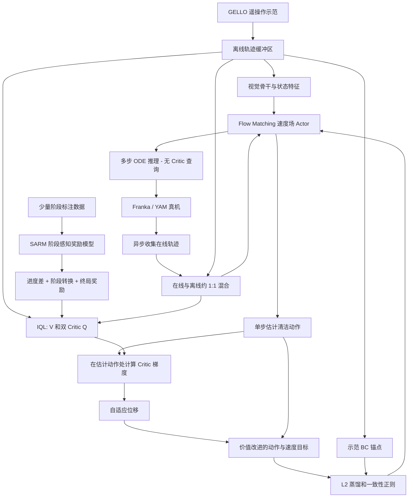

# FlowDPG：面向真实机器人操作的流匹配确定性策略梯度（FlowDPG: Deterministic Policy Gradient on Flow Matching Policies for Real-World Manipulation）

## 一句话定义

**FlowDPG**（CoRL 2026，Skild AI / CMU / UPenn）用单步清洁动作估计，把 Critic 的动作价值梯度蒸馏到 Flow Matching 速度场，**无需对多步去噪 ODE 做 BPTT**；在两台 Franka 机械臂的 AirPods 八阶段装配中达到 92% 的端到端成功率。

## 英文缩写速查

| 缩写 | 英文全称 | 简要说明 |
|---|---|---|
| FlowDPG | Flow Matching + Deterministic Policy Gradient | 本文提出的流匹配策略梯度蒸馏方法 |
| DPG | Deterministic Policy Gradient | 利用 Critic 对动作的梯度更新 Actor |
| DDPG | Deep Deterministic Policy Gradient | 本文采用的离策略 Actor–Critic 风格 |
| IQL | Implicit Q-Learning | 通过 expectile 状态价值学习避免 OOD 动作取最大 Q |
| BPTT | Backpropagation Through Time | 多步 ODE 求导过程，本文在策略优化中绕过 |
| SARM | Stage-Aware Reward Model | 预测任务阶段、阶段内进度的奖励模型 |
| BC | Behavior Cloning | 对示范速度的监督锚点 |
| ODE | Ordinary Differential Equation | 从随机噪声积分生成动作块的微分方程 |

## 核心信息

| 字段 | 一手来源 |
|---|---|
| 作者 | Kexin Shi、Junyao Shi、Poorvi Hebbar、Zhuolun Zhao、Tarun Amarnath、Yifan Su、Shikhar Bahl、Deepak Pathak |
| 机构 | Skild AI（斯齐尔德）、卡内基梅隆大学（CMU）、宾夕法尼亚大学（UPenn） |
| 论文 | [arXiv:2606.22303v2（2026-09-30，CoRL 2026 camera-ready）](https://arxiv.org/html/2606.22303v2) |
| 项目 | [官方主页、图表和两类真机演示](https://flowdpg.github.io/) |
| 代码 | 截至 2026-11-13 未在项目页确认可运行官方仓库、权重或数据下载 |

## 为什么重要

长任务会累积每个阶段的小概率失败，单纯行为克隆很难处理不在演示分布内的失败恢复。对多步 Flow Matching 策略直接用 DPG 更新，又必须穿过整个 ODE 积分链反传，计算量和数值风险都很高。FlowDPG 将价值梯度变成一个监督目标，训练时优化原有速度场，部署仍保留生成式多步策略。

## 流程总览

以下根据论文 Fig. 2、§3、Appendix B 的 Algorithm 1 绘制，是**论文方法流**，不是源码调用图。

## 核心原理

**1. 双 Critic IQL + SARM（§3.1）**：V 使用 expectile regression，Q 的目标为 chunk 回报加折扣状态价值；取两个 Critic 的最小值降低过估计。SARM 结合阶段内进度、阶段跳变奖金与终局奖励提供密集反馈。

**2. 估计动作与 Q 梯度（公式 4–7）**：

$$
\hat a=x_t+(1-t)v_\theta(x_t,t,s),\qquad
g=\nabla_{\hat a}\min_iQ_i(s,\hat a)
$$

$$
\Delta=\alpha\frac{\|u_t\|}{\|g\|+\varepsilon}g,\qquad
a^*=\hat a+\Delta,\quad u_t^*=a^*-x_0
$$

在单步估计的清洁动作上读取 Critic 梯度、按速度大小规范位移，然后把改进速度通过 L2 回归蒸馏进 Actor；训练保留 BC anchor 与清洁动作估计一致性损失，防止离示范太远。Critic 不需参与部署推理。

**3. 与 vanilla DPG 的边界（§3.2、Appendix A）**：FlowDPG 对精确 ODE 策略梯度做三项近似：用单步动作估计替代末端并近似忽略敏感度矩阵、随机时间采样替代完整轨迹积分、归一化梯度幅值。不能说二者完全等价。

**4. 离线到在线（§3.3）**：离线在示范上联合训练 backbone、actor、value/critic；真机数据异步写入 replay，在线用约 1:1 演示与 rollout，冻结 backbone 和 SARM，BC 锚点只用示范与成功 rollout，定期同步新策略检查点。

## 源码运行时序图

**不适用。** 截至 2026-11-13，作者项目页仅提供 Paper、arXiv、Video、BibTeX，未列可核实的训练/推理/部署源码；论文 Algorithm 1 不能冒充按真实代码验证的 sequenceDiagram。官方源码发布后可依据 README 与入口补录。

## 工程实践

- **长时序奖励：** 将任务分为可识别阶段，分别监测阶段内进度、阶段转换奖励和终局成功；消融表明仅用终局奖励会破坏阶段完成。
- **训练监控：** 同时跟踪清洁动作预测误差、Q 值误差、BC/distillation loss 与真实任务成功率；Critic 评分变高不能单独证明动作改进。
- **在线数据：** 保持示范锚点并引入失败/重试后真实轨迹，评测扰动恢复能力，不只看无扰动 demo。
- **复现状态：** 目前仅能从论文实现算法级复刻，不能声称官方可运行代码和 checkpoint 已公开。
- **机器人：** 原论文确认为两台 Franka 机械臂执行 AirPods 组装，炒蛋由两台 YAM 机械臂执行；论文并未验证 PNP 产品代理或 Franka Duo 的商业型号身份。

## 实验与评测

| 指标 | BC | QAM | FlowDPG |
|---|---:|---:|---:|
| AirPods 25-case 端到端成功率（离线） | 64% | 80% | **88%** |
| AirPods 25-case 端到端成功率（离线+在线） | — | — | **92%** |
| 炒蛋 14 阶段 rubric（仅离线，满分 42 分） | 64.2% | 论文列对照 | **85.8%** |

AirPods 用前、顶及两腕共 4 路相机，一套策略连续完成抓盒、开盖、抓与插两枚耳机、关盒、放盒八阶段；完整成功需两枚耳机正确就位，阶段内允许重试。独立的重复评估协议为 5 个 checkpoint、每个 10 次共 50 rollout，在线整任务为 90%，不能与主表 92% 混读。

炒蛋使用 YAM 双臂，顶视与两腕共 3 路相机，14 个评分阶段涵盖两颗鸡蛋的取放、打蛋、加盐、搅拌、入锅、炒蛋与盛盘。**85.8% 是分阶段 rubric，不是整任务成功率；炒蛋没有报告在线训练结果。**

扰动恢复（各 50 次，离线→在线）：物体被放回托盘 78%→92%，盒盖状态翻转 82%→94%，已插耳机被移位 86%→92%，伸手过程中托盘被重排 70%→88%。去一致性正则成功率降至 80%，去自适应位移降至 76%；只留终局奖励末阶段累计覆盖为 60%。

## 与其他工作对比

- **BC / RA-BC / AWR / RECAP：** 标量价值加权或条件化示范动作，仍较受演示分布约束。
- **DSRL / PLD / RLT：** 外挂适配模块、原基础流策略不被直接改写，能力提升受到模块上限约束。
- **QAM：** 沿流过程用伴随方法提供价值梯度监督；FlowDPG 只在单步估计动作上查询 Critic，然后将修正蒸馏回速度场。
- **直接 DPG 或一步 Actor：** 前者完整 ODE 梯度更昂贵且不稳定；后者改变部署策略的多步生成方式。

## 结论

**FlowDPG 是价值驱动优化多步 Flow Matching 操作策略的一种低反传开销路线，但可靠性仍取决于 Critic 与阶段奖励模型。**

1. **区分指标：** 92% 是 Franka AirPods 完整任务成功率，85.8% 是 YAM 炒蛋离线 rubric。
2. **奖励质量先行：** 阶段进度、转换与终局奖励缺一都会影响长任务稳定性。
3. **监控动作投影：** 一致性正则减少 Critic 在 OOD 清洁动作估计处提供误导梯度。
4. **验收完整轨迹：** 分步骤成功不能代替端到端成功，长时序误差会累积。
5. **验证失败恢复：** 托盘重排 70→88% 的恢复变化是在线数据价值的直接证据。
6. **避免泛化外推：** 大型 VLA、多任务和跨新硬件推广仍未在论文中证实。

## 局限与风险

- Critic 在演示分布外的梯度不可靠，在线学习还依赖 SARM 在新状态上的评分质量；BC 锚点可能同时限制有效探索。
- 方法默认有可分阶段和较密集进度信号的任务，只有两项真机任务支持其量化结论。
- 未公开可核实官方可运行代码/权重；论文算法流程不能直接证明可复现计算开销。
- 用户素材的 PNP 机器人商业宣传不属于该研究一手实验结论，故未入论文事实条目。

## 关联页面

- [双臂协调操作](../tasks/bimanual-manipulation.md)
- [机器人操作](../tasks/manipulation.md)
- [强化学习](../methods/reinforcement-learning.md)
- [模仿学习](../methods/imitation-learning.md)

## 参考来源

- [FlowDPG v2 原文全文通读归档](../../sources/papers/flowdpg_arxiv_2606_22303.md)
- [FlowDPG 项目主页及代码状态](../../sources/sites/flowdpg.md)

## 推荐继续阅读

- [arXiv:2606.22303v2 官方全文](https://arxiv.org/html/2606.22303v2)
- [官方 17 页 PDF](https://flowdpg.github.io/static/images/main.pdf)
- [官网视频与评测图](https://flowdpg.github.io/)
