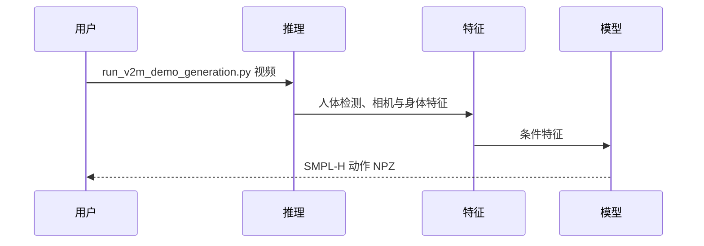

# FlowHMR: Physically Plausible Motion Capture from Video

单目视频经条件流匹配生成全局人体、手部及轨迹，再以物理跟踪奖励进行 GRPO 后训练。

## 英文缩写速查

| 缩写 | 英文全称 | 简要说明 |
|------|----------|----------|
| FM | Flow Matching | 条件动作生成
| GRPO | Group Relative Policy Optimization | 物理奖励后训练
| PHC | Physics-based Humanoid Control | 仿真跟踪控制器 |

## 核心信息

| 字段 | 内容 |
|------|------|
| 机构 | 北京大学、香港科技大学、腾讯、华东师范大学、中山大学、浙江大学 |
| 论文 | [arXiv:2610.03691](https://arxiv.org/abs/2610.03691) |
| 项目页 | [官方网站](https://flowhmr.github.io/) |

## 方法与意义

单目视频经条件流匹配生成全局人体、手部及轨迹，再以物理跟踪奖励进行 GRPO 后训练。 MM-DiT 接收视频特征和相机信息，在合成视频与动作对上预训练；后训练结合动作保真奖励与冻结 PHC+ 控制器的跟踪奖励。项目演示再用 GMR 重定向至 Unitree G1，并由 SONIC 在仿真中跟踪；这不是直接输出机器人关节控制指令。

## 源码运行时序图

## 实验与评测

Wild-4K 上 PHC+ 仿真跟踪成功率从 base 的 78.79% 提升至 82.47%；这是作者报告的控制器跟踪指标，不等于真机成功率。

## 结论

该工作提供了值得验证的管线，但实验指标应按原始设置解读。

- 先确认输入、输出及所需资产，再评估接入成本。
- 在目标动作、材料和仿真器上独立测量效果。
- 将仿真结果用于真机前，检查物理约束与安全边界。

## 与其他工作对比

- **vs 纯运动学人体恢复：** FlowHMR 在条件流匹配预训练之外，以冻结 PHC+ 的物理跟踪奖励做 GRPO 后训练，使输出更易被物理控制器跟踪（Wild-4K 仿真跟踪成功率 78.79% → 82.47%）。
- **vs 流匹配策略：** 与 [具身流匹配策略](../concepts/flow-matching-embodied-policy.md)（π₀ / GR00T N1 等直接生成动作）不同，FlowHMR 生成的是 **人体动作参考**，到机器人还需 GMR [重定向](../concepts/motion-retargeting.md) 与 SONIC 跟踪。

## 工程实践与局限

官方公开推理、训练和权重；训练视频不随仓库提供，Wild-4K 发布片段清单而非视频。SMPL 系列、VGGT-Omega、SAM 3D Body 等资源需单独处理许可或访问。

## 关联页面

- [相关方法](../concepts/motion-retargeting.md)
- [相关概念](../concepts/flow-matching-embodied-policy.md)

## 参考来源

- [论文归档](../../sources/papers/flowhmr_arxiv_2610_03691.md)
- [项目页归档](../../sources/sites/flowhmr-project.md)
- [代码归档](../../sources/repos/flowhmr.md)

## 推荐继续阅读

- [原论文](https://arxiv.org/abs/2610.03691)
