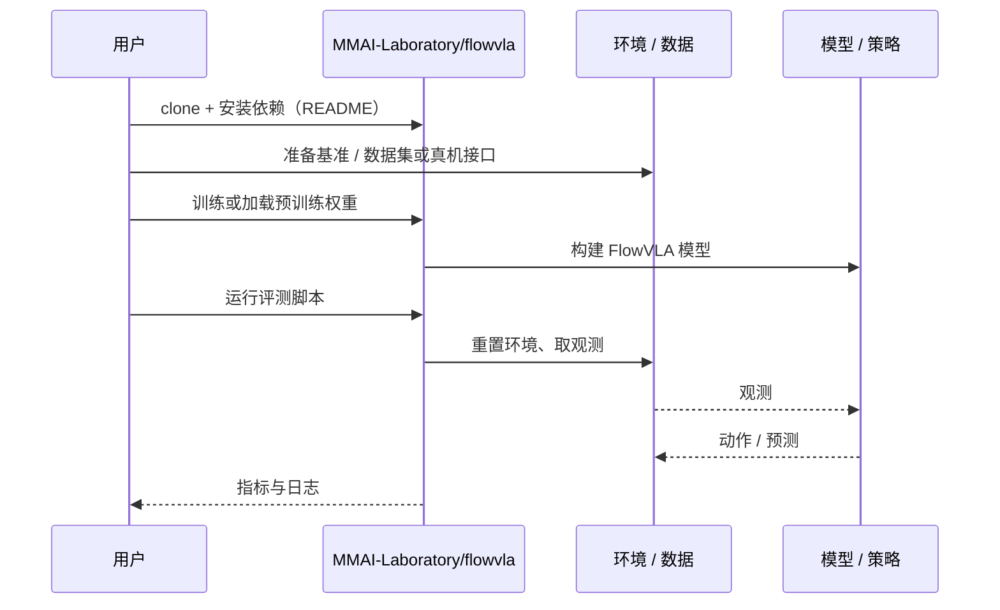

# FlowVLA（arXiv:2610.16160）

**FlowVLA**（*FlowVLA: Enabling World Dynamics Understanding through Pluggable 3D Flow Learning*，[arXiv:2610.16160](https://arxiv.org/abs/2610.16160)，[项目页](https://mmai-laboratory.github.io/flowvla/)，[代码](https://github.com/MMAI-Laboratory/flowvla)）来自 [具身智能小站 2026-10-14 盘点](../../sources/blogs/wechat_embodied_station_41_papers_streamingwam_2026-10-14.md)，属「VLA 与动作生成」组。

## 一句话定义

**只在训练时加入点级与末端执行器级三维流监督，让二维 VLA 对齐场景运动与控制信号；推理移除辅助头。**

## 英文缩写速查

| 缩写 | 英文全称 | 简要说明 |
|------|----------|----------|
| VLA | Vision-Language-Action | 视觉–语言–动作策略 |
| EE | End-Effector | 末端执行器 |
| 3D flow | 3D scene flow | 三维场景流 |

## 为什么重要

- 二维 VLA 缺少动态理解；把三维知识留在训练阶段可避免推理成本上升。
- 开源结论：**已开源**（步骤 2.5，2026-10-14）。公众号只列项目页；项目页链接的 GitHub 仓库经 ls-remote 可达。
- 同期同组工作见 [流式动作块与世界模型记忆：具身智能小站 10-14 期 41 篇阅读坐标](../overview/embodied-station-2026-10-14-41-papers-technology-map.md)。

## 核心机制

| 项 | 内容 |
|----|------|
| **arXiv** | [2610.16160](https://arxiv.org/abs/2610.16160) |
| **开源** | **已开源** |
| **要点** | 可插拔 3D flow 头；监督来自点流与 EE 流；推理与原 VLA 等价。 |
| **文内指标** | 以原文为准。 |

## 源码运行时序图

以下为按仓库入口（`MMAI-Laboratory/flowvla`）推断的通用运行链路；入库日仅核实仓库可达，未逐文件阅读，具体脚本名以 README 为准。

## 实验与评测

- 以原文为准。
- **读法：** 本页为索引级摘要，依据公众号转述的官方摘要与仓库信息整理；逐项数字与 baseline 以原文 PDF 为准。

## 与其他工作对比

- 横向索引见 [流式动作块与世界模型记忆：具身智能小站 10-14 期 41 篇阅读坐标](../overview/embodied-station-2026-10-14-41-papers-technology-map.md)；同 arXiv 不重复造页。

## 结论

**辅助三维监督是提升 VLA 动态理解的低成本路径，前提是推理时不额外依赖三维输入。**

1. 开源边界：**已开源** — 公众号只列项目页；项目页链接的 GitHub 仓库经 ls-remote 可达。
2. 核心机制：可插拔 3D flow 头；监督来自点流与 EE 流；推理与原 VLA 等价。
3. 复现与选型前核对任务协议、硬件与基准口径，勿直接横比公众号摘录数字。

## 关联页面

- [vla](../methods/vla.md)
- [manipulation](../tasks/manipulation.md)
- [world-action-models](../concepts/world-action-models.md)
- [embodied-station-2026-10-14-41-papers-technology-map](../overview/embodied-station-2026-10-14-41-papers-technology-map.md)

## 参考来源

- [flowvla_pluggable_3d_flow_arxiv_2610_16160.md](../../sources/papers/flowvla_pluggable_3d_flow_arxiv_2610_16160.md)
- [wechat_embodied_station_41_papers_streamingwam_2026-10-14.md](../../sources/blogs/wechat_embodied_station_41_papers_streamingwam_2026-10-14.md)
- [arXiv:2610.16160](https://arxiv.org/abs/2610.16160)

## 推荐继续阅读

- [arXiv PDF](https://arxiv.org/pdf/2610.16160)
- [项目页](https://mmai-laboratory.github.io/flowvla/)
- [https://github.com/MMAI-Laboratory/flowvla](https://github.com/MMAI-Laboratory/flowvla)
