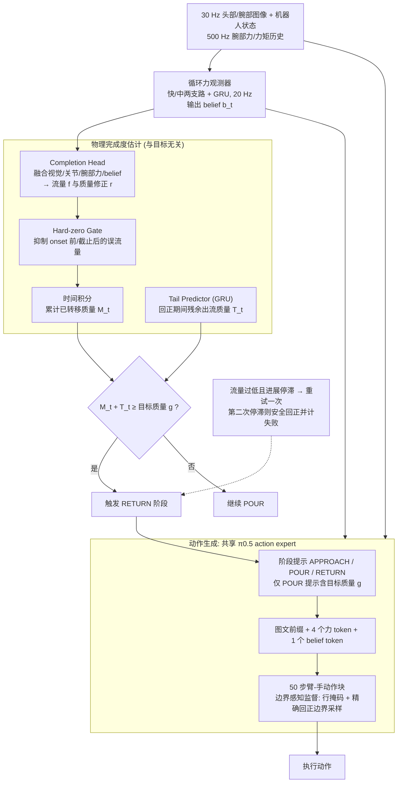

# FlowVLA：面向定量机器人倾倒操作的流动感知物理完成状态学习

**FlowVLA 倾倒**（*FlowVLA: Learning Flow-Aware Physical Completion for Quantitative Robotic Pouring*，[arXiv:2610.29692](https://arxiv.org/abs/2610.29692)）收录于 senlanke「具身运控lab」10-19–10-23 前沿论文动态（Manipulation）。本页依据**周报条目 + arXiv 摘要页**整理，流程图依据论文方法部分（见参考来源），未逐页核对实验数字；指标与结论以论文为准。

## 一句话定义

**FlowVLA：面向定量机器人倾倒操作的流动感知物理完成状态学习——将流动状态与物理完成程度引入操作学习，使机器人能够根据物体转移过程调整动作，而不是仅执行预先生成的倾倒轨迹。**

## 英文缩写速查

| 缩写 | 英文全称 | 简要说明 |
|------|----------|----------|
| VLA | Vision-Language-Action | 视觉–语言–动作模型 |
| IL | Imitation Learning | 模仿学习 |

## 为什么重要

- 周报所述待解决的问题：定量倾倒不仅要求机器人完成倾倒动作，还需要判断流体转移是否达到目标数量。传统操作策略难以仅根据机械臂运动判断任务完成程度。

## 流程总览

图依据：论文 §III-A–D / Fig.2

## 核心机制

| 项 | 内容 |
|----|------|
| **arXiv** | [2610.29692](https://arxiv.org/abs/2610.29692) · [PDF](https://arxiv.org/pdf/2610.29692) |
| **作者（arXiv）** | Liwen Yang, Yutian Zhang, Jiaqi Zhai, Li Yang, Tutian Tang, Qiwei Shan, Yancheng Bi, Qiankuan Shangguan, Yangkun Zhu, Ce Hao, Dong Wei, Qiaojun Yu, Dibo Hou |
| **机构（周报所述，未逐条核实）** | 待核实（作者：Liwen Yang、Yutian Zhang、Dibo Hou 等）。 |
| **arXiv 评论栏** | 9 pages, 6 figures |
| **开源** | arXiv 摘要页与评论未见代码或项目页链接（仅核对 arXiv 摘要页，不代表未发布）（2026-10-26） |
| **周报所述创新点** | 将流动状态与物理完成程度引入操作学习，使机器人能够根据物体转移过程调整动作，而不是仅执行预先生成的倾倒轨迹。 |

### arXiv 摘要节选（英文原文）

> During steady pouring, images and robot pose may remain nearly unchanged while transferred mass accumulates, making the return decision ambiguous for a whole-task vision-language-action (VLA) policy. We present FlowVLA, which separates motor generation from physical-completion estimation.

## 源码运行时序图

**不适用**：arXiv 摘要页与评论未见代码或项目页链接（仅核对 arXiv 摘要页，不代表未发布），无可对齐的官方代码流程。

## 实验与评测

- 周报与摘要给出的数字/场景已写入上表「创新点」与摘要节选；其余实验细节、基线与成功率定义请回到论文正文。
- 读法：先对齐任务设定、传感器与成功定义（仿真/真机），再解读 headline 数字，勿跨论文直接比较。

## 与其他工作对比

| 维度 | 读法 |
|------|------|
| **同周对照** | 见 [Manipulation周报技术地图](../overview/senlanke-weekly-2026-10-19-23-manipulation-technology-map.md)，按方向浏览同期论文 |
| **开源状态** | arXiv 摘要页与评论未见代码或项目页链接（仅核对 arXiv 摘要页，不代表未发布） |

## 结论

**FlowVLA：面向定量机器人倾倒操作的流动感知物理完成状态学习。**

1. 本页是入库级摘要，复现前请核对论文正文、附录与代码仓库。
2. 指标须连同实验条件解读。
3. 关注 arXiv 版本更新与代码发布。

## 关联页面

- [senlanke-weekly-2026-10-19-23-manipulation-technology-map](../overview/senlanke-weekly-2026-10-19-23-manipulation-technology-map.md)
- [manipulation](../tasks/manipulation.md)
- [vla](../methods/vla.md)

## 参考来源

- [flowvla-quantitative-robotic-pouring_arxiv_2610_29692.md](../../sources/papers/flowvla-quantitative-robotic-pouring_arxiv_2610_29692.md)
- [wechat_senlanke_weekly_manipulation_2026-10-19_23.md](../../sources/blogs/wechat_senlanke_weekly_manipulation_2026-10-19_23.md)
- [arXiv:2610.29692](https://arxiv.org/abs/2610.29692)
- [arXiv PDF](https://arxiv.org/pdf/2610.29692)：已通读方法部分（实验与附录以略读为准）：摘要、§I 引言、§II 相关工作、§III 方法（持久物理状态与边界感知动作生成 / 结构化物理完成度估计 / 监督与执行）、§IV-A 实验设定与主要结果表

## 推荐继续阅读

- [arXiv PDF](https://arxiv.org/pdf/2610.29692)
