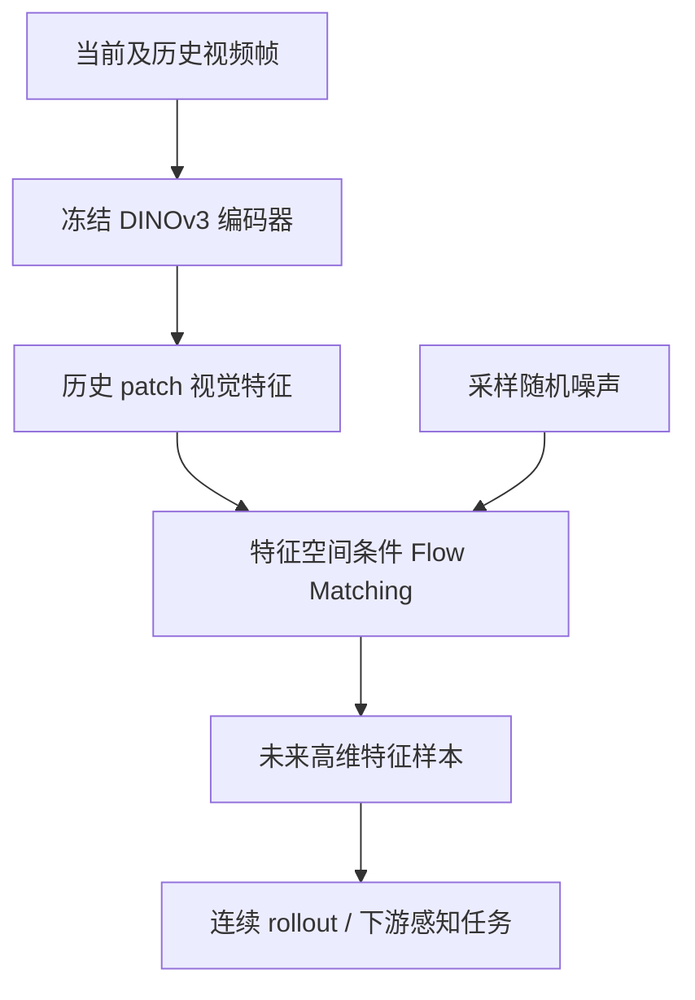
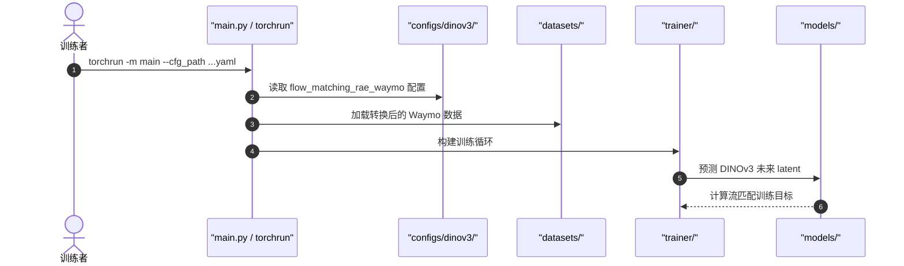

# FlowWM — Flow Matching in Feature Space for Stochastic World Modeling / 特征空间流匹配随机世界模型

## 一句话定义

**FlowWM** 将条件流匹配直接用于预训练 DINOv3 视觉特征，预测多种可能的未来潜空间状态，而不是预测一张确定性的未来图像。

## 英文缩写速查

| 缩写 | 英文全称 | 简要说明 |
|---|---|---|
| WM | World Model | 学习随时间演化的视觉状态 |
| DINOv3 | Self-Distillation with No Labels v3 | 冻结的稠密视觉特征骨干 |
| FM | Flow Matching | 生成未来状态分布的连续流方法 |
| AP | Average Precision | Waymo 未来目标识别评测量 |

## 为什么重要

纯确定性预测将多种可能未来平均化，在遮挡、运动分叉时可能损失真实动态；FlowWM 在视觉特征空间学习随机未来分布，绕过昂贵的像素生成。

## 流程总览

## 核心机制

**原文限制：** 该模型不使用机器人动作条件；作者在附录 J 将动作条件规划列为未来工作，而不是当前功能。

- 在 DINOv3 patch latent 上直接训练条件生成动态模型，保留视觉语义与空间特征。
- 使用采样方式预测随机未来；合成 Bouncing Shapes 与真实 Waymo FuturePerception 是不同任务场景。
- 论文没有把 Waymo 感知指标等同于机器人控制成功率。

## 源码运行时序图

依据官方 README 的 `main.py` 和 `configs/dinov3/flow_matching_rae_waymo/` 入口；尚未逐函数核查。

## 工程实践

- 官方入口：`uv run torchrun --nproc_per_node=8 -m main --cfg_path configs/dinov3/flow_matching_rae_waymo/base/384/dinov3_waymo_512_vits_16_384_flow_matching_rae_base.yaml`。
- 先准备 Waymo COCO 形式的数据及对应帧文件。官方代码使用 CC BY-NC 4.0，非商业许可。
- 重现实验应分别核对未来感知指标和采样成本。

## 实验与评测

论文在合成 Bouncing Shapes 和 Waymo FuturePerception 上测试；示例报告 Waymo 的 AP_L(3)=20.9、AP_L(6)=21.7、深度 RMSE 0.078。**这些不是机械臂抓取成功率。** 其余表格与附录尚待通读。

## 与其他工作对比

- [GAWM](paper-gawm-compact-latent-world-action-model.md) 偏重直接动作生成，不是 FlowWM 的随机未来感知设定。
- [RLA-WM](paper-rcl-2605-07079-learning-visual-feature-based-world-models-via-r.md) 通过残差潜动作连接机器人交互。

## 结论

**FlowWM 提供了在高维视觉特征空间表达随机未来的路线，但尚不能据其视觉评测直接断定具身闭环性能。**

1. 对随机动态场景优先考察多模态未来分布而非只看均值。
2. 与像素扩散视频模型比较时对齐表示空间及采样预算。
3. 机器人规划应用需要补充动作条件、闭环评测与时延验证。

## 局限与风险

- 主论文方法与部分实验已核查，所有附录和训练源码尚未完整通读，状态 **draft**。
- 推理采样次数、显存与数据预处理成本会影响实际应用。
- CC BY-NC 4.0 的许可边界需要单独审查。

## 2026-11-08 原文及附录完整核对

**方法：** 冻结 DINOv3 高维 patch 特征，在未来视频特征空间执行条件流匹配并配合单步投影时间一致性及检测任务损失；**按历史视觉上下文条件化，不输入候选机器人动作**。

**实验：** Waymo FuturePerception 附录消融 AP_L(3)：基线19.1，加时间一致性20.1，加 detector loss 20.9；多采样可提升随机未来覆盖度，但这些是目标感知指标不是机器人成功率。

**局限：** 作者附录 J 明确 action-conditioned dynamics 与 planning 仍是 future work；冻结编码器、长视频采样成本与 CC BY-NC 许可约束。

[论文版本 arXiv:2606.29059](https://arxiv.org/abs/2606.29059)。已审阅主要源码入口和官方说明；未实际运行训练或机器人部署。

## 关联页面

- [DINOv3](paper-rcl-2508-10104-dinov3.md)
- [生成式世界模型](../methods/generative-world-models.md)
- [JEPA-WMs](paper-jepa-wms-physical-planning.md)

## 参考来源

- [原文核验归档](../../sources/papers/flowwm-feature-space-stochastic-wm_arxiv_2606_29059.md)
- [源码核验归档](../../sources/repos/dinov3-wm-flowwm.md)

## 推荐继续阅读

- [论文原文](https://arxiv.org/html/2606.29059)
- [官方源码](https://github.com/facebookresearch/Flow-World-Models)
