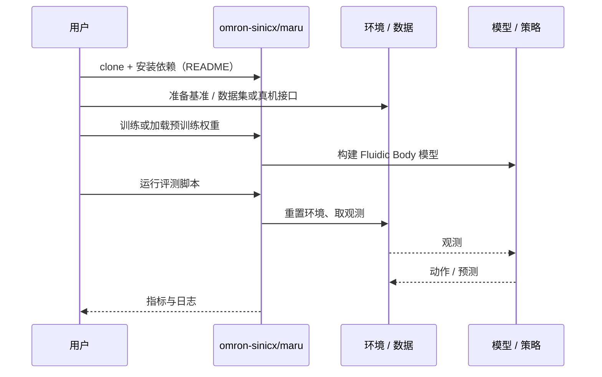

# Fluidic Body（arXiv:2611.06068）

**Fluidic Body**（*Fluidic Body: Swarm Robots as a Fluid Extension of the Hand*，[arXiv:2611.06068](https://arxiv.org/abs/2611.06068)，[代码](https://github.com/omron-sinicx/maru)）来自 [具身智能小站 2026-11-06 盘点](../../sources/blogs/wechat_embodied_station_20_papers_curobov2_fast_halo_humanwam_2026-11-06.md)，属「运动与控制」组。

## 一句话定义

**张手时，桌面小车群散开绕障。**

## 英文缩写速查

| 缩写 | 英文全称 | 简要说明 |
|------|----------|----------|
| Fluidic Body | Fluidic Body: Swarm Robots as a Fluid Extension of the Hand | 本文方法 / 基准的简称 |

## 为什么重要

- 张手绕开障碍，握拳让机器人群合力推物。握拳时，小车聚拢推物。
- 开源结论：**已开源**（步骤 2.5，2026-11-06）。项目页地址即 omron-sinicx/maru 仓库，经 git ls-remote 可达。
- 同期同组工作见 [按路段调速的规划、虚拟房间到真机的人形动作与人类视频缩放：具身智能小站 11-06 期 20 篇阅读坐标](../overview/embodied-station-2026-11-06-20-papers-technology-map.md)。

## 核心机制

| 项 | 内容 |
|----|------|
| **arXiv** | [2611.06068](https://arxiv.org/abs/2611.06068) |
| **开源** | **已开源** |
| **要点** | 张手时，桌面小车群散开绕障。 |
| **文内指标** | 公众号转述：附链是实验用的 maru 小车平台。 |

## 源码运行时序图

以下为按仓库入口（`omron-sinicx/maru`）推断的通用运行链路；入库日仅核实仓库可达，未逐文件阅读，具体脚本名以 README 为准。

## 实验与评测

- 公众号转述：附链是实验用的 maru 小车平台。
- **读法：** 本页为索引级摘要，依据公众号转述的官方摘要与仓库信息整理；逐项数字与 baseline 以原文 PDF 为准。

## 与其他工作对比

- 横向索引见 [按路段调速的规划、虚拟房间到真机的人形动作与人类视频缩放：具身智能小站 11-06 期 20 篇阅读坐标](../overview/embodied-station-2026-11-06-20-papers-technology-map.md)；同 arXiv 不重复造页。

## 结论

**张手绕开障碍，握拳让机器人群合力推物：附链是实验用的 maru 小车平台。**

1. 开源边界：**已开源** — 项目页地址即 omron-sinicx/maru 仓库，经 git ls-remote 可达。
2. 核心机制：张手时，桌面小车群散开绕障。
3. 复现与选型前核对任务协议、硬件与基准口径，勿直接横比公众号摘录数字。

## 关联页面

- [locomotion](../tasks/locomotion.md)
- [manipulation](../tasks/manipulation.md)
- [embodied-station-2026-11-06-20-papers-technology-map](../overview/embodied-station-2026-11-06-20-papers-technology-map.md)

## 参考来源

- [fluidic_body_arxiv_2611_06068.md](../../sources/papers/fluidic_body_arxiv_2611_06068.md)
- [wechat_embodied_station_20_papers_curobov2_fast_halo_humanwam_2026-11-06.md](../../sources/blogs/wechat_embodied_station_20_papers_curobov2_fast_halo_humanwam_2026-11-06.md)
- [arXiv:2611.06068](https://arxiv.org/abs/2611.06068)

## 推荐继续阅读

- [arXiv PDF](https://arxiv.org/pdf/2611.06068)
- [https://github.com/omron-sinicx/maru](https://github.com/omron-sinicx/maru)
