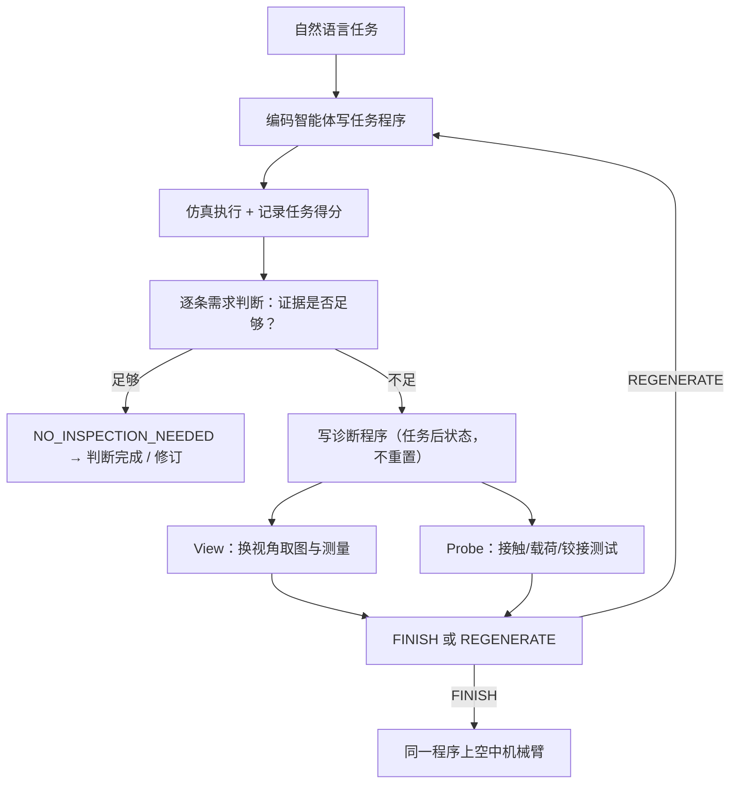

---

type: entity
tags: [paper, aerial-manipulation, uav, coding-agent, llm-agent, active-perception, isaac-lab, sim2real, snu, cmu, umd, kyung-hee]
status: complete
updated: 2026-10-12
arxiv: "2610.12549"
project_id: fly-by-code
project: https://fly-by-code.github.io/
related:
  - ../overview/embodied-station-34-papers-spatial-grounding-technology-map.md
  - ../tasks/manipulation.md
  - ../concepts/llm-robotics-control-interfaces.md
  - ./isaac-lab.md
  - ./gym-pybullet-drones.md
  - ./paper-prior-evolution-aerial-grasping.md
sources:
  - ../../sources/blogs/wechat_embodied_station_34_papers_spatial_grounding_2026-10-12.md
  - ../../sources/papers/fly_by_code_arxiv_2610_12549.md
  - ../../sources/sites/fly-by-code-project.md
summary: "Fly-by-Code（arXiv:2610.12549，SNU/CMU/UMD 等）：为空中操作编码智能体增加 Active Feedback——任务后在仿真里写诊断程序主动换视角（View）或做接触探测（Probe）；6 个仿真任务最终成功率由 31.7% 升至 75%，错误宣称完成 25→5，仿真程序免改迁移真机；代码待发布。"
---

# Fly-by-Code：让空中操作的编码智能体主动查明失败原因

**Fly-by-Code**（[arXiv:2610.12549](https://arxiv.org/abs/2610.12549)，[项目页](https://fly-by-code.github.io/)）研究“编码智能体写机器人程序并依据执行反馈改进”在空中操作里为什么失效，并提出 **Active Feedback（AF，View and Probe）**：任务执行完后，智能体再写一段诊断程序，在仿真里换视角看结果或做受控接触实验，之后才决定结束还是改写任务程序。作者来自首尔大学、卡内基梅隆大学、马里兰大学等。

## 一句话定义

**把“获取反馈”本身也变成可执行程序：反馈不足时先写 View 或 Probe 诊断，再修订任务代码。**

## 英文缩写速查

| 缩写 | 英文全称 | 简要说明 |
|------|----------|----------|
| AF | Active Feedback | 本文方法，含 View 与 Probe 两类诊断 |
| CaP-X | Code-as-Policies 系框架 | 本文的基线与代码框架来源，仅提供执行日志与终态 RGB |
| TP/FP/ND | True Positive / False Positive / No Declaration | 宣称完成正确 / 错误 / 未宣称，用于统计完成判断 |
| UMI | Universal Manipulation Interface | 真机夹爪类型（并行 UMI 夹爪） |
| API | Application Programming Interface | 仿真与真机共用的机器人接口 |
| SE(3) | Special Euclidean group in 3D | 飞控的位姿几何 PID 所在空间 |

## 为什么重要

- **空中操作的反馈缺口真实存在：** 载荷限制机载相机，关键结果常不在视野内；强耦合使“失败原因”难从日志读出。
- **反馈获取可程序化：** 与“多读几遍同一份日志”不同，AF 去采集此前不存在的数据。
- **仿真到真机免改代码：** 共享机器人 API，使仿真里打磨的程序可直接上实机。

## 流程总览

## 方法

- **智能体：** 主实验用 Claude Opus 5（Claude Code 式持续会话，effort high，最多 1 次初始执行 + 10 次修订）；交叉检验换 Claude Code Opus 5.5 与 Codex + GPT-6 Astra。基础框架改自 CaP-X，RGB 直接给智能体。
- **诊断程序：** View 把腕部相机移到可回答结果问题的视角，返回图像与注记；Probe 在任务得分记录之后做物理实验，如推不同接触点、测门铰接、超载提升。
- **API：** 仿真与真机共用：观察/位姿/夹爪、Molmo 点提示与 SAM3 分割、语义地图查询、抓取规划、点云与变换工具。
- **仿真：** Isaac Lab，扩展 AM-Bench，实验室数字孪生与仓库场景。
- **真机：** 8 旋翼 + 4 倾转关节的全向平台（8.30 kg），4 自由度臂 + 并行 UMI 夹爪（开口 80 mm），腕部 RealSense D455，OptiTrack + EKF 定位，SE(3) 几何 PID。

## 源码运行时序图

**不适用。** 项目页写 “Code coming soon”，截至 2026-10-12 无官方仓库，无可对齐的目录或脚本。

## 实验与评测

**仿真 6 任务 × 10 次（Cabinet、1-Object P&P、2-Objects P&P、Payload、Align、Sort）：**

| 条件 | 最终成功率 | 完成判断精度 | 错误宣称完成 | 每次估算费用 |
|------|-----------|--------------|-------------|--------------|
| CaP-X | 31.7%（19/60） | 43.2%（19/44） | 25 | 9.6 美元 |
| CaP-X+Trace | 48.3%（29/60） | 60.4%（29/48） | 19 | 9.4 美元 |
| AF | 75%（45/60） | 90.0%（45/50） | 5 | 17.1 美元 |

分任务：Payload 100% 对 30% / 60%；2-Obj P&P 90% 对 40% / 60%；Cabinet 40% 对 10% / 0%。AF 平均轮数 6.0，基线 7.2 / 7.0；每次成功费用 22.8 对 30.4 / 19.5（token 估算）。

**消融与跨模型：** 去语义地图后 2-Obj P&P 由 9/10 降到 4/10、Sort 由 5/10 降到 2/10；“无结构化诊断”（原始视频 + 日志）Payload 0–20%。AF 在每个模型-任务对上不低于基线，但接口差异与模型效应未被隔离。

**真机（每任务 5 次，程序未改）：** 2-Objects P&P 全任务 4/5；Cabinet 3/5；约 8–9 分钟自主运行。失败：基篮位置感知误差、夹爪卡住把手、抓瓶遮挡腕部相机。

## 结论

**在反馈本身缺失的空中操作里，让智能体主动采集证据比让它多看现有日志更有效，主要收益体现在“不再错误宣称完成”和 Payload / 2-Obj P&P 这类可被探测的失败上。**

1. 先问“证据是否足以判定”，再决定是否写诊断。
2. 诊断程序要在任务得分记录之后运行，才能安全使用破坏性探测。
3. 结构化的 View/Probe 打包比给原始视频加日志更好：Payload 100% 对 0–20%。
4. 语义地图类基础设施不可省：去掉后成功率与成本都变差。
5. 预算会上升：每次估算 17.1 美元，约为基线的 1.8 倍。
6. 真机只有 5 次/任务，且 Probe 未在真机验证，不能视作安全可部署流程。

## 局限与风险

- **开源状态：待发布。** 项目页 “Code coming soon”（[fly-by-code-project.md](../../sources/sites/fly-by-code-project.md)），无仓库、数据或环境。
- 增加推理与机器人交互开销；受机载感知误差与不可达视角限制。
- Probe 只在仿真中验证，未提供真机无约束探测的安全保证。
- 成功仍取决于运动规划与飞控；不声称对未见环境或其他本体的零样本泛化。
- 未做仅 View / 仅 Probe 消融；论文飞控频率表述内部不一致，未引用；使用的模型名（Opus 5、GPT-6 Astra 等）照论文所述。

## 与其他工作对比

| 对照 | 差异读法 |
|------|----------|
| [LLM 机器人控制接口](../concepts/llm-robotics-control-interfaces.md) | 本文属“LLM 写代码调 API”路线，新增“主动诊断”这一步 |
| [先验演化空中抓取](./paper-prior-evolution-aerial-grasping.md) | 同属空中操作，该工作侧重抓取，本文侧重编码智能体的反馈闭环 |
| [Isaac Lab](./isaac-lab.md) | 本文仿真平台 |
| [gym-pybullet-drones](./gym-pybullet-drones.md) | 常见无人机仿真环境，但本文不用 |

## 工程实践

| 项 | 建议 |
|----|------|
| 反馈设计 | 把“看不见的结果”显式列成需求清单，逐条判断是否有证据 |
| 诊断隔离 | 诊断运行于任务得分已记录之后，不重置 |
| 迁移 | 保持仿真/真机 API 一致，避免改源码 |
| 成本控制 | 先用无诊断判定“证据足够”，再启用 Probe |

## 关联页面

- [34 篇空间落地论文技术地图](../overview/embodied-station-34-papers-spatial-grounding-technology-map.md) — 本文所在盘点
- [操作任务](../tasks/manipulation.md)
- [LLM 机器人控制接口](../concepts/llm-robotics-control-interfaces.md)
- [Isaac Lab](./isaac-lab.md)
- [先验演化空中抓取](./paper-prior-evolution-aerial-grasping.md)
- [机器人视觉感知栈选型闭环](../queries/robot-perception-stack-selection-loop.md) — 本页对应其 ④ 下游策略消费层：载荷限制机载相机视野，View 诊断主动换视角补感知证据，真机失败仍含基篮位置感知误差与腕部相机遮挡

## 参考来源

- [微信盘点：具身智能小站 34 篇（2026-10-12）](../../sources/blogs/wechat_embodied_station_34_papers_spatial_grounding_2026-10-12.md)
- [fly_by_code_arxiv_2610_12549.md](../../sources/papers/fly_by_code_arxiv_2610_12549.md) — 论文摘录
- [fly-by-code-project.md](../../sources/sites/fly-by-code-project.md) — 项目页核查
- [arXiv:2610.12549](https://arxiv.org/abs/2610.12549)

## 推荐继续阅读

- [Fly-by-Code 项目页](https://fly-by-code.github.io/)
- [arXiv HTML 全文](https://arxiv.org/html/2610.12549v1)
