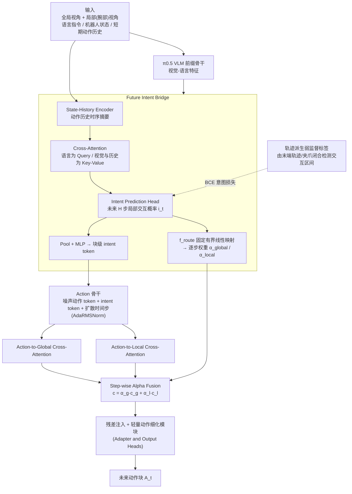

# FocusVLA：基于未来意图引导的视觉语言动作模型动态视角路由

**FocusVLA**（*FocusVLA: Future-Intent Guided Dynamic View Routing for Vision-Language-Action Models*，[arXiv:2610.31423](https://arxiv.org/abs/2610.31423)）收录于 senlanke「具身运控lab」10-19–10-23 前沿论文动态（Manipulation）。本页依据**周报条目 + arXiv 摘要页**整理，流程图依据论文方法部分（见参考来源），未逐页核对实验数字；指标与结论以论文为准。

## 一句话定义

**FocusVLA：基于未来意图引导的视觉语言动作模型动态视角路由——将未来操作意图引入视角路由，根据即将执行的动作动态选择视觉信息，使视觉处理与后续操作需求相匹配。论文已被 CoRL 2026 接收。**

## 英文缩写速查

| 缩写 | 英文全称 | 简要说明 |
|------|----------|----------|
| VLA | Vision-Language-Action | 视觉–语言–动作模型 |
| IL | Imitation Learning | 模仿学习 |

## 为什么重要

- 周报所述待解决的问题：多相机 VLA 在不同操作阶段需要关注不同视角，但统一处理全部相机信息会增加计算开销，也可能引入无关视觉内容。

## 流程总览

图依据：论文 §3.2–3.3 / Fig.4

## 核心机制

| 项 | 内容 |
|----|------|
| **arXiv** | [2610.31423](https://arxiv.org/abs/2610.31423) · [PDF](https://arxiv.org/pdf/2610.31423) |
| **作者（arXiv）** | Huixin Xu, Ziya Yu, Peng Li |
| **机构（周报所述，未逐条核实）** | 待核实（作者：Huixin Xu、Ziya Yu、Peng Li）。 |
| **arXiv 评论栏** | Accepted at CoRL 2026 |
| **开源** | arXiv 摘要页与评论未见代码或项目页链接（仅核对 arXiv 摘要页，不代表未发布）（2026-10-26） |
| **周报所述创新点** | 将未来操作意图引入视角路由，根据即将执行的动作动态选择视觉信息，使视觉处理与后续操作需求相匹配。论文已被 CoRL 2026 接收。 |

### arXiv 摘要节选（英文原文）

> Vision-language-action (VLA) models have become an important paradigm for robotic manipulation by unifying visual perception, language understanding, and action generation. Since reliable manipulation requires sufficient observation of objects, end-effectors, and their spatial relationships, multi-view inputs are widely used to provide complementary spatial information.

## 源码运行时序图

**不适用**：arXiv 摘要页与评论未见代码或项目页链接（仅核对 arXiv 摘要页，不代表未发布），无可对齐的官方代码流程。

## 实验与评测

- 周报与摘要给出的数字/场景已写入上表「创新点」与摘要节选；其余实验细节、基线与成功率定义请回到论文正文。
- 读法：先对齐任务设定、传感器与成功定义（仿真/真机），再解读 headline 数字，勿跨论文直接比较。

## 与其他工作对比

| 维度 | 读法 |
|------|------|
| **同周对照** | 见 [Manipulation周报技术地图](../overview/senlanke-weekly-2026-10-19-23-manipulation-technology-map.md)，按方向浏览同期论文 |
| **开源状态** | arXiv 摘要页与评论未见代码或项目页链接（仅核对 arXiv 摘要页，不代表未发布） |

## 结论

**FocusVLA：基于未来意图引导的视觉语言动作模型动态视角路由。**

1. 本页是入库级摘要，复现前请核对论文正文、附录与代码仓库。
2. 指标须连同实验条件解读。
3. 关注 arXiv 版本更新与代码发布。

## 关联页面

- [senlanke-weekly-2026-10-19-23-manipulation-technology-map](../overview/senlanke-weekly-2026-10-19-23-manipulation-technology-map.md)
- [manipulation](../tasks/manipulation.md)
- [vla](../methods/vla.md)

## 参考来源

- [focusvla-future-intent-view-routing_arxiv_2610_31423.md](../../sources/papers/focusvla-future-intent-view-routing_arxiv_2610_31423.md)
- [wechat_senlanke_weekly_manipulation_2026-10-19_23.md](../../sources/blogs/wechat_senlanke_weekly_manipulation_2026-10-19_23.md)
- [arXiv:2610.31423](https://arxiv.org/abs/2610.31423)
- [arXiv PDF](https://arxiv.org/pdf/2610.31423)：已通读方法部分（实验与附录以略读为准）：摘要、§1–2、§3 Method（3.1 动机分析 / 3.2 Future Intent Bridge 与 Action-Side Dynamic Routing / 3.3 训练目标）、§4 实验设定与仿真结果表

## 推荐继续阅读

- [arXiv PDF](https://arxiv.org/pdf/2610.31423)
