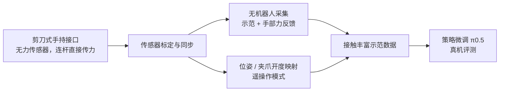

# FOMI：用于接触丰富操作示教的力反馈手持接口

**FOMI**（论文 *FOMI: A Force-Feedback Manipulation Interface for Teaching Contact-Rich Manipulation*，[arXiv:2610.19839](https://arxiv.org/abs/2610.19839)，[项目页](https://robbyant-research.github.io/FOMI/)）由香港科技大学、香港大学、Robbyant 与南方科技大学的作者提出：用 **剪刀式机械结构** 把物体交互力直接传到操作者的手上，使其在 **无机器人采集** 时也能感受接触，并能切换到遥操作模式。

## 一句话定义

**用无传感器的剪刀式连杆把接触力「原样」送到操作者手上，让人在不接机器人的情况下就能边感受边采集接触丰富的示范，同一接口还能映射为遥操作指令。**

## 英文缩写速查

| 缩写 | 英文全称 | 简要说明 |
|------|----------|----------|
| FOMI | Force-feedback Manipulation Interface（论文题名缩写） | 本文接口与采集系统 |
| UMI | Universal Manipulation Interface | 手持式无机器人示范采集的代表路线，作为论文基线 |
| VR | Virtual Reality | VR 手柄遥操作基线 |
| GELLO | 论文基线名（关节空间主从遥操作） | 基于关节映射的主从遥操作基线 |
| VLA | Vision-Language-Action | 论文中策略学习使用的 π0.5 等模型所属范式 |

## 为什么重要

- **接触丰富任务的示范难采：** 擦拭、插入、开拉链等任务需要操作者根据接触力调整动作，纯视觉手持接口看不到这些力。
- **主动力反馈代价高：** 力传感器与执行器增加硬件和控制复杂度；FOMI 用纯机械直传替代，降低成本。
- **采集与遥操作共用一个接口：** 同一套硬件可以做无机器人采集（扩展性）和遥操作（上机验证），减少切换成本。

## 核心信息

| 项 | 内容 |
|----|------|
| **机构** | 香港科技大学（HKUST）；香港大学（HKU）；Robbyant（蚂蚁灵波科技）；南方科技大学（SUSTech） |
| **平台** | 双臂 Franka 与 Flexiv 平台，Robotiq 2F-85 夹爪，腕部相机 |
| **任务** | Pick Chip、Insert Tube、Wash Dish、Open Pouch 四项接触丰富任务 |
| **开源** | **待发布**（截至 2026-10-15）：论文声明将发布硬件设计、代码与数据集；项目页 Code 按钮禁用，标注 coming soon |

## 核心原理

### 流程总览

### 机械设计：直接力路径

- 每个手柄与其扇形齿轮、驱动连杆刚性相连，接触力沿机械路径直接传回操作者手部，中间没有额外的传动级。
- 两个相同的扇形齿轮相互啮合，使两支臂对称开合，与平行夹爪的运动一致。
- 推测：因为力路径是纯机械的，操作者感受到的力与夹爪受力之间的关系由机构几何决定，不依赖力传感器的标定或控制带宽；论文未对这一关系做定量测试。

### 采集与遥操作

- **无机器人采集：** 接口测量位姿与夹爪开度，经标定与同步后记录为示范，不需要机器人参与。
- **遥操作：** 把接口的位姿变化与夹爪开度映射为末端位姿目标与夹爪宽度指令，使同一接口可直接控制机器人。

## 工程实践

| 项 | 建议 |
|----|------|
| 采集模式选择 | 接触力是任务关键时优先无机器人采集；需要上机的动作细节或视觉-机器人差距敏感的任务用遥操作示范 |
| 数据规模 | 论文中无机器人示范每 10 分钟约 17.8 条，100 条约需一小时主动采集；遥操作约 8.4 条 |
| 训练 | π0.5 微调在无机器人示范上 25 / 50 / 100 条/任务时成功率为 42.0% / 59.1% / 78.4%；遥操作 25 条即达 70.5% |
| 标定 | 夹爪指令采用分段二次映射加方向相关偏移；论文 Table 3 比较了多种映射的 RMSE |
| 源码运行时序图 | **不适用**（代码与硬件设计待发布，截至 2026-10-15 无可运行官方代码） |
| 开源状态 | 待发布（2026-10-15 核查：论文声明将发布，项目页代码按钮禁用） |

## 实验与评测

- **采集效率（Table 2）：** 无机器人模式 FOMI 17.8 条/10 min，高于 UMI（13.8）与 Ring（11.6），相对 UMI 提升 29.0%；遥操作模式 FOMI 8.4 条/10 min，高于 GELLO（7.1）与 VR（3.4），相对 GELLO 提升 18.3%。
- **完成率（Fig. 5）：** 无机器人模式 86.6%（UMI 64.6%，Ring 64.5%）；遥操作模式 75.6%（GELLO 54.0%，VR 34.1%）。
- **策略（Fig. 7–8）：** 无机器人示范 25 / 50 / 100 条每任务时平均成功率 42.0% / 59.1% / 78.4%；遥操作 25 条每任务时 70.5%。论文认为无机器人示范与遥操作示范之间存在视觉与运动学差距，但遥操作数据在相同条数下更好。
- **样本设计：** 3 名无机器人经验的操作者，组内随机顺序，每人每接口每任务 3 个 10 分钟时段；属于探索性评测。

## 结论

**接触丰富任务的示范质量，取决于操作者能否「感到」接触；纯机械直传力是一种低成本的替代路径。**

1. **直传力比主动反馈便宜** — 无力传感器、无执行器，依赖纯机械路径，采集效率与完成率仍高于 UMI 与 GELLO/VR 基线。
2. **无机器人采集可以更高效** — 在本文四项任务上，无机器人模式的效率（17.8）高于遥操作模式（8.4），且不占用机器人。
3. **示范数量是策略成功率的主要杠杆** — 无机器人示范 25 → 100 条时成功率从 42.0% 升到 78.4%，论文认为仍有上升空间。
4. **两种模式各有取舍** — 遥操作示范在相同条数下更好（70.5% vs 42.0%），但无机器人示范采集更快、不需要机器人。
5. **映射标定决定遥操作可用性** — 把接口开度映射为机器人夹爪指令需要分段标定与偏移校正，属于系统工程的关键步骤。

## 与其他工作对比

| 对照 | 差异读法 |
|------|----------|
| [HandUMI](./handumi.md) | 面向平行夹爪双臂的无机器人采集与重定向软件栈；FOMI 的贡献是硬件层的力反馈，两者可互补 |
| [UMI-FT](./paper-umi-ft.md) | 用指端力传感器采集并训练顺应策略；FOMI 不用力传感器，而是把力直接传到操作者手上 |
| [FreeTacMan](./paper-sa-2506-01941-freetacman-robot-free-visuo-tactile-data-collect.md) | 人手视觉-触觉的无机器人采集；FOMI 的力反馈来自接口本身，而非触觉传感 |
| [直接力反馈控制](../methods/direct-force-feedback-control.md) | 控制层的力误差驱动；FOMI 把同样的「直接传力」思想搬到采集接口层 |
| [接触丰富操作](../concepts/contact-rich-manipulation.md) | 论文的任务背景；FOMI 解决的是示范采集环节的接触感知问题 |

## 局限与风险

- **代码与硬件未发布：** 论文与项目页均未给出可用的硬件图纸或代码，复现依赖自行制造机械结构。
- **评测规模小：** 3 名操作者、4 项任务，属于探索性研究，统计意义有限。
- **力反馈的主观性：** 论文报告的效率提升来自操作者体验，不同操作者对力的感受可能不同。
- **机器人侧未直接测力：** 论文以示范完成率与策略成功率为主要指标，未给出接触力的定量对比。

## 关联页面

- [HandUMI](./handumi.md) — 无机器人采集的相关接口与软件栈
- [UMI-FT](./paper-umi-ft.md) — 带力传感的手持采集与顺应策略
- [FreeTacMan](./paper-sa-2506-01941-freetacman-robot-free-visuo-tactile-data-collect.md) — 无机器人视觉-触觉采集
- [直接力反馈控制](../methods/direct-force-feedback-control.md) — 力误差直接驱动的控制基础
- [接触丰富操作](../concepts/contact-rich-manipulation.md) — 论文的任务背景

## 参考来源

- [fomi_arxiv_2610_19839.md](../../sources/papers/fomi_arxiv_2610_19839.md) — 论文摘录与开源核查
- [arXiv:2610.19839](https://arxiv.org/abs/2610.19839) — 原文（Submitted 2026-10-14）
- [FOMI 项目页](https://robbyant-research.github.io/FOMI/) — 项目页与代码待发布标注

## 推荐继续阅读

- [FOMI 项目页](https://robbyant-research.github.io/FOMI/)
- [arXiv 全文 PDF](https://arxiv.org/pdf/2610.19839) — Table 1–4 与附录的设备细节
- [Universal Manipulation Interface（UMI）](https://umi-gripper.github.io/) — 论文主要基线的项目页
