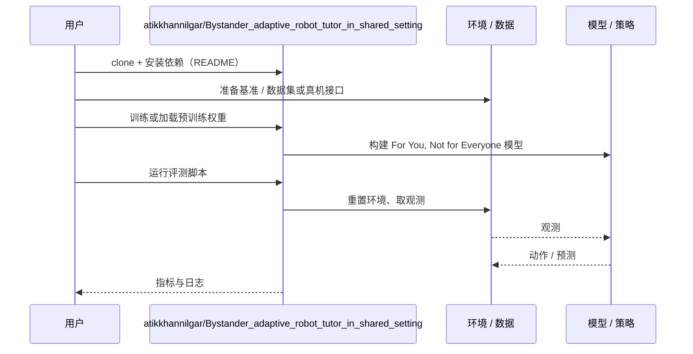

# For You, Not for Everyone（arXiv:2611.05001）

**For You, Not for Everyone**（*For You, Not for Everyone: Bystander-Aware Delivery of Critical Feedback in Robot Tutoring*，[arXiv:2611.05001](https://arxiv.org/abs/2611.05001)，[代码](https://github.com/atikkhannilgar/Bystander_adaptive_robot_tutor_in_shared_setting)）来自 [具身智能小站 2026-11-05 盘点](../../sources/blogs/wechat_embodied_station_43_papers_grasp_mesa_airoa_2026-11-05.md)，属「移动导航与人机交互」组。

## 一句话定义

**一项 40 人实验让机器人在旁人出现后转身，用屏幕私下给出预设纠错提示。**

## 英文缩写速查

| 缩写 | 英文全称 | 简要说明 |
|------|----------|----------|
| For You, Not for Everyone | For You, Not for Everyone: Bystander-Aware Delivery of Critical Feedback in Robot Tutoring | 本文方法 / 基准的简称 |

## 为什么重要

- 旁人走近时，机器人怎样提醒学生写错了。与当众念出相同反馈相比，参与者更认可它的隐私意识。
- 开源结论：**已开源**（步骤 2.5，2026-11-05）。仓库可达（git ls-remote）。
- 同期同组工作见 [接触丰富的手物重定向、分项泛化评测与手持夹爪示范：具身智能小站 11-05 期 43 篇阅读坐标](../overview/embodied-station-2026-11-05-43-papers-technology-map.md)。

## 核心机制

| 项 | 内容 |
|----|------|
| **arXiv** | [2611.05001](https://arxiv.org/abs/2611.05001) |
| **开源** | **已开源** |
| **要点** | 一项 40 人实验让机器人在旁人出现后转身，用屏幕私下给出预设纠错提示。 |
| **文内指标** | 公众号转述：两组尴尬感的差异仍不明确。 |

## 源码运行时序图

以下为按仓库入口（`atikkhannilgar/Bystander_adaptive_robot_tutor_in_shared_setting`）推断的通用运行链路；入库日仅核实仓库可达，未逐文件阅读，具体脚本名以 README 为准。

## 实验与评测

- 公众号转述：两组尴尬感的差异仍不明确。
- **读法：** 本页为索引级摘要，依据公众号转述的官方摘要与仓库信息整理；逐项数字与 baseline 以原文 PDF 为准。

## 与其他工作对比

- 横向索引见 [接触丰富的手物重定向、分项泛化评测与手持夹爪示范：具身智能小站 11-05 期 43 篇阅读坐标](../overview/embodied-station-2026-11-05-43-papers-technology-map.md)；同 arXiv 不重复造页。

## 结论

**旁人走近时，机器人怎样提醒学生写错了：两组尴尬感的差异仍不明确。**

1. 开源边界：**已开源** — 仓库可达（git ls-remote）。
2. 核心机制：一项 40 人实验让机器人在旁人出现后转身，用屏幕私下给出预设纠错提示。
3. 复现与选型前核对任务协议、硬件与基准口径，勿直接横比公众号摘录数字。

## 关联页面

- [vision-language-navigation](../tasks/vision-language-navigation.md)
- [locomotion](../tasks/locomotion.md)
- [manipulation](../tasks/manipulation.md)
- [embodied-station-2026-11-05-43-papers-technology-map](../overview/embodied-station-2026-11-05-43-papers-technology-map.md)

## 参考来源

- [for_you_not_for_everyone_arxiv_2611_05001.md](../../sources/papers/for_you_not_for_everyone_arxiv_2611_05001.md)
- [wechat_embodied_station_43_papers_grasp_mesa_airoa_2026-11-05.md](../../sources/blogs/wechat_embodied_station_43_papers_grasp_mesa_airoa_2026-11-05.md)
- [arXiv:2611.05001](https://arxiv.org/abs/2611.05001)

## 推荐继续阅读

- [arXiv PDF](https://arxiv.org/pdf/2611.05001)
- [https://github.com/atikkhannilgar/Bystander_adaptive_robot_tutor_in_shared_setting](https://github.com/atikkhannilgar/Bystander_adaptive_robot_tutor_in_shared_setting)
