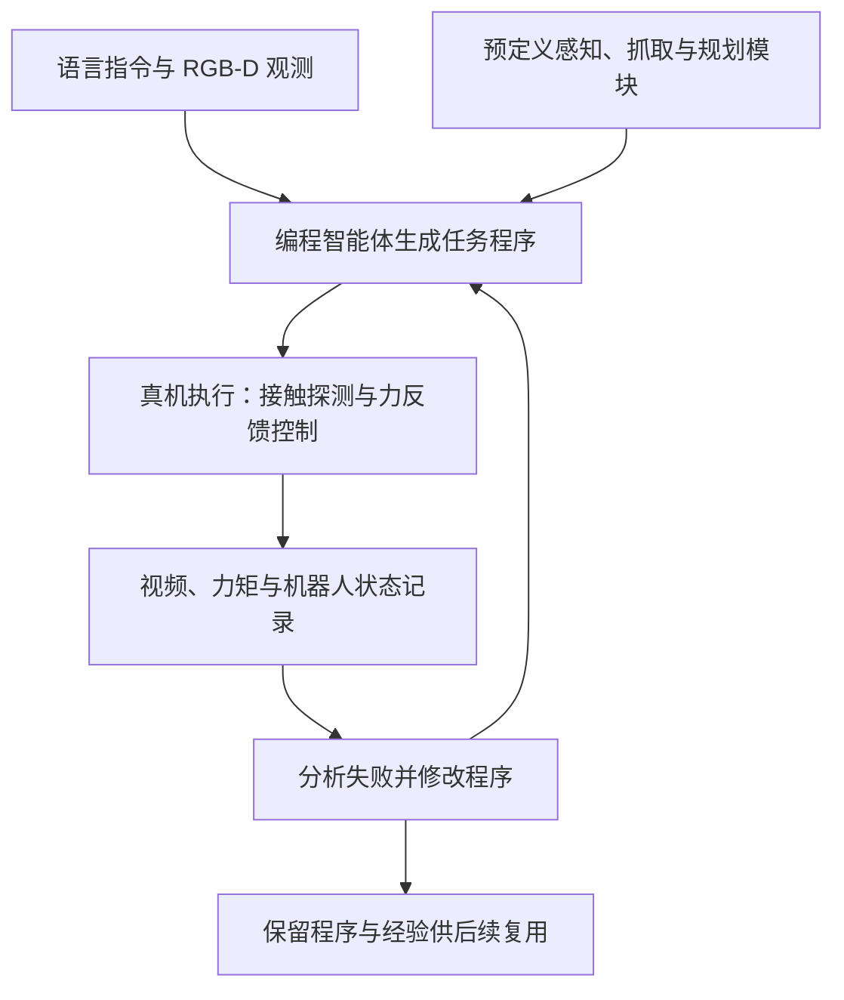

# FORCA：面向接触操作的力感知编程智能体

## 一句话定义

FORCA 根据语言、视觉和腕部力/力矩信息生成机器人程序，利用执行记录逐轮修正动作和力反馈逻辑。

## 英文缩写速查

| 缩写 | 英文全称 | 简要说明 |
|---|---|---|
| F/T | Force/Torque | 腕部力与力矩测量 |
| RGB-D | Red Green Blue and Depth | 彩色与深度视觉 |
| RTDE | Real-Time Data Exchange | 实验中读取机器人状态并发送控制的接口 |
| VLM | Vision-Language Model | 视觉语言模型 |

## 核心信息

| 项目 | 内容 |
|---|---|
| 机构 | 伊利诺伊大学厄巴纳-香槟分校、清华大学 |
| 论文 | [arXiv:2610.31841v1](https://arxiv.org/abs/2610.31841v1)，2026-10-22；核对全文方法、实验、局限与附表 |
| 硬件 | UR5e、腕部 F/T、WSG-50 夹爪、RealSense D455 |
| 开放状态 | 截至 2026-10-30 [项目页](https://tanoom.github.io/forca/)未列官方代码或数据下载链接 |

## 项目流程

预定义模块包括 SAM 3、GraspGen 和 PyRoKi；程序在执行期间不查询基础模型。持续接触任务使用主机侧 100 Hz 循环，经 RTDE 读取状态和力矩并更新笛卡尔速度。运行前检查错误、可达性和工作空间；实验设 30 N 硬限制。

## 实验与评测

与相同基础模型、任务指令和基础技能的纯视觉智能体比较；最终程序冻结后每项重复 10 次：

| 任务 | FORCA | 纯视觉 |
|---|---:|---:|
| 抽屉开启成功率 | 10/10 | 4/10 |
| 门把操作成功率 | 10/10 | 1/10 |
| 手持花瓶擦拭：接触丢失率 | 1.6% | 55.9% |
| 手持黄瓜削皮：削皮覆盖率 | 81.1% | 37.4% |

花瓶程序先在静态花瓶上迭代，再不经修改用于手持移动花瓶；物体敲击任务改变物体或表面后，复用程序并通过额外迭代适配。每次开发上限为 20 次执行或 4 小时，人工负责执行授权、场景操作与最终验收。

## 与其他工作对比

| 对象 | 差异 |
|---|---|
| 纯视觉编程智能体（论文基线） | 相同基础模型、指令和基础技能，但不读取力/力矩；接触任务成功率与接触保持显著落后（见上表） |
| [VLA](../methods/vla.md) 端到端策略 | VLA 由模型直接输出动作；FORCA 由模型生成程序，执行期 100 Hz 力反馈在程序中运行，模型推理不进入实时回路，改进依赖执行间迭代而非参数训练 |

## 结论

力信号既可用于执行时调节接触，也可为执行间的代码修改提供证据。

1. 接触探测可修正视觉估计，但效果依赖可达与安全约束。
2. 100 Hz 力反馈由生成程序执行，模型推理不在该实时回路中。
3. 每轮智能体推理约 4–10 分钟，真机运动约 1–3 分钟；开发有时间和交互成本。
4. 腕部合力无法直接提供接触位置和手指力分布；复杂长序列仍可能失败。

## 源码运行时序图

不适用：截至核对日项目页未列出官方可运行实现；公开后需阅读实际入口再补图。

## 关联页面

- [接触丰富操作](../concepts/contact-rich-manipulation.md)
- [视觉语言动作模型](../methods/vla.md)
- [同期论文技术地图](../overview/embodied-station-2026-10-29-58-papers-technology-map.md)

## 参考来源

- [论文归档](../../sources/papers/forca_arxiv_2610_31841.md)
- [项目页归档](../../sources/sites/forca.md)
- [论文全文 PDF](https://tanoom.github.io/forca/static/pdfs/FORCA.pdf)
- [官方项目页](https://tanoom.github.io/forca/)
