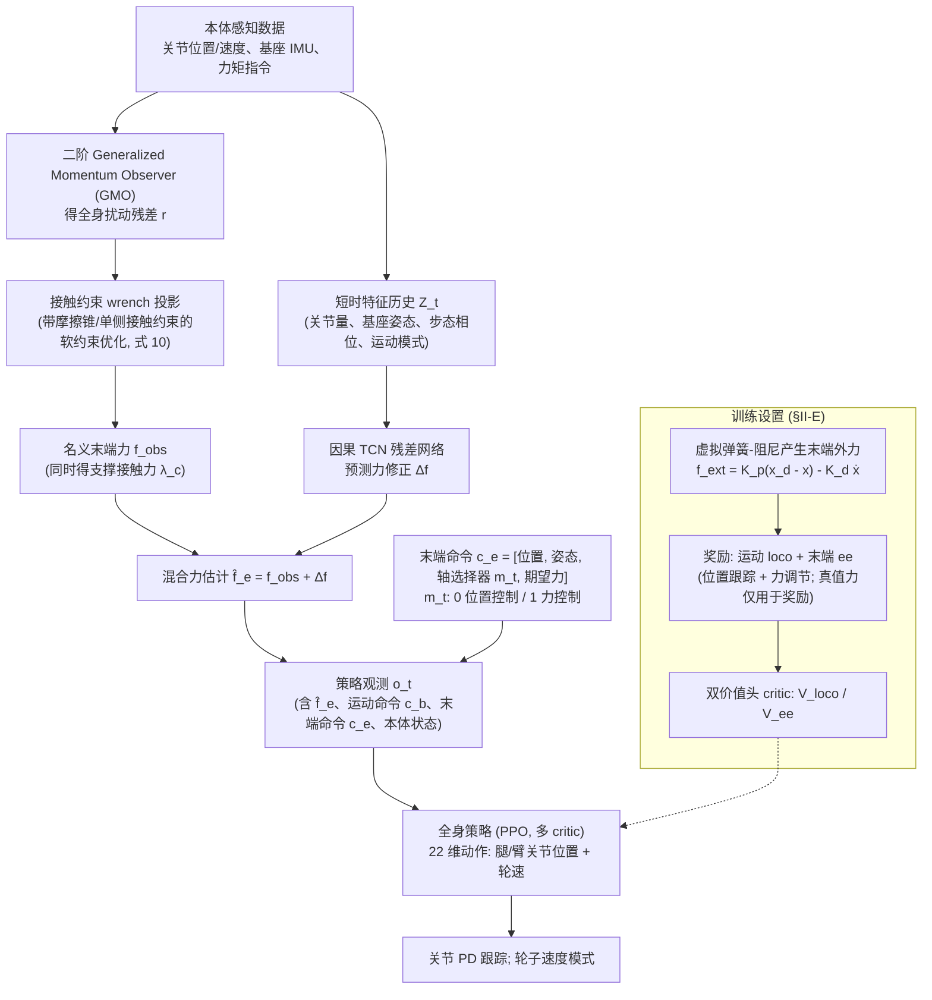

# 力感知轮足 loco-manip（arXiv:2609.13779）

**力感知轮足 loco-manip**（*Force-Aware Reinforcement Learning with Hybrid Sensorless Force Estimation for Wheeled-Legged Loco-Manipulation*，[arXiv:2609.13779](https://arxiv.org/abs/2609.13779)）来自 [senlanke 具身运控lab 周更盘点](../../sources/blogs/wechat_senlanke_weekly_humanoid_quadruped_2026-09-14_18.md)（2026-09-14–18）。

## 一句话定义

**广义动量观测 + 接触约束投影 + 时序残差估计末端力；显式输入带力/位选择器的全身 RL；覆盖自由运动、纯力控与混合力位控。**

## 英文缩写速查

| 缩写 | 英文全称 | 简要说明 |
|------|----------|----------|
| RL | Reinforcement Learning | 强化学习 |
| WBC | Whole-Body Control | 全身控制 |
| EE | End-Effector | 末端执行器 |

## 为什么重要

- 轮足操作常缺力传感；混合估计 + 力感知 RL 统一多控制模式。

## 流程总览

图依据：论文 §II-A 至 §II-E / Fig. 3。

## 核心机制

| 项 | 内容 |
|----|------|
| **arXiv** | [2609.13779](https://arxiv.org/abs/2609.13779) |
| **开源** | **待发布**（步骤 2.5，2026-09-20） |
| **方法摘要** | Hybrid sensorless force estimation → force-aware whole-body RL with axial force/position selector. |

## 源码运行时序图

**不适用**（截至 2026-09-20 未发布可运行官方代码或待核实）。

## 实验与评测

- Wheeled-legged loco-manipulation modes（以 PDF 为准）。
- 读法：先对齐任务设定、传感器与成功定义，再解读 headline 数字。

## 与其他工作对比

| 维度 | 读法 |
|------|------|
| **同周对照** | 见对应 [周更盘点](../../sources/blogs/wechat_senlanke_weekly_humanoid_quadruped_2026-09-14_18.md) 映射表，勿跨任务直接比 SR |
| **开源状态** | **待发布** — 部署前以项目页/arXiv 为准 |

## 结论

**本文把无传感器力估计与轮足全身 RL 绑定，实现力位混合单一控制器。**

1. 开源：**待发布**；勿凭公众号摘要臆断可复现性。
2. 指标须连同实验条件解读（仿真/真机、平台、成功阈值）。
3. 关注 arXiv 版本更新与代码发布。

## 关联页面

- [loco-manipulation](../tasks/loco-manipulation.md)
- [reinforcement-learning](../methods/reinforcement-learning.md)
- [contact-dynamics](../concepts/contact-dynamics.md)

## 参考来源

- [force-aware-wheeled-leg-manip_arxiv_2609_13779.md](../../sources/papers/force-aware-wheeled-leg-manip_arxiv_2609_13779.md)
- [wechat_senlanke_weekly_humanoid_quadruped_2026-09-14_18.md](../../sources/blogs/wechat_senlanke_weekly_humanoid_quadruped_2026-09-14_18.md)
- [arXiv:2609.13779](https://arxiv.org/abs/2609.13779)
- [arXiv PDF](https://arxiv.org/pdf/2609.13779)：已通读方法部分（实验与附录以略读为准）：§II 方法（A 问题形式化与概述、B GMO、C 接触约束 wrench 投影、D 时序残差学习、E 力感知全身 RL）

## 推荐继续阅读

- [arXiv PDF](https://arxiv.org/pdf/2609.13779)
