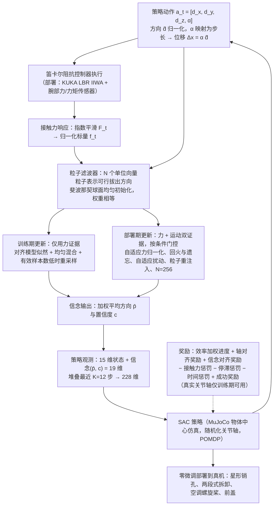

# 钩子拆卸力驱动 RL：通过约束感知的物体中心强化学习实现力驱动卡扣拆解

**钩子拆卸力驱动 RL**（*Force-Driven Hook Disassembly via Constraint-Aware Object-Centric Reinforcement Learning*，[arXiv:2610.38513](https://arxiv.org/abs/2610.38513)）收录于 senlanke「具身运控lab」10-26–10-30 前沿论文动态（Manipulation）。本页依据**周报条目 + arXiv 摘要页**整理，未逐页核对正文 PDF；指标与结论以论文为准。

## 一句话定义

**钩子拆卸力驱动 RL：通过约束感知的物体中心强化学习实现力驱动卡扣拆解——使用物体中心状态表示和粒子化信念状态估计隐藏约束，再通过强化学习选择拆解动作。方法能够处理单轴和多阶段拆解，并在真实废旧空调部件拆解任务中验证。**

## 英文缩写速查

| 缩写 | 英文全称 | 简要说明 |
|------|----------|----------|
| RL | Reinforcement Learning | 强化学习 |
| VLA | Vision-Language-Action | 视觉–语言–动作模型 |

## 为什么重要

- 周报所述待解决的问题：工业卡扣连接通常被外壳遮挡，机器人难以仅根据视觉判断正确的拆解方向。

## 流程总览

图依据：论文 §III-A–D / Fig. 3、式 (1)–(20)；§IV-B。

## 核心机制

| 项 | 内容 |
|----|------|
| **arXiv** | [2610.38513](https://arxiv.org/abs/2610.38513) · [PDF](https://arxiv.org/pdf/2610.38513) |
| **作者（arXiv）** | Elhadad, Nadeen, Kiyokawa, Takuya, Harada, Kensuke |
| **机构（周报所述，未逐条核实）** | 大阪大学、日本产业技术综合研究所。 |
| **arXiv 评论栏** | （无） |
| **开源** | arXiv 摘要页与评论未见代码或项目页链接（仅核对 arXiv 摘要页，不代表未发布）（2026-11-02） |
| **周报所述创新点** | 使用物体中心状态表示和粒子化信念状态估计隐藏约束，再通过强化学习选择拆解动作。方法能够处理单轴和多阶段拆解，并在真实废旧空调部件拆解任务中验证。 |

### arXiv 摘要节选（英文原文）

> The growing volume of end-of-life products has intensified the need for automated disassembly, yet hook-type connections remain challengin: their orientations vary, they deform under load, and their geometry is hidden, so vision alone cannot identify a feasible non-destructive disassembly direction. This work proposes a constraint-aware reinforcement learning framework that infers feasible extraction directions online from contact forces.

## 源码运行时序图

**不适用**：arXiv 摘要页与评论未见代码或项目页链接（仅核对 arXiv 摘要页，不代表未发布），无可对齐的官方代码流程。

## 实验与评测

- 周报与摘要给出的数字/场景已写入上表「创新点」与摘要节选；其余实验细节、基线与成功率定义请回到论文正文。
- 读法：先对齐任务设定、传感器与成功定义（仿真/真机），再解读 headline 数字，勿跨论文直接比较。

## 与其他工作对比

| 维度 | 读法 |
|------|------|
| **同周对照** | 见 [Manipulation周报技术地图](../overview/senlanke-weekly-2026-10-26-30-manipulation-technology-map.md)，按方向浏览同期论文 |
| **开源状态** | arXiv 摘要页与评论未见代码或项目页链接（仅核对 arXiv 摘要页，不代表未发布） |

## 结论

**钩子拆卸力驱动 RL：通过约束感知的物体中心强化学习实现力驱动卡扣拆解。**

1. 本页是入库级摘要，复现前请核对论文正文、附录与代码仓库。
2. 指标须连同实验条件解读。
3. 关注 arXiv 版本更新与代码发布。

## 关联页面

- [senlanke-weekly-2026-10-26-30-manipulation-technology-map](../overview/senlanke-weekly-2026-10-26-30-manipulation-technology-map.md)
- [manipulation](../tasks/manipulation.md)
- [vla](../methods/vla.md)

## 参考来源

- [force-driven-hook-disassembly-object-centric-rl_arxiv_2610_38513.md](../../sources/papers/force-driven-hook-disassembly-object-centric-rl_arxiv_2610_38513.md)
- [wechat_senlanke_weekly_manipulation_2026-10-26_30.md](../../sources/blogs/wechat_senlanke_weekly_manipulation_2026-10-26_30.md)
- [arXiv:2610.38513](https://arxiv.org/abs/2610.38513)
- [arXiv PDF](https://arxiv.org/pdf/2610.38513)：已通读全文：框架 §III（粒子滤波信念、训练/部署期更新、强化学习形式化与奖励）及 §IV 实验设定

## 推荐继续阅读

- [arXiv PDF](https://arxiv.org/pdf/2610.38513)
