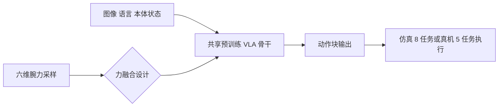

# ForceBench：机器人操作中的力集成基准

**ForceBench 是一个仿真基准，在统一的 VLA 骨干与控制设置下，比较六维腕力接入策略的七种设计（含无力基线），覆盖物性推断、阻力交互与接触丰富装配三类任务。**

## 英文缩写速查

| 缩写 | 英文全称 | 简要说明 |
|------|----------|----------|
| VLA | Vision-Language-Action | 视觉-语言-动作策略，以图像与语言为输入直接输出机器人动作 |
| F/T | Force/Torque | 六维力/力矩传感器，输出三轴力与三轴力矩；本文的腕力即此类信号 |
| CoM | Center of Mass | 质心；CoM Sort 任务要求按包裹质心分拣 |
| DoF | Degrees of Freedom | 自由度；此处指机械臂与夹爪的控制维度 |

## 为什么重要

VLA 策略擅长理解视觉与语言，但拧、压、装配等接触丰富操作需要力觉。已有工作的力融合方式在任务、示范和控制设置上各不相同，结果难以横向比较。ForceBench 把这些变量固定下来，回答"力应该以什么形式接入 VLA"这一设计问题，并给出可复用的评测协议。

## 核心信息

| 项目 | 内容 |
|------|------|
| arXiv | [2610.19604](https://arxiv.org/abs/2610.19604)（cs.RO） |
| 作者 | Xuan Han, Zinuo Jin, Tianlin Li, Yunfan Lou, Xin Liu, Yuchen Xue, Yuanpeng He, Boxian Yao, Shuhan Zhan, Ruihai Wu, Zhibo Pang |
| 机构 | 未核实（arXiv 摘要页与项目页均未列作者单位） |
| 数据/平台 | 仿真：Isaac Lab / Isaac Sim，Franka 臂 + 平行夹爪，物理 60 Hz、控制 15 Hz；8 任务 × 200 条专家示范 = 1600 条同步示范 |
| 真机 | Franka Research 3 + KWR75B 六轴力传感器 + Robotiq 夹爪；8 个系统、5 个任务 |
| 开源状态 | **待发布**（2026-10-15 核查：项目页写明代码、示范与检查点的公开下载链接"暂未提供"，将在发布后更新；未列 GitHub 仓库） |
| 项目页 | <https://forcebench-platform.github.io/> |

## 核心原理

七种设计的共同点是：同一预训练 VLA 骨干、同一批示范，只改变六维腕力进入策略的方式。

| 设计 | 腕力进入策略的方式 |
|------|--------------------|
| No Force（基线） | 不输入力，只用图像、语言与本体感知 |
| Token Fusion | MLP 将当前力采样映射为 6 个连续 token，置于动作 token 之前 |
| Prompt Fusion | 当前力拼接到 7 维机器人状态后归一化并离散化为数值提示 token |
| Cross-Attention | 力 token 在动作专家输出与动作投影之间经交叉注意力接入 |
| Token Fusion + Pred | 同 Token Fusion，另加训练期辅助损失预测未来 10 步力读数；部署时不用预测头 |
| Temporal Prompt | 使用最近 16 个采样（约 1 秒）的窗口，在 Prompt Fusion 基础上加入窗口均值与标准差 |
| Dual-Path Fusion | 保留 Temporal Prompt 通路，另加一路把 25 个窗口统计量映射为 4 个连续 token；训练时 30% 样本窗口置零 |

## 工程实践

- **复现入口：** 目前没有公开代码或数据，无法直接复现；若自行搭建，应固定 60 Hz 物理与 15 Hz 控制、每任务 200 条示范，并用共享随机种子做 200 episode 评测。
- **选型读法：** 以物性推断（重量、质心分拣）为主的任务，可优先考虑 Temporal 或 Dual-Path 类窗口设计；若要在所有任务类别上都稳定提升，Prompt Fusion 是论文中唯一在三类任务上都优于基线的方案。
- **调试指标：** 按任务类别拆分成功率，不只看平均值；Nut Thread 装配任务上两种时序设计都低于基线，应单独监控。
- **源码运行时序图：** **不适用**（项目页未发布代码、权重或示范，无可运行入口）。

## 实验与评测

仿真（每方法每任务 200 episode，共享随机种子）的均值结果：

| 方法 | 仿真均值（%） | 备注 |
|------|---------------|------|
| No Force | 23.25 | 基线 |
| Token Fusion | 23.56 | 基本持平 |
| Cross-Attention | 22.13 | 略低于基线 |
| Token Fusion + Pred | 26.25 | 物性推断提升，装配持平 |
| Temporal Prompt | 32.63 | Weight Sort 90.0，CoM Sort 69.5 |
| Dual-Path Fusion | 35.13 | Weight Sort 99.5，CoM Sort 72.0 |
| Prompt Fusion | **35.31** | 三类任务均提升 |

真机（8 个系统、5 个任务）：基线均值 40.00%；Prompt Fusion 与 Dual-Path Fusion 均为 63.00%，但只有 Prompt Fusion 在每个任务上都优于基线。

## 结论

**一句话总判：力以提示或 token 的形式接入比"多给一个输入"更依赖设计；窗口化的力信息有助于物性推断，但在装配任务上可能有害。**

1. **Prompt Fusion 是最稳的默认选择** — 仿真均值 35.31%（基线 23.25%），三类任务都有提升；真机 63.00%（基线 40.00%），且每个任务都优于基线。
2. **时序信息主要帮助物性推断** — Weight Sort 与 CoM Sort 上，Temporal 与 Dual-Path 明显高于基线。
3. **时序设计在装配上会退化** — Nut Thread 上两种时序设计（22.0、16.5）都低于基线（31.5）。
4. **Dual-Path 与 Prompt Fusion 的均值差只有 0.18 个点** — 论文自述该差距未经统计确认，不能据此排序。
5. **均值相近不代表任务取舍相同** — 同等均值的设计在不同任务上表现相反，选型应按任务类别判断。
6. **真机结论的样本量有限** — 真机只有 8 个系统、5 个任务，结论适合作为方向性依据，不宜当作定论。

## 与其他工作对比

| 路线 | 力如何参与 | 代表 | 与 ForceBench 的差异 |
|------|------------|------|----------------------|
| 经典力/位混合控制 | 力作为控制律的反馈 | [混合力位控制](../concepts/hybrid-force-position-control.md) | ForceBench 把力作为策略观测输入，融合方式交给策略学习 |
| 直接力反馈控制 | 力直接调节动作 | [直接力反馈控制](../methods/direct-force-feedback-control.md) | 本工作不设计控制律，只比较输入接入的形式 |
| 纯视觉-语言 VLA | 不使用力觉 | [VLA](../methods/vla.md) | 对应本文的 No Force 基线 |

## 局限与风险

- 大部分结论来自仿真，真机只覆盖 8 个系统、5 个任务。
- 所有设计共用一个骨干与同一批示范，结论能否迁移到其他 VLA 结构未知。
- 代码与数据尚未发布，第三方复现与验证暂不可行。
- 仿真中的接触模型与真实摩擦、柔顺性存在差距，力相关的结论可能受影响（推测，参见 [仿真与真机评测差距](../concepts/sim-vs-real-eval-gap.md)）。
- 作者单位未核实。

## 关联页面

- [VLA](../methods/vla.md)
- [接触丰富操作](../concepts/contact-rich-manipulation.md)
- [力控基础](../concepts/force-control-basics.md)
- [操作任务](../tasks/manipulation.md)
- [具身大模型评测基准选型闭环](../queries/embodied-eval-benchmark-selection-loop.md) — 本页归入其 ③ 策略任务成功率评测层（力接入设计对照）；仿真 + 真机双报也可作 ④ sim↔real 校准的小样本参考

## 参考来源

- [ForceBench 来源归档](../../sources/papers/forcebench_arxiv_2610_19604.md)
- [公众号综述摘录（31 篇论文）](../../sources/raw/wechat_embodied_station_robot_31_papers_2026-10-15.md)

## 推荐继续阅读

- [arXiv:2610.19604 — ForceBench 论文](https://arxiv.org/abs/2610.19604)
- [ForceBench 项目页](https://forcebench-platform.github.io/)
