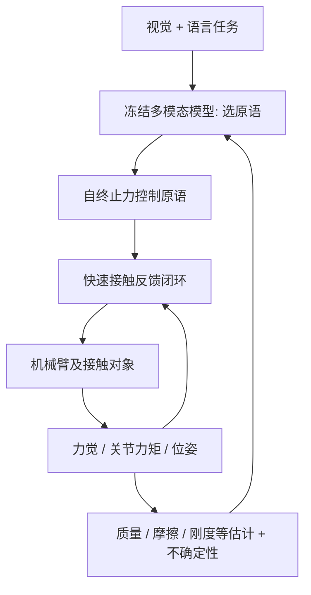
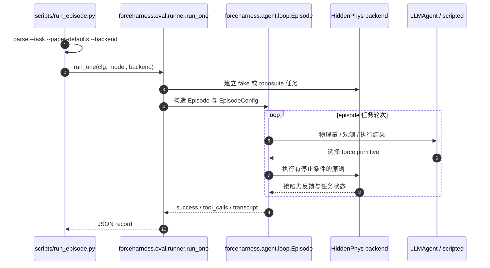

# ForceHarness｜冻结多模态模型的力觉物理接口

## 一句话定义

ForceHarness 为不更新权重的多模态模型提供自终止力控制原语和带不确定性的力觉物理量摘要，让接触阶段由快速局部控制闭环完成，再由慢速模型进行任务规划。

## 英文缩写速查

| 缩写 | 英文全称 | 简要说明 |
|---|---|---|
| FT | Force-Torque | 腕部力/力矩测量 |
| LLM | Large Language Model | 低频语义推理层 |
| FR3 | Franka Research 3 | 真机实验机械臂 |

## 为什么重要

仅依赖位姿原语的通用模型难以对突发接触、摩擦与柔顺要求及时响应；快慢闭环解耦避免把接触安全寄托在模型 API 延迟上。

## 核心原理

1. 低层由力/位姿反馈执行 self-terminating force primitives：探测接触、维持力边界、按事件终止，抑制高频负载波动。
2. 中间层将力和位姿变化估为物体质量、摩擦、刚度、质心等物理属性，并保留不确定性供模型作高层决策。
3. 上层调用冻结多模态模型选择下一动作与物理试探原语；不做模型梯度微调。

## 流程总览

## 源码运行时序图

下图仅依照官方开源入口的静态调用链绘制，不表示已运行训练、实验或机器人。

## 工程实践

- 官方入口：python scripts/run_episode.py --task weight_sort --agent scripted --backend fake；作者实验协议用 --paper-defaults。
- 源码核对：`scripts/run_episode.py` 导入 `forceharness.eval.runner.run_one`、`forceharness.agent.loop.EpisodeConfig`；支持无需 API Key 的 fake backend (weight_sort scripted)，或 robosuite/付费模型实验；`configs/hiddenphys/` 为论文协议，`scripts/run_matrix.py` 跑批量。MIT。
- 复现前检查输入格式、动作坐标系、依赖、评测种子以及硬件和 API 资源；作者报告数字不可当作本仓实测。

## 实验与评测

- 作者报告 FR3 真实机器人零样本任务由 2/60 提升到 54/60；每组包含 60 次，需注意任务分布与样本量。
- 论文另给出 HiddenPhys / ForceBench 的模拟环境指标；不能把仿真基准和 FR3 真机 success 混为一谈。

## 结论

**ForceHarness 为不更新权重的多模态模型提供自终止力控制原语和带不确定性的力觉物理量摘要，让接触阶段由快速局部控制闭环完成，再由慢速模型进行任务规划。**

1. 先以论文明确的输入输出、数据拆分和评测协议定位方法适用范围。
2. 区分定量实验、官方开源可复现入口与本次未执行的实验步骤。
3. 重点跟进部署时的误差、计算开销以及任务/机器人构型迁移边界。

## 局限与风险

- 力觉物理量依赖接触模型与传感器标定，不确定性估计并不等于严格安全保证。
- 真机 54/60 的数量级结果受特定操作、模型、原语与 API 预算限制。
- 代码已公开 MIT，提供 HiddenPhys/Fake backend 示例，且多模态模型测试可能产生付费 API 费用。

## 关联页面

- [manipulation ](../tasks/manipulation.md)
- [reinforcement-learning ](../methods/reinforcement-learning.md)
- [contact-rich-manipulation ](../concepts/contact-rich-manipulation.md)
- [相关纵深路线](../../roadmap/depth-contact-manipulation.md)

## 参考来源

- [论文原文与技术核对归档](../../sources/papers/forceharness-arxiv-2611-21099.md)
- [官方项目页归档](../../sources/sites/forceharness.md)
- [官方代码及开放状态归档](../../sources/repos/forceharness.md)

## 推荐继续阅读

- [arXiv:2611.21099 全文](https://arxiv.org/html/2611.21099v1)
- [项目主页](https://showlab.github.io/ForceHarness/)
- [官方源码](https://github.com/showlab/ForceHarness)
