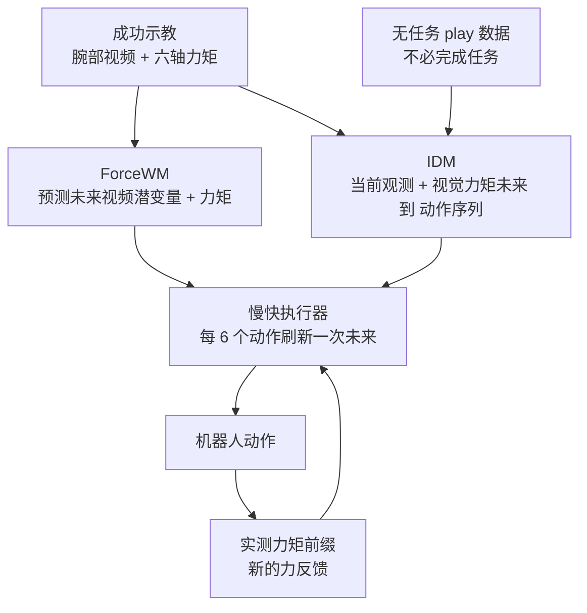

# ForceWAM：把「未来」与「响应」拆开学的力觉世界动作模型

**ForceWAM 把接触密集操作拆成两个学习问题：用成功示教训练世界模型（ForceWM）预测未来视频与六轴力/力矩，再用任务数据加无任务 play 数据训练逆动力学模型（IDM），把预测未来转成动作，并在执行中吸收新的力反馈。**

论文 *ForceWAM*（[arXiv:2610.18852](https://arxiv.org/abs/2610.18852)，[项目页](https://force-wam.github.io/)）。

## 英文缩写速查

| 缩写 | 英文全称 | 简要说明 |
|------|----------|----------|
| WAM | World Action Model | 联合建模未来观测与动作的模型族；本文给它加上力矩通道 |
| IDM | Inverse Dynamics Model | 输入当前观测与目标未来，输出使其发生的动作；本文用 play 数据训练 |
| F/T | Force / Torque | 末端六轴力矩传感信号，既是预测目标也是执行时的反馈 |
| EDM | Elucidated Diffusion Model | ForceWM 与 IDM 采用的扩散去噪框架（arXiv HTML 描述） |

## 为什么重要

- 纯示教训练的策略只见过成功轨迹，缺少「小动作怎样改变接触力」的因果覆盖；play 数据正好补这块，但作者发现直接并入基线的训练目标会掉点，需要把两类学习分离。
- 把力矩与视频一起作为「未来」，使策略不是只看视觉终点，而是对齐接触力轨迹（如 Slide 要把力保持在 5–15 N）。
- 对 [World Action Models](../concepts/world-action-models.md) 路线给出一个具体答案：未来生成与动作解码可以用不同数据源分别喂。

## 核心信息

| 项 | 内容 |
|----|------|
| **机构** | 复旦大学；上海交通大学；东南大学；上海创智学院；南方科技大学（项目页署名，通讯作者 Lixin Yang） |
| **平台** | Flexiv Rizon 4S 7 自由度臂 + 末端六轴 F/T（型号未给出）；Robotiq 2F-85 或带柔顺指尖的摇杆工具；腕部相机 |
| **数据** | 每任务族 200 条成功示教 + 200 条 play；Flip 与 Flip-D 共享数据 |
| **骨干** | ForceWM 由 Cosmos Predict 2B 初始化；IDM 为 ResNet-34 + GRU + 7 层 Transformer 解码 |
| **开源** | **宣称将开源**（2026-10-17 核查）：项目页仅 "Code coming soon"，无 GitHub / Hugging Face 链接 |

## 核心原理

### 流程总览

- **ForceWM：** 五槽潜变量（空白 / 当前力矩 / 当前图像 / 未来力矩 / 未来视觉），损失只作用在未来槽；训练 20,000 iter（8 GPU，学习率 3e-5）。
- **IDM：** 对「记录的视觉-力矩未来」做增强后输入，监督来自同一片段的真实动作；输出 18 个动作 token（14 维相对位姿）。
- **慢-快执行器：** 每次刷新缓存参考未来、初始噪声与基准 TCP 位姿；刷新间隔内 IDM 用不断增长的实测力矩前缀重新去噪，只执行当前动作。ForceWM 约 100 ms，IDM 约 60 ms（5 步 DDIM）。

## 源码运行时序图

**不适用**：截至 2026-10-17 项目页只写 "Code coming soon"，无可运行的官方代码，无法对齐真实入口；上方流程图依据论文 HTML 描述。

## 与其他工作对比

| 维度 | ForceWAM（本文） | [ForceVLA](./paper-forcevla.md) | [ImplicitRDP](./paper-implicitrdp-visual-force-diffusion-policy.md) | [Cosmos Policy](./paper-shenlan-wm-11-cosmos-policy.md) |
|------|------|------|------|------|
| 范式 | 世界模型预测视频 + 力矩未来，IDM 转成动作 | VLA（π₀）上加力觉模态 | 端到端视觉–力扩散策略 | 微调 Cosmos-Predict2 视频模型做控制与规划 |
| 力觉的角色 | 既是预测的"未来"，又是执行时 IDM 的实时反馈 | 6 轴 wrench 经 FVLMoE 作为 VLM 后的一等输入 | 慢快 token 处理异步力观测，VRR 辅助监督 | 本库页未述力觉通道 |
| 是否用 play 数据 | play 只喂 IDM，0→200 条单调提升 | 本库页未述 | 本文实验中 + play 反而掉点 | 本文实验中 + play 反而掉点 |
| 开源 | Code coming soon | 代码待发布 | 本库页未述 | 本库页未述 |

- **相对 ForceVLA：** ForceVLA 把力当作 VLA 的输入模态，ForceWAM 把力当作需要预测与对齐的目标未来；本文四任务上 ForceVLA 为 15–60%，ForceWAM 为 85–95%。
- **相对 ImplicitRDP：** 二者都处理慢视觉 / 快力觉的时间尺度差，但 ImplicitRDP 在单一策略内做，ForceWAM 把未来生成与动作响应拆成两个模型并分别配数据。
- **相对 Cosmos Policy：** 二者都从 Cosmos 视频基础模型出发，本文实验显示 Cosmos Policy 直接并入 play 会掉点（如 Hanoi 60→40），而 ForceWAM 只让 IDM 吃 play 数据。
- 基线数字均为本文 4 任务、每格 20 次真机试验的同一设置；ForceVLA 自报的五任务 60.5% 为其自身任务集，不可横比。

## 工程实践

| 项 | 建议 |
|----|------|
| 复现门槛 | 需要力矩传感的臂（论文用 Flexiv Rizon 4S）与腕部相机；代码未发布，只能按论文自建 |
| 数据配比 | 示教只喂 ForceWM；IDM 同时喂示教与 play，play 越多越好（0→200 条单调上升） |
| 未来条件 | 视觉 + 力矩最优；仅视觉、仅力矩、无未来都更低 |
| 延迟 | 世界模型每 6 个动作才刷新一次，快环由 IDM 靠力反馈维持 |
| 开源状态 | 未发布；入库日期 2026-10-17，后续 lint 复查 |

## 实验与评测

每项 20 次真机试验（项目页）。成功率 %（Slide / Flip / Flip-D / Hanoi）：

| 方法 | Slide | Flip | Flip-D | Hanoi |
|------|-------|------|--------|-------|
| ForceWAM 全 play IDM | 85 | 95 | 85 | 90 |
| ForceWAM 仅任务数据 IDM | 40 | 75 | 65 | 75 |
| 最强基线（逐列） | 20 | 60 | 40 | 65 |
| π0.5 | 10 | 40 | 20 | 60 |
| ForceVLA | 15 | 55 | 30 | 60 |

- 摘要给出 85–95% 平均成功率与 play 带来 15–45 pp 增益；Slide 从 40% 升到 85%。
- ImplicitRDP + Play、Cosmos Policy + Play 反而低于不加 play（如 Slide 20→10，Hanoi 60→40），作者归因于需要分离未来学习与响应学习的目标。
- 未来条件消融：视觉 + 力矩未加增强为 65/80/70/75，低于完整配置。

## 结论

**ForceWAM 的增益主要来自「用 play 数据只训练响应模型」这一分工，而不是简单堆数据。**

1. **看 play 的放法** — 同样加 play，基线掉点而 ForceWAM 涨点，关键是 play 只进 IDM。
2. **力矩要进未来** — 视觉 + 力矩的未来条件优于单模态，接触任务不能只靠视觉预测。
3. **扰动任务受益明显** — Flip-D 从 65% 到 85%，新力反馈在慢-快执行器内起作用。
4. **样本量要谨慎读** — 每格仅 20 次试验，差距小的格不宜过度解读。
5. **复现未就绪** — 代码未发布，真机硬件（F/T 型号未披露）也限制了复现。

## 局限与风险

- 代码 "coming soon"，主结果无法独立复现。
- 仅 4 类任务、单一机械臂平台；跨本体泛化未评测（论文页未涉及，未核实）。
- 每任务需 200 条成功示教 + 200 条 play，采集成本未折算。
- 页面无独立局限小节，失败案例分析未核实。

## 关联页面

- [World Action Models](../concepts/world-action-models.md) — 本文所属范式
- [逆动力学模型](../concepts/inverse-dynamics-model.md) — IDM 的背景
- [接触密集操作](../concepts/contact-rich-manipulation.md) — 任务语境
- [力控基础](../concepts/force-control-basics.md) — 力反馈与力调节背景
- [EgoWAM](paper-egowam-egocentric-human-wam-co-training.md) — 另一条 WAM 数据共训练路线

## 参考来源

- [forcewam_arxiv_2610_18852.md](../../sources/papers/forcewam_arxiv_2610_18852.md) — 论文摘录与开源核查
- [forcewam-project.md](../../sources/sites/forcewam-project.md) — 项目页归档
- [arXiv:2610.18852](https://arxiv.org/abs/2610.18852) — 原文

## 推荐继续阅读

- [ForceWAM 项目页](https://force-wam.github.io/)
- [Cosmos Predict（NVIDIA Cosmos）](nvidia-cosmos.md)
