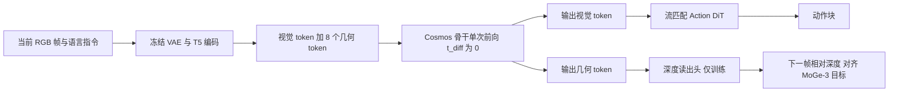

# ForeAct：用未来相对深度塑形世界模型表征（arXiv:2611.11500）

**ForeAct**（*Geometry-Guided Action Learning from World Representations*，[arXiv:2611.11500](https://arxiv.org/abs/2611.11500)，香港科技大学（广州）与京东探索研究院，v1 于 2026-11-08）。本页依据论文 v1 全文与仓库 README 撰写，逐条记录见 [来源归档](../../sources/papers/foreact_arxiv_2611_11500.md)。

## 一句话定义

以预训练视频世界模型为骨干，只对干净的当前观测做一次前向，训练时用可学习几何 token 预测下一帧相对深度来塑形共享表征，推理时去掉深度读出头，再由流匹配动作专家输出动作块（论文 Sec. III）。

## 英文缩写速查

| 缩写 | 英文全称 | 简要说明 |
|------|----------|----------|
| WAM | World Action Model | 把动作预测与未来视频生成耦合的策略 |
| VLA | Vision-Language-Action | 视觉-语言-动作策略 |
| DiT | Diffusion Transformer | 本文的 Cosmos 骨干与动作专家都是 DiT |
| VAE | Variational Autoencoder | 冻结的视频 VAE，作为 latent 编解码器 |
| MoGe-3 | Monocular Geometry Estimation（第三代） | 仅离线生成相对深度监督目标 |
| LIBERO | Lifelong robot learning benchmark | Franka 仿真基准，四个套件 |

## 为什么重要

- 论文要回答的问题（摘要、引言）：视频类 WAM 靠迭代扩散或整流流推理，开销高且表征缺显式空间结构；几何类策略多只恢复已观测的结构，缺少对未来几何变化的监督。
- 作者的做法是用一次前向取代未来帧合成，并把几何知识压进共享骨干，部署时不需要深度输入或外部几何骨干（Sec. I、III）。
- 这是作者自述；是否优于其他单步方案，论文只在 LIBERO 上做了与 Diffusion WAM 的受控对比（Table III）。

## 核心原理与流程总览

要点（均出自论文 Sec. III、IV-A）：

1. **单次前向表征（III-B，式 4）：** 当前帧 latent 与几何 token 拼接，在 t_diff=0 过一次 Cosmos-Predict2-2B 骨干，没有未来帧合成与迭代视频去噪。
2. **几何 token（III-C）：** 8 个可学习 token 与视觉 token 做双向（不加掩码）自注意力；输出 token 经投影、2D 坐标映射与零初始化残差（来自当前帧 VAE 特征）解码为下一帧深度 latent，再由冻结 VAE 解码器还原深度图。
3. **损失（III-A，式 3）：** 动作流匹配损失加 λ_geo=0.01 的深度损失（latent、像素、梯度三项，权重 1 / 0.1 / 0.05），深度对骨干的梯度另乘 0.01。
4. **推理（III-A/B）：** 只用骨干加动作专家；几何头移除，不需要机器人状态或深度输入。

## 工程实践

- **初始化与规模（IV-A）：** Cosmos-Predict2-2B Video2World；冻结 T5 与视频 VAE；联合训练 Cosmos DiT、16 层 DiT-B 动作专家（隐维 1024）与几何读出头。
- **训练设置（IV-A）：** LIBERO 100K 步、4 GPU、batch 48、horizon 8；SimplerEnv-Bridge 50K 步、8 GPU、batch 96、horizon 16；骨干学习率 1e-5，其余 1e-4。
- **数据依赖（README）：** 需要离线 MoGe-3 下一帧深度缓存、LeRobot 格式数据、Cosmos-Predict2 权重；README 给出 bridge 与 LIBERO 两个检查点的 Hugging Face 链接与训练、评测脚本入口。本次只读 README，代码文件与真机相关内容未核实。
- **评测（README）：** 复现数字需匹配 `configs/evaluation/` 里记录的检查点、denoising steps、seed 与执行 horizon。
- **延迟（IV-D）：** H20 单卡、batch 1，LIBERO 168 ms、约 2.1B 参数；文字称成功率相近时延迟约为 Cosmos Policy 的三分之一，且快于 Fast-WAM。

### 关键结果

| 项目 | 数字 | 出处 |
|------|------|------|
| LIBERO 平均 | 96.6（Spatial 98.4 / Object 98.8 / Goal 97.2 / Long 91.8） | Table I |
| 对照 LIBERO | Fast-WAM 97.6，Cosmos Policy 98.5，GeoPredict 96.5，DepthVLA 94.9 | Table I |
| SimplerEnv-Bridge 平均 | 63.5（ST 87.5 / CP 54.2 / SB 12.5 / EB 100.0），GR00T N1.5 为 61.9 | Table II |
| 真机 | 67/90 = 74.4%；Fast-WAM 58，π0 52；六任务中五个最好 | Sec. IV-C，Fig. 5 |
| 消融 | Diffusion WAM 93.2，Action Only 94.3，几何 token 无监督 94.7，直接特征监督 93.4，单向注意力 94.9，完整 96.6 | Table III |
| 几何 token 数 | 1/8/32/64 个对应 94.3/96.6/95.2/94.7 | Fig. 7(a) |
| 监督时间 | 下一帧 96.6，当前帧 95.2，t+4 为 95.5，t+8 为 94.9 | Fig. 7(b) |

## 与文章说法的核对

被核对的文章（公众号《机器人动作块太长，什么时候该重新规划？》2026-11-11 速览）原话大意：一次提取视频骨干表征，用未来相对深度作训练辅助，推理时移除该辅助头；仿真与机械臂实验支持几何信息价值；动作头仍用流匹配，不能把整套策略称为单步推理。

| 文章说法 | 核对结论 |
|----------|----------|
| 一次提取视频骨干表征 | 一致：Sec. III-B，t_diff=0 单次前向。 |
| 未来相对深度作训练辅助，推理移除辅助头 | 一致：Sec. III-A/C，下一帧相对深度，几何读出头仅训练用，深度对骨干梯度另乘 0.01。 |
| 仿真实验支持几何信息价值 | 基本一致：Table III 中完整版 96.6 对 Action Only 94.3；几何 token 无监督 94.7，故增益主要来自深度监督。这是 LIBERO 单一基准的结果。 |
| 机械臂实验支持几何信息价值 | 需限定：真机只对比 π0 与 Fast-WAM 总体成功率（Fig. 5），没有在真机上做去掉几何监督的消融，所以真机结果不能单独证明几何信息的价值（我的判断）。 |
| 动作头仍用流匹配 | 一致：Sec. III-A 的条件流匹配动作专家。 |
| 不能把整套策略称为单步推理 | 与论文措辞一致：论文说的是骨干 single-pass，未称整套策略单步；动作头的去噪步数论文正文未给，README 提到 denoising steps 需与配置匹配，具体值本次未读（未核实）。 |

文章未写数字；论文数字见上表。

## 局限

论文没有单独的局限节。以下分作者自述与我的判断。

- **作者自述：** LIBERO-Long 为 91.8，明显低于 Cosmos Policy 的 97.6（Table I），作者归因于长程累积难度（Sec. IV-B）；SimplerEnv 中 Stack Blocks 仅 12.5，作者归因于顺序多物体对齐（Sec. IV-B）；监督跨度拉长到 t+4、t+8 变差（Fig. 7(b)）。
- **未验证（我的判断）：** 真机只有一种机械臂、一个固定 RGB 视角、六个任务、每任务 15 次，没有给置信区间，也没有几何消融；LIBERO 总分 96.6 低于 Fast-WAM 与 Cosmos Policy，优势主要体现在延迟与参数量，而延迟对比仅为 Fig. 6 散点与正文一句话；Table I 的对照数来自各自论文，训练设置未必统一；深度目标来自 MoGe-3 的伪标签，其误差对效果的影响论文未分析；动作头步数与单次动作块总延迟的拆分未给出。
- **性质：** 本页依据 arXiv v1 与 README；未运行代码，未核对检查点内容。

## 关联页面

- [World Action Models](../concepts/world-action-models.md)
- [流匹配具身策略](../concepts/flow-matching-embodied-policy.md)
- [VLA](../methods/vla.md)
- [动作分块](../methods/action-chunking.md)
- [Fast-WAM](./paper-fast-wam.md)
- [Cosmos Policy](./paper-shenlan-wm-11-cosmos-policy.md)
- [LIBERO 基准](./libero-benchmark.md)
- [SimplerEnv](./paper-simplerenv-real2sim-eval.md)
- [LeapBot-JAC](./paper-leapbot-jac-joint-action-chains.md)

## 参考来源

- [foreact_arxiv_2611_11500.md](../../sources/papers/foreact_arxiv_2611_11500.md)
- [arXiv:2611.11500](https://arxiv.org/abs/2611.11500)
- [GitHub：Bulrush666/ForeAct](https://github.com/Bulrush666/ForeAct)

## 推荐继续阅读

- [arXiv PDF](https://arxiv.org/pdf/2611.11500v1)
- [Hugging Face 检查点](https://huggingface.co/Bulru1234/ForeAct)
- [Fast-WAM](./paper-fast-wam.md)
