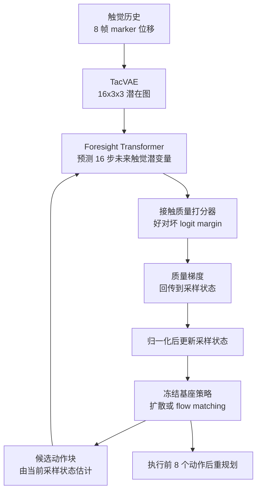

# ForeTac：先预测触觉后果，再引导动作生成

**ForeTac 在冻结的扩散或 flow matching 策略上增加一个「表示-预测-评估-引导」环：先编码当前触觉，再预测候选动作序列的未来触觉，用接触质量打分器评估，并把梯度沿预测器回传到采样状态，在动作执行前把它拉向更好的接触结果。**

论文 *ForeTac: Predictive Contact Guidance for Generative Robot Policies*（[arXiv:2610.18118](https://arxiv.org/abs/2610.18118)，[项目页](https://foretac.github.io/)）。

## 英文缩写速查

| 缩写 | 英文全称 | 简要说明 |
|------|----------|----------|
| SR | Task Success Rate | 达到任务目标的比例 |
| CSR | Contact Success Rate | 任务成功且满足预设接触准则（未脱离接触、未超力阈值）的比例 |
| DP | Diffusion Policy | 视觉-only 基座之一，也是对 ForeTac 的主要对照 |
| TacVAE | Tactile Variational Autoencoder | 把 9×9×2 marker 位移场压成 16×3×3 潜在图的触觉表示 |
| RDP | Reactive Diffusion Policy | 反应式触觉基线 |

## 为什么重要

- 看起来相同的擦拭、刷卡动作可能保持接触、丢失接触或用力过大；触觉反馈往往在关键转变之后才到，失败来不及纠正。
- 把触觉用作预测而不是事后反应：动作生成过程中就能评估「这样做会得到什么接触」。
- 引导发生在推理时，基座策略冻结，意味着不必为每个任务重训策略（但需训练触觉相关模块，见下）。

## 核心信息

| 项 | 内容 |
|----|------|
| **机构** | PDF 与项目页均未给出单位（项目页匿名），**未核实** |
| **平台** | Realman RM75 + Robotiq Hand-E，Vitai GF225 光学视触觉传感器，两台 RealSense D405 |
| **任务** | 平板擦拭、曲面花瓶擦拭、刷卡、易碎芯片抓取；每方法每任务 20 次 |
| **基座** | Diffusion Policy；flow matching 的 π0.5 |
| **开源** | **宣称将开放**：项目页 Paper / Code 均标 "Coming soon"，截至 2026-10-17 未列 GitHub |

## 核心原理

### 流程总览

- **TacVAE：** 因果 3D 卷积与时空残差块；解码器仅训练时用，部署时绕过。
- **Foresight Transformer：** 3 层，输入当前触觉 token、本体状态与候选动作块；一次前向产出 H=16 步的未来触觉潜变量，每步 144 维。
- **打分器：** 每任务单独训练，4 个接触类（1 个目标接触 + 3 个录得失败模式）；引导目标是目标类相对失败类的 logit margin。
- **引导方式：** 对扩散，用干净动作估计的质量梯度更新当前状态；对 flow matching，更新当前流状态再走常规 Euler 步；基座、TacVAE、Foresight、打分器部署时全部冻结。

## 源码运行时序图

**不适用**：项目页 Code 标 "Coming soon"，截至 2026-10-17 无官方可运行仓库。

## 工程实践

| 项 | 内容 |
|----|------|
| 传感前提 | 需要视触觉传感器的 marker 位移场；预训练语料 5,969 条 episode、约 210 万 marker 帧 |
| 打分器数据 | 每任务 100 条目标接触 episode + 每个失败模式 40 条，需要事先定义失败模式 |
| 扩散设置 | 30 采样步，在 10 个步上引导，尺度 0.003，执行前 8 个动作后重规划 |
| flow 设置 | 10 个积分步，仅最后 2 步引导 |
| 预测视野 | L=1→16，Board 任务 SR/CSR 60/50→85/80，视野越长越好（论文在固定打分器下测得） |
| 算力 | RTX 4090 单次重规划 132.46 ms（DP）对 261.26 ms，增加约 128.8 ms；ForeTac 另增 34.9M 参数（项目页） |

## 实验与评测

- **主比较（四任务平均 SR/CSR）：** DP 36.3/20.0；RDT 50.0/40.0；DP+Tactile Concat 48.8/41.3；RDP 58.8/48.8；DP+ForeTac **71.3/66.3**；相对 DP 提升 35.0/46.3 个百分点，相对 RDP 12.5/17.5。
- **flow matching：** π0.5 46.3/36.3 → π0.5+ForeTac 67.5/62.5。
- **消融：** 冻结 ResNet-18 输入 50.0/38.8；仅预测辅助损失 55.0/48.8；预测重排序 58.8/52.5；当前接触引导 60.0/51.3。
- **分任务（DP+ForeTac）：** Board 85/80，Vase 70/65，Card 55/50，Chip 75/70；Card 任务最难，DP 仅 10/0。
- **预测可靠性：** 预测触觉的偏好序准确率 92.9%（5,640 对），记录触觉 91.2%；动作被遮挡后预测误差上升（latent MAE 0.0589→0.0941），说明预测器确实用了候选动作。

## 结论

**ForeTac 的收益主要来自「预测未来触觉并用梯度直接塑形动作」，而不是触觉输入本身或事后重排序；代价是任务专属打分器与翻倍的重规划延迟。**

1. **预测优于反应** — 对比 RDP 58.8/48.8，ForeTac 71.3/66.3；对比当前接触引导 60.0/51.3，说明未来触觉带来额外信息。
2. **梯度引导优于重排序** — 预测重排序 58.8/52.5，比完整方法低 12.5/13.8 个百分点。
3. **对骨干可迁移** — 在 π0.5 上 +21.3 SR、+26.3 CSR（论文口径），但只测了两个骨干。
4. **必须准备失败数据** — 打分器需要目标接触与三类失败的数据，且每任务单独训练。
5. **延迟要预算** — 132.46 ms→261.26 ms，高频接触任务需评估是否够用。

## 与其他工作对比

| 对照 | 差异读法 |
|------|----------|
| [Diffusion Policy](../methods/diffusion-policy.md) | 基座策略；ForeTac 不改其参数，只在采样时引导 |
| [Flow matching 具身策略](../concepts/flow-matching-embodied-policy.md) | 第二个基座族（π0.5），引导对象换成流状态 |
| [视触觉融合](../concepts/visuo-tactile-fusion.md) | 现有做法多为把当前触觉拼入策略（Tactile Concat 48.8/41.3）；ForeTac 预测未来触觉 |
| RDP（反应式触觉） | 根据当前触觉实时修正；ForeTac 在动作成形阶段预判，CSR 高 17.5 个百分点 |

## 局限与风险

- **任务专属打分器：** 依赖目标接触与预定义失败模式数据，作者列为当前限制。
- **延迟：** 重复预测、打分与梯度计算使重规划约翻倍。
- **规模：** 每方法每任务 20 次，共 4 个任务；置信区间论文未报（未核实）。
- **传感器绑定：** 实验使用单一视触觉传感器，跨传感器泛化未验证（推测需重训 TacVAE）。
- **开源边界：** 无代码；单位匿名，无法确认实验室背景（2026-10-17）。

## 关联页面

- [触觉感知](../concepts/tactile-sensing.md) — 传感背景
- [接触丰富操作](../concepts/contact-rich-manipulation.md) — 任务族
- [视触觉融合](../concepts/visuo-tactile-fusion.md) — 触觉输入的常规做法
- [Diffusion Policy](../methods/diffusion-policy.md) — 基座之一

## 参考来源

- [foretac_arxiv_2610_18118.md](../../sources/papers/foretac_arxiv_2610_18118.md) — 论文摘录与开源核查
- [foretac-project.md](../../sources/sites/foretac-project.md) — 项目页归档
- [arXiv:2610.18118](https://arxiv.org/abs/2610.18118) — 原文

## 推荐继续阅读

- [ForeTac 项目页](https://foretac.github.io/)
- [ForeTac 论文 PDF](https://arxiv.org/pdf/2610.18118)
