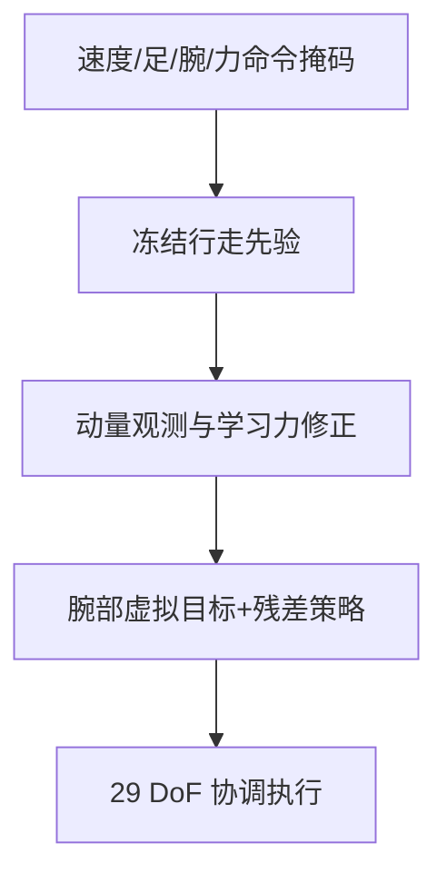
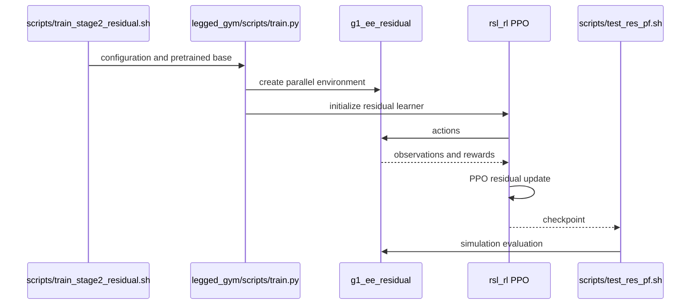

# FORGE：力感知多粒度人形移动操作（FORGE: Force-Aware Multi-Granularity Control for Efficient Humanoid Loco-Manipulation）

**机构：** 上海人工智能实验室、清华大学、浙江大学、上海交通大学、香港中文大学  
**论文：** [arXiv:2611.17142](https://arxiv.org/abs/2611.17142)
**项目：** https://bb0928.github.io/forge/  
**官方源码：** https://github.com/bb0928/FORGE  

## 一句话定义

**四组命令（底座速度、足端平面、双腕位姿、力设定）按激活掩码动态生效；下身冻结 locomotion prior，残差网络负责上身与底座协调。腕臂动量观测器加仿真特权力监督的学习补偿估计低频外力，经虚拟目标更新改变腕位姿。**

## 英文缩写速查

| 缩写 | 英文全称 | 简要说明 |
|---|---|---|
| WBC | Whole Body Control | 全身协调控制 |
| PPO | Proximal Policy Optimization | 残差策略训练 |
| PD | Proportional Derivative | 关节力矩代理 |
| MPE | Mean Position Error | 足与腕位置误差 |

## 为什么重要

机器人接近物体、摆脚、操作腕端与长期接触需要不同精度命令；全身人体轨迹难采集，腕力传感器又不总可用。

## 核心原理

四组命令（底座速度、足端平面、双腕位姿、力设定）按激活掩码动态生效；下身冻结 locomotion prior，残差网络负责上身与底座协调。腕臂动量观测器加仿真特权力监督的学习补偿估计低频外力，经虚拟目标更新改变腕位姿。

### 流程总览

以下根据论文方法整理，箭头表示控制/数据流向。

## 实验与评测

真机 20 次每方法的响应延迟 22 ms、足端 MPE 5.42 cm、腕 MPE 4.15 cm；仿真双臂夹箱平均法向作用力 8.52 N（不是实机力跟踪误差）。遮蔽消融有效 rollout 从 15.69±1.32 s 提升 19.46±0.52 s。跨载荷 0、0.5、1、2 kg 成功率 100/100/90/90%，各 20 次。

## 与其他工作对比

与 SONIC、TWIST2、HOMIE 比较时需区分真机响应延迟、跟踪 MPE 和仿真接触力，不将它们当成一个统一指标。

## 结论

**FORGE：力感知多粒度人形移动操作 的实际价值在于明确研究对象与实验边界，而非脱离原文场景比较单个成功率。**

1. 22 ms 是响应延迟，不能解读为神经网络前向时间。
2. 仿真箱子接触力与真实力估计误差要区分。
3. 仅已开源的第二阶段可按 README 重现。

## 工程实践

实际验证时先检查任务接口与坐标系，再按论文试验复现主指标；记录 WBC / PPO / PD 相关状态、控制采样与异常回退路径，不能以论文中的概念图代替可执行模块证明。

**源码开放状态：** 官方源码已部分发布 stage2 残差策略训练和仿真评估；基本策略训练、MuJoCo 及真机部署脚本尚未开源。

## 源码运行时序图

此图仅表示官方 README 和脚本可核实的训练/评测调用入口，不包含未经发布的真机部署运行时。

## 局限与风险

估测为腕部低频等效三维力，不是通用六维力矩传感。官方代码仅公开 stage2 残差训练与仿真评估，基本策略训练和真机部署脚本尚在 TODO。

## 关联页面

- [whole body control](../concepts/whole-body-control.md)
- [residual policy learning](../methods/residual-policy-learning.md)
- [loco manipulation](../../roadmap/depth-loco-manipulation.md)
- [11.09–11.13 29 篇总览](../overview/humanoid-quadruped-2026-11-09-13-29-papers.md)

## 参考来源

- [arXiv v1 原文核对归档](../../sources/papers/forge-force-aware-loco-manipulation_arxiv_2611_17142.md)
- [arXiv v1 HTML 全文](https://arxiv.org/html/2611.17142v1)
- [官方项目主页](https://bb0928.github.io/forge/)
- [官方 GitHub 源码](https://github.com/bb0928/FORGE)

## 推荐继续阅读

- [论文 PDF](https://arxiv.org/pdf/2611.17142v1)
