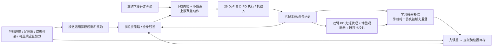
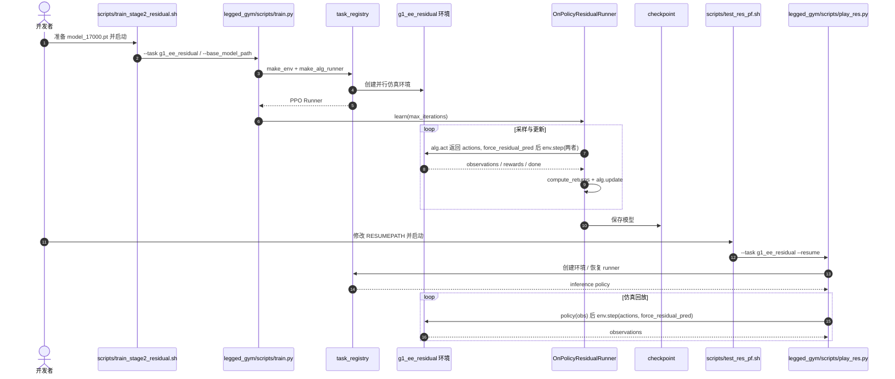

# FORGE: Force-Aware Multi-Granularity Control for Efficient Humanoid Loco-Manipulation｜FORGE：面向高效人形移动操作的力感知多粒度控制

## 一句话定义

**FORGE** 将导航速度、平面足端位置、双腕位姿和期望腕部施加力组合为可选激活的多粒度命令，用冻结行走先验与全身残差稳定跟踪，并利用无腕力传感器的力估计调整持续接触时的腕位置目标。

## 英文缩写速查

| 缩写 | 英文全称 | 简要说明 |
|---|---|---|
| FORGE | Force-Aware Multi-Granularity Control for Efficient Humanoid Loco-Manipulation | 力感知多粒度人形移动操作控制框架 |
| WBC | Whole-Body Control | 全身运动与接触协调 |
| PPO | Proximal Policy Optimization | 残差策略强化学习 |
| PD | Proportional–Derivative | 低层关节目标的控制器及重构力矩代理 |
| MPE | Mean Position Error | 末端目标平均位置误差 |
| RMSE | Root Mean Squared Error | 外力估计均方根误差 |

## 为什么重要

移动操作要同时兼顾走稳、足端落点、腕端精度和持续接触。高维人体全身动作示范难采集，腕部力传感器也未必可用。FORGE 让同一控制器接受稀疏任务空间命令，不再需要在“行走策略”和“操作策略”之间硬切换。

## 核心信息

| 项目 | 核查结果 |
|---|---|
| 作者 | Liangjun Xing、Ke Fan、Kailin Li、Bin Wang、Xiaojie Niu、Qingwei Ben、Jiafei Cao、Wei Yao、Yebin Liu、Jingbo Wang、Weinan Zhang |
| 机构 | 上海人工智能实验室、清华大学、浙江大学、上海交通大学、香港中文大学 |
| 原文 | [arXiv:2611.17142v1（2026-11-12）](https://arxiv.org/html/2611.17142v1) |
| 项目与代码 | [官方项目页](https://bb0928.github.io/forge/) · [官方 GitHub](https://github.com/bb0928/FORGE) |
| 平台与执行 | 论文为 29 DoF 人形平台；Isaac Gym 200 Hz 仿真 / 50 Hz 策略 |
| 开放程度 | **部分开源**：残差训练和仿真评估；基础策略训练、MuJoCo 与真机部署脚本尚未开放 |

## 核心原理

### 四组独立激活的任务空间命令

- **Navigation**：底座速度指令。
- **Stance**：左右足端的平面位置目标。
- **Pose**：双腕在任务坐标系中的位姿目标。
- **Force**：可选的双腕**机器人施加力**期望值，供目标位姿修正，而非直接作为电机力矩指令。

训练期间通过四个激活位同时屏蔽未使用组的观测项和对应奖励项，防止旧目标干扰当前任务。策略从六帧本体与命令历史中推理；共享编码器与 adaptation encoder 输出 29 维动作并预测力估计补偿。无需把人体全身关节角轨迹作为训练标签。

### 无腕部力传感器的混合估计与虚拟目标

对双臂分别从 7 DoF 关节位置/速度和底层 PD 目标恢复力矩代理；动量观测器得出 14 维关节扰动残差，借腕部平移雅可比投影为左右腕 3D 力。学习补偿器用仿真接触力监督残差，在部署时仅根据可观测历史补偿模型/执行器误差。

准静态虚拟目标采用原文公式 (5) 的符号约定：`p_virtual = p_nominal + K_f^-1 (f_env_hat + f_cmd)`。这里 `f_env_hat` 是环境**反作用力**估计，`f_cmd` 是机器人期望**施加力**，二者方向相反；`K_f=200 N/m` 为论文力命令模式的设置。该环节属于类导纳的位置目标偏移，**不是**完整六维 wrench 感知或动态阻抗控制。

### 冻结行走先验与非对称残差

先训练并冻结下肢 locomotion expert，之后训练统一残差策略：下肢动作 = 冻结策略动作 + 下肢小幅修正，上肢直接来自残差策略。论文将下肢 PPO 探索标准差上限设为 0.2、上肢为 1.0，降低足端与操作目标对行走稳定性的干扰。

## 流程总览

下图按原文 Fig. 2、§III-A–C 分开表示“命令到策略”和“本体反馈到虚拟目标”两条路径，而不是把动量观测器误放在行走先验之后。

仿真接触力只用于**训练补偿器**，不作为真机部署时的观测。虚拟目标反馈主要面向持续、准静态接触。

## 源码运行时序图

已阅读 [官方代码归档](../../sources/repos/forge.md) 所列 shell、训练/回放入口、任务注册、`g1_29dof_ee_residual_config.py` 和 **`OnPolicyResidualRunner`**；下面仅绘制**已公开**的第二阶段训练和 Isaac Gym 评估调用链：

**仓库参数与论文差异：** 公开 `train_stage2_residual.sh` 默认 **4096** 个环境，论文 §IV-A 写 **2048**；脚本还依赖 `model_17000.pt` 基础模型。评估脚本 `test_res_pf.sh` 中的 `RESUMEPATH` 需修改为有效路径。官方 README 尚未提供第一阶段基础策略训练及真机部署入口。

## 实验与评测

| 指标 | FORGE | 原文比较/说明 |
|---|---:|---|
| 真机端到端目标响应延迟（Table I） | **22 ms** | HOMIE 27、TWIST2 197、SONIC 252 ms；不是仅模型推理时延 |
| 真机双足平面 MPE | **5.42 cm** | TWIST2 7.87、SONIC 7.35 cm |
| 真机双腕 3D MPE | **4.15 cm** | TWIST2 7.76、SONIC 6.42 cm |
| 仿真刚性箱体双腕平均法向夹持力 | **8.52 N** | HOMIE 15.48、TWIST2 17.16、SONIC 15.32 N；越小仅表示该设定挤压力越小 |
| 掩码消融有效运行时间（Table III） | **19.46 ± 0.52 s** | 无掩码 15.69 ± 1.32 s，20 次滚动实验 |
| 真机阶梯外力 Hybrid RMSE x/y/z（Table IV） | **0.81 / 1.97 / 0.87 N** | 仅代表性曲线；35/40/50 N 未见载荷的 RMSE **8.28/9.66/12.35 N** |

**下游学习：** 使用一个 Diffusion Policy（头戴 RGB + 任务状态）向 FORGE 输出多粒度命令；四种载荷各收集 80 条、合计 320 条示范。真机蹲起搬箱在 0 / 0.5 / 1 / 2 kg 条件下分别成功 **20/20、20/20、18/20、18/20**（Table V）。每组只有 20 次，不推断开放场景的泛化成功率。

## 与其他工作对比

- [HOMIE](./paper-loco-manip-161-040-homie.md)：优先上下身分离接口，未提供 FORGE 同型的双腕/足端任务空间命令。
- [SONIC](./nvidia-sonic.md)、[TWIST2](./paper-twist2.md)：擅长全身动作跟踪，但需要按同一任务和单位区分 end-effector MPE、真机响应延迟与仿真接触力。
- [残差策略学习](../methods/residual-policy-learning.md)：FORGE 是把冻结行走策略变为可供足端与操作共同修正的具体实现。

## 结论

**FORGE 的价值是让稀疏任务空间命令在一个稳定的全身控制器中组合，并为持续接触增加无需腕部力传感器的低频力反馈。**

1. 先核对任务是导航、足端、腕姿态还是持续接触，不要把四级命令误当成四个独立控制器。
2. 复现时冻结下身先验，并单独测试去掩码/去先验/去下肢探索限制的稳定性影响。
3. 对比时将真机响应延迟、位置 MPE、仿真夹持力与真机力估计 RMSE 严格分开。
4. 期望力输入通过**腕目标偏移**起作用，不代表可以直接精确控全六维接触力矩。
5. 完整的 Sim2Real 验证必须等待真机部署代码或自行实现并校准，不要把已开放的第二阶段训练脚本当成全流程复现。

## 工程实践

- 基于官方 `g1_ee_residual` 任务和脚本核对 observation mask、历史长度、动作拼接、PD 增益及 50 Hz 策略周期；同时记录 Isaac Gym/驱动依赖。
- 对力估计分别记录 observer-only、learned-only、hybrid 误差；在超出训练力范围时检查误差增长和雅可比病态。
- 对照论文 2048 环境与 shell 4096 环境的差异，固定训练预算后再评估收益。
- 若从上游 Diffusion Policy 或遥操作输入双腕目标，先明确骨盆相对坐标与 yaw-frame 转换及指令生效时序。

## 局限与风险

- 力估计是 **低频、腕部等效平移 3D 力**，以仿真特权接触力监督训练；未覆盖一般 6D wrench、高动态冲击或通用阻抗稳定性证明。
- 表 IV 的小误差对应代表性阶梯载荷曲线，较大未见载荷误差明显增大；泡沫箱变形观察是定性证据。
- 当前官方仓库**部分开源**：第二阶段残差训练与 Isaac Gym 评估可读，第一阶段训练、MuJoCo 与真机部署未发布；本次仅核读原文与源码，**未实际训练、运行仿真或真机复现**。

## 关联页面

- [Whole-Body Control](../concepts/whole-body-control.md)
- [残差策略学习](../methods/residual-policy-learning.md)
- [Loco-Manipulation 任务](../tasks/loco-manipulation.md)
- [Loco-Manipulation 纵深路线 Stage 1](../../roadmap/depth-loco-manipulation.md)
- [11.09–11.13 人形/四足论文总览](../overview/humanoid-quadruped-2026-11-09-13-29-papers.md)

## 参考来源

- [论文原文核对归档](../../sources/papers/forge-force-aware-loco-manipulation_arxiv_2611_17142.md)
- [官方项目页资源核对](../../sources/sites/forge.md)
- [官方训练/回放源码核对](../../sources/repos/forge.md)
- [arXiv HTML v1](https://arxiv.org/html/2611.17142v1)
- [官方项目主页](https://bb0928.github.io/forge/)
- [官方 GitHub](https://github.com/bb0928/FORGE)

## 推荐继续阅读

- [原始 PDF](https://arxiv.org/pdf/2611.17142v1)
- [官方项目的 Contact & Force 评估说明](https://bb0928.github.io/forge/)
