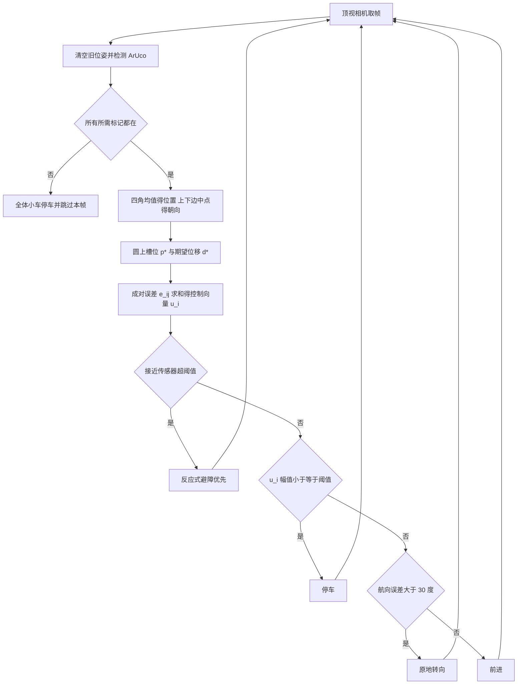

# Tutorial: Vision-Based Formation Control with Differential-Drive Robots（arXiv:2611.11164）

**论文：** [arXiv:2611.11164](https://arxiv.org/abs/2611.11164)（Marowski, Min；Indiana University SMART Lab；v1 2026-11-08）。**代码：** [SMARTlab-IU/formation-control-tutorial](https://github.com/SMARTlab-IU/formation-control-tutorial)（本环境 403，内容未核实）。

## 一句话定义

一篇**教学型**教程：用一台固定顶视 USB 相机识别每辆差速小车上的 ArUco 标记，在图像像素坐标里算相对位置，把「当前相对位移与期望相对位移之差」求和成控制向量，再转成左右轮命令，让多辆真实小车排成圆上等距的编队（第 2、5-7 节）。

## 英文缩写速查

| 缩写 | 英文全称 | 简要说明 |
|------|----------|----------|
| ArUco | Augmented Reality University of Cordoba（方形基准标记） | 方形编码标记，OpenCV 可检测 ID 与四角（第 3.2、5.1 节） |
| OpenCV | Open Source Computer Vision Library | 提供标记生成与检测接口（第 4 节） |
| HamsterS | Robomation HamsterS | 论文所用差速小车，约 100 美元 / 台（第 13 节） |
| RoboID | roboid Python 包 | 经 USB 适配器（dongle）发送左右轮命令的接口库（第 2、4 节） |
| D* / P* | desired displacements / positions | 期望成对位移集合 / 圆上槽位集合（第 6 节） |
| E(t) | mean pairwise formation error | 平均成对编队误差，单位像素（式 17） |
| N, R | 机器人数 / 编队半径 | 示例 N=4，R=100 像素（第 4.1 节） |

## 为什么重要

- 填的是「公式到真机」的教学空档：作者动机是让学生看到传感、坐标变换、反馈计算与运动控制如何串成可运行系统（第 1、13 节）。
- 栈很轻：Python 3.10+、NumPy、OpenCV、roboid（第 4 节），小车约 100 美元（第 13 节），门槛低于专用实验平台；无硬件者可转 Robotarium（第 13 节，需改接口）。
- 把坐标约定、标记朝向、轮符号、丢标记即停等**真机常见坑**写成清单（第 3、5.4、11 节），对入门复现有用。

## 核心原理与流程总览

每一帧相机图像走一遍闭环（第 2、8 节，图 2、图 4）：

要点（均出自论文，节号见括号）：

- **位姿：** 位置 = 四角均值（式 1）；朝向 = 上边中点减下边中点向量的 atan2，取 [0°, 360°)，图像 y 向下故角度顺时针增（式 2-3，图 3）。
- **槽位与期望位移：** p*_i = R(cos 2πi/N, sin 2πi/N)（式 4）；d*_ij = p*_j − p*_i（式 6）。相对位移定义形状而非固定中心，故编队可落在视野内不同位置（第 1、6.2 节）。
- **控制向量：** e_ij = (p_j − p_i) − d*_ij（式 8），u_i = Σ_{j≠i} e_ij（式 11）。论文指出这与一致性协调「概念上相关」，但相关收敛 / 时延结果**不**适用于本实现（第 6.3 节）。
- **差速执行：** 先转后走；转速 min(KP_ANGLE·|e_θ|, 40)，前进速度 min(KP_DISTANCE·‖u_i‖, 40)；‖u_i‖ ≤ DISTANCE_THRESHOLD 停（式 12-16，第 7 节）。
- **避障：** 左右接近读数超过 OBS_THRESHOLD 时的固定轮速反应，优先于编队运动；论文明确这是「基础反应式避障，不是无碰撞路径规划」（第 7.4 节）。

## 评测与实验结果

原文未给定量实验：只有图 1 一次真机运行（四台 HamsterS，0–7 s）的定性截图序列，自称定性示例。第 10.1 节定义了平均成对编队误差 E(t)（式 17，单位像素）并说明可用 global_error 记录与绘图，但论文本身没有报告 E(t) 数值、重复次数、成功率或任何基线对比。

## 与其他工作对比

| 工作 | 关注点 | 与本文的区别 |
|------|--------|--------------|
| [视觉伺服](../methods/visual-servoing.md) | 用图像误差直接驱动运动 | 本文是外部固定相机测机器人位姿再做编队反馈，属「眼在外」的多机版本，无相机标定与图像雅可比 |
| [四旋翼编队（微分平坦保持）](./paper-flatness-preserving-quadrotor-formation.md) | 带动力学性质保证的四旋翼编队控制 | 研究型方法论文；本文是差速小车上的教学实现，不给收敛或稳定性保证 |
| [去中心化群体碰撞验证](./paper-decentralized-collision-verification-swarms.md) | 多机碰撞安全的形式化验证 | 本文只有接近传感器的反应式避障，明确不保证无碰撞（第 7.4、12 节） |

## 结论

**这是一篇把「ArUco 位姿估计 → 成对位移误差求和 → 先转后走差速执行」串成可运行真机系统的教学教程，价值在入门复现，而不在算法或性能。**

1. 控制律 u_i = Σ e_ij 用相对位移定义形状，编队可落在视野中任意位置（式 8、11，第 6 节）。
2. 硬件与软件栈轻量（约 100 美元小车、Python + OpenCV），并附坐标约定、标记朝向、轮符号等排错清单（第 3、11、13 节）。
3. 安全兜底简单直接：任一标记丢失全体停车（第 5.4 节）。
4. 局限：像素坐标无标定、集中式固定相机、槽位预分配，无定量实验，也不保证收敛或无碰撞（第 12 节）。

## 工程实践

- **参数（第 4.1 节）：** target_ids=[0,1,2,3]，ROBOTS_N=4，SHAPE_R=100，KP_DISTANCE=0.7，KP_ANGLE=0.5，DISTANCE_THRESHOLD=10，ANGLE_THRESHOLD=30，OBS_THRESHOLD=70，OBS_SPEED=50。N=4、R=100 时相邻槽位中心距约 141.4 像素（第 6.1 节）。
- **硬件（第 3 节）：** 建议 1080p 相机，垂直朝下固定；标记字典生成与检测一致；标记上边须指向车头，否则航向错；标记中心只近似车中心。避免运动模糊与自动对焦变化。
- **代码结构（表 1）：** main.py、settings.py、utils/ 下 camera_supervisor / formation_control / actuation / img_overlay 四模块。
- **安全兜底（第 2、5.4、8.2、8.4 节）：** 每帧先清位姿，缺任一标记全体停；finally 中停轮并释放相机。
- **调参与排错（第 7.5、11 节，表 2）：** 低速起步；振荡时降速或增大停止阈值；转向反了先查轮符号而非改误差公式。
- **误差记录（第 10.1 节）：** 用 global_error 记录 E(t) 并可 Matplotlib 绘图（可选，需额外装 Matplotlib）。
- 以上均为论文描述；仓库实际内容**未核实**（访问 403）。我未运行任何代码。

## 与文章说法的核对

对照公众号文章《机器人动作块太长，什么时候该重新规划？》（2026-11-11）第 51 条对本文的描述：

| 文章说法 | 核对 | 出处 |
|----------|------|------|
| 用顶视相机识别标记 | 一致：固定顶视 USB 相机 + ArUco | 第 2、3 节 |
| 计算相对位置并生成差速轮命令 | 一致：成对位移误差求和 → 先转后走 → 左右轮命令 | 第 6、7 节 |
| 串起视觉编队控制的基础流程 | 一致：含位姿估计、几何、控制、主循环、误差度量、排错 | 第 5-11 节 |
| 真机教程 | 一致：四台 HamsterS 真机；图 1 为真机一次运行 | 第 1、2 节，图 1 |
| 适合教学与复现入门 | 一致：作者动机即教学，并附仓库（仓库本身未核实） | 第 1、13 节 |
| 像素坐标控制不提供完备安全保证 | 一致：像素坐标无标定；减小误差不保证无碰撞或收敛 | 第 12 节 |
| 基础避障不提供完备安全保证 | 一致：仅反应式接近传感器避障，无路径规划与车间距约束 | 第 7.4、12 节 |

文章未写数字，故无数字需核对。补充：论文**没有定量实验结果**（图 1 自称定性示例），文章也没有给出此类结果，两者一致。

## 局限

**性质说明：** 本文是教程 / 教学材料，不是提出新算法并做对比评测的研究论文；下列局限分「论文自述」与「我的判断」。

论文自述（第 12 节）：

- 位置与编队尺寸用像素表示，无相机标定与像素到世界坐标转换，像素距离不对应均匀物理距离；位姿依赖可靠标记检测与正确粘贴。
- 集中式 + 固定顶视相机；所有标记须始终可见，丢任一即全体停车。
- 槽位与机器人到槽位的分配预先固定，无动态重分配或编队自适应。
- 先转后走、固定增益与阈值；停止条件看合向量幅值，而非逐对误差界。
- 无无碰撞路径规划、无显式车间距离约束；降低编队误差不保证无碰撞或在所有工况收敛。

我的判断 / 未验证之处：

- 论文未给出定量实验：仅图 1 的一次运行定性序列（0-7 s），没有重复次数、E(t) 曲线数值、成功率或与其他方法的对比（第 10 节、图 1）。因此「能收敛到什么精度、对初值多敏感」本文**未验证**。
- 示例参数是否对别的 N、R 或别的小车适用，论文只给调参提示（第 7.5 节），未做扫参（推测：需自行调）。
- 相机帧率 30 FPS 为请求值，实际取决于设备（第 8.2 节）；延迟对稳定性的影响未分析（第 6.3 节只说一致性文献的时延结论不适用）。
- 我只读了论文文本与图注，没有运行仓库代码，也无法打开仓库核对其与论文摘录是否一致。

## 关联页面

- [视觉伺服](../methods/visual-servoing.md)：同属「图像反馈驱动运动」，本文是对机器人位置的外部相机反馈。
- [人形多机协同](../concepts/humanoid-multi-robot-coordination.md)：多机协调的更一般讨论。
- [控制屏障函数](../concepts/control-barrier-function.md)、[安全过滤器](../concepts/safety-filter.md)：本文自认缺乏的碰撞安全保证通常由此类方法补上（此为我的关联判断，非论文内容）。
- [去中心化群体碰撞验证](./paper-decentralized-collision-verification-swarms.md)、[四旋翼编队（微分平坦保持）](./paper-flatness-preserving-quadrotor-formation.md)：相邻的多机 / 编队工作。

## 参考来源

- [原文归档：formation-control-tutorial_arxiv_2611_11164.md](../../sources/papers/formation-control-tutorial_arxiv_2611_11164.md)
- [arXiv:2611.11164](https://arxiv.org/abs/2611.11164)
- 代码仓库（未核实）：<https://github.com/SMARTlab-IU/formation-control-tutorial>

## 继续阅读

- [arXiv PDF v1](https://arxiv.org/pdf/2611.11164v1)
- 论文引用的综述：Oh, Park, Ahn, A survey of multi-agent formation control, Automatica 2015；一致性综述 Olfati-Saber et al., Proc. IEEE 2007（论文参考文献 [6]、[20]）
- [视觉伺服](../methods/visual-servoing.md)
