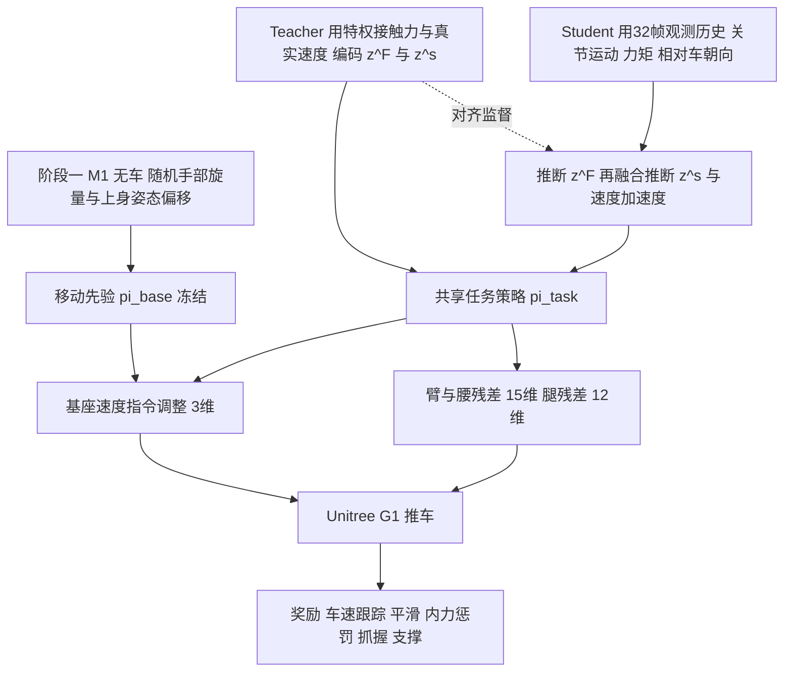

# ForPC：力感知人形全身推车（arXiv:2611.08664）

**ForPC**（*ForPC: Force-Aware Whole-Body Control for Precise Humanoid Cart Pushing*，[arXiv:2611.08664](https://arxiv.org/abs/2611.08664)，v1，2026-11-05，cs.RO）。作者 ZhenYu Zou 等（通讯作者 Cheng Cheng），论文首页未列机构，项目页 [roboforpc.github.io](https://roboforpc.github.io/) 为未填充的模板页，未见代码链接（未核实开源）。

## 一句话定义

**两阶段强化学习的人形推车全身控制：冻结一个在手部载荷下训好的移动先验，再用从机载观测推断出的「力隐变量 + 状态隐变量」驱动残差策略，协调臂、腰、腿并避免双手互相对抗，让 Unitree G1 在无力传感器下精确跟踪车速。**

## 英文缩写速查

| 缩写 | 英文全称 | 简要说明 |
|------|----------|----------|
| ForPC | Force-aware whole-body control for Precise humanoid Cart pushing | 本文方法名 |
| Loco-only | Locomotion-only baseline | 只用第一阶段移动策略、不做任务级修正的基线 |
| RMSE | Root-Mean-Square Error | 均方根误差，本文用于速度、跨轨迹、估计误差 |
| RMSF | RMS velocity Fluctuation | 指令平台内速度相对自身均值的波动（式 18） |
| POMDP | Partially Observable Markov Decision Process | 部分可观测马尔可夫决策过程，第 3 节用于建模 |
| M1 / M2 | Subsystem 1 / 2 | M1：无车、手部旋量扰动下训移动先验，M2：带车的残差任务 |
| z^F / z^s | Force latent / State latent | 力隐变量 / 状态隐变量，teacher 由特权信息编码，student 由观测历史推断 |

## 为什么重要

- 推车是双手握同一把手的闭环力耦合：手部力既推车又扰动平衡，两臂不协调会产生不推进的内力（论文第 1 节）。
- 作者指出已有工作要么估计接触力但不估计物体运动（Portela 等、Zhi 等），要么预测物体运动但无显式手部力估计（HAIC），没有同时闭合车速与双手力旋量反馈（第 1 节，作者自述）。
- 实际价值：无力传感器、无车载传感器、不知载荷，也能仿真训练后零样本上真机（第 5.4 节）。

## 核心原理 / 方法栈 / 流程总览

要点（均见论文第 3–4 节）：

1. **系统拆分：** M1 用手部外力扰动代替小车训练 π_base（跟踪基座速度、保持平衡，奖励含跟踪 / 平衡 / 步态 / 正则四组，第 4.1 节）；M2 冻结 π_base，只学残差 a^res（第 3 节）。
2. **隐变量推断（第 4.2 节）：** 观测含关节运动、关节力矩、头部相机看 AprilTag 得到的相对车朝向。student 先经因果时间编码器得到力隐变量并解码出每只手接触力，再与观测帧融合（32 帧时间卷积分支加最近 6 帧分支）得到状态隐变量及辅助车 / 机器人速度、加速度估计；损失为隐变量对齐加力、速度、加速度的均方误差（式 11–12）。训练中周期性用 student 推断值采样，并逐步屏蔽任务策略观测里的直接上身力矩通道，使接触力信息只经力隐变量到达（第 4.2 节末）。
3. **动作（第 4.3 节）：** 30 维，含 3 个基座速度指令调整、15 个臂与腰残差、12 个腿残差。
4. **内力惩罚（式 15–16）：** 将双手旋量分解为驱动分量与内力分量，按各抓握方向承载能力归一后惩罚内力。
5. **训练与评测环境（第 5.1 节）：** Isaac Lab 训练，Isaac Sim 与 MuJoCo 评测，50 Hz；空车 12 kg 四脚轮；训练时使用动力学随机化与观测噪声（图 3 图注）。

## 关键结果

| 评测 | 结果 | 出处 |
|------|------|------|
| 速度跟踪 RMSE | 12 个组合全部最优，相对 Loco-only 最多降 68.2%，RMSF 最多降 65.4% | 第 5.2.1 节、表 1 |
| 路线跟踪（仿真，S 弯 + 圆角矩形） | 跨轨迹 RMSE 0.0648 m（15 kg）/ 0.0685 m（25 kg），Loco-only 0.2153 / 0.2652 m，最多降 74.2% | 第 5.2.2 节、表 2 |
| 路线成功率（各 640 次） | ForPC 100%，Loco-only 89.1%（15 kg）/ 76.6%（25 kg） | 表 2 |
| 力估计 | 单手各分量 RMSE 约 4.3–7.5 N，R² 前向 0.97、垂向 0.95、侧向 0.78 | 第 5.3.1 节、表 3 |
| 内力比 | 力感知使侧向 / 转向内力比降至 51.9–61.5%（无力感知版本为 82.9–89.2%），驱动占比最多提高 4.0 倍 | 第 5.3.2 节、表 4 |
| 真机 | G1 零样本，推 30 kg 车，0.5 m/s，含接入导航与中途换载荷 | 第 5.4 节、图 6–7 |

消融（同为作者自述的解读）：加力感知比同一标准先验降 RMSE 最多 36.1%，在手部载荷下训练先验再降最多 13.5%、并把路线成功率提到 100%（第 5.2 节）。

## 工程实践

- **复现要点：** 先训移动先验（带随机手部旋量与臂 / 腰姿态偏移，偏移范围与第二阶段残差范围匹配，第 4.1 节），冻结后再训残差与 teacher-student 估计器。
- **部署链路：** 部署时去掉特权编码器，只保留归一化器、student 推断网络与任务策略；真机只用本体感知、关节力矩与 AprilTag 相对朝向（第 5.4 节）。
- **硬件与设置：** Unitree G1 + Dex3-1 三指手固定抓握，腰 roll / pitch 固定，头部 RealSense（第 5.1 节）。关联实现可参考 [Isaac Lab](../entities/isaac-lab.md)、[Unitree G1](../entities/unitree-g1.md)。
- **未披露项：** RL 算法名、网络结构细节、训练步数、奖励权重、随机化范围正文均未给出，复现需等代码（未见开放）。

## 局限

- **作者自述：** 仅覆盖一种四脚轮平台车与固定抓握姿态，后续要扩展到其他轮式物体与接触模式，并加入更丰富的外部感知以应对杂乱环境（第 5.1、6 节）。
- **读者观察（非作者结论）：** 定量对比只有仿真（Isaac Sim，速度跟踪另含 MuJoCo 的 sim-to-sim）；真机为定性演示，无与 Loco-only 的实机对照或误差表。仿真载荷只测 15 / 25 kg，30 kg 仅在真机演示。力与速度估计精度只在 Isaac Sim 内报告。内力比评估中各配置的手部载荷取自仿真参考旋量，而不是估计值（第 5.3.2 节）。基线只有自身消融，未与 HAIC、FALCON 等做数值对比。表 1 中 RMSF 并非每格 ForPC 最优。前向运动下各配置内力比都很高、差异小，作者给出的解释标为「可能」。机构与开源状态论文 / 项目页均未确认。

## 与其他工作对比

| 对照 | 差异读法 |
|------|----------|
| [HAIC](../entities/paper-haic.md) | 论文称其预测物体运动但无显式手部力估计（第 1 节） |
| [FALCON](../entities/paper-loco-manip-161-109-falcon.md) | 论文称用力课程训上下身双智能体，目标是指令力 / 抗扰（第 2.2 节） |
| [HULK](../entities/paper-hulk-forceful-loco-manipulation.md) | 论文引用其 150 kg 推拉车（第 2.1 节），ForPC 强调精确车速而非极限载重 |
| [ResMimic](../entities/paper-resmimic.md) | 同为残差，但论文称其依赖逐任务参考动作与物体状态，推车无参考动作且车速不可测（第 2.3 节） |

## 关联页面

- [全身控制](../concepts/whole-body-control.md)
- [残差策略学习](../methods/residual-policy-learning.md)
- [特权训练](../concepts/privileged-training.md)
- [Teacher-Student 训练](../methods/teacher-student-dagger-training.md)
- [域随机化](../concepts/domain-randomization.md)
- [Sim2Real](../concepts/sim2real.md)
- [Unitree G1](../entities/unitree-g1.md)
- [Isaac Lab](../entities/isaac-lab.md)
- [HAIC](../entities/paper-haic.md)
- [FALCON](../entities/paper-loco-manip-161-109-falcon.md)
- [HULK](../entities/paper-hulk-forceful-loco-manipulation.md)
- [ResMimic](../entities/paper-resmimic.md)

## 参考来源

- [forpc-cart-pushing_arxiv_2611_08664.md](../../sources/papers/forpc-cart-pushing_arxiv_2611_08664.md)
- [arXiv:2611.08664](https://arxiv.org/abs/2611.08664)
- [项目页](https://roboforpc.github.io/)（模板页，未见代码链接）

## 推荐继续阅读

- [arXiv PDF v1](https://arxiv.org/pdf/2611.08664v1)
- [残差策略学习](../methods/residual-policy-learning.md)
- [HAIC](../entities/paper-haic.md)
