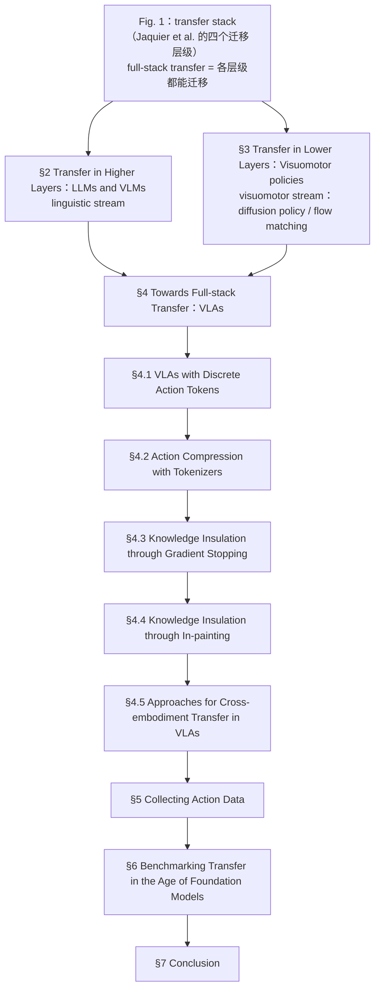

# Are Foundation Models the Route to Full-Stack Transfer in Robotics?（arXiv:2602.22001）

**Are Foundation Models the Route to Full-Stack Transfer in Robotics?**（Freek Stulp, Samuel Bustamante, João Silvério, Alin Albu-Schäffer, Jeannette Bohg, Shuran Song；DLR; Stanford University；[arXiv:2602.22001](https://arxiv.org/abs/2602.22001)，[项目页](https://arxiv.org/abs/2602.22001)）— 从迁移学习视角审视基础模型与 Transformer 如何把机器人推向「全栈迁移」——语言理解到精细电机控制——并讨论数据与评测缺口。

## 一句话定义

从迁移学习视角审视基础模型与 Transformer 如何把机器人推向「全栈迁移」——语言理解到精细电机控制——并讨论数据与评测缺口。

## 英文缩写速查

| 缩写 | 英文全称 | 简要说明 |
|------|----------|----------|
| VLA | Vision-Language-Action | 视觉–语言–动作策略 |
| LLM | Large Language Model | 高层语义与规划接口 |
| VLM | Vision-Language Model | 视觉–语言表征 |
| MP | Movement Primitives | 低层运动原语迁移路线 |

## 为什么重要

VLA 爆发期需要一张「迁移发生在哪一层」的地图，避免把语义泛化误当成动力学泛化。

## 流程总览

图依据：综述章节框架图（论文 §1 末段「The main structure of this article follows Figure 2」、Fig. 1、Fig. 2 与 §2–§7 各章节标题）

## 核心原理（方法）

按抽象层级回顾 LLM/VLM/VLA、运动原语与世界模型；对比 OpenVLA、π₀-FAST、π₀ 等架构；讨论数据收集与 transfer benchmark。

## 实验与评测

定性综述 + 代表性系统案例，非单一基准排行榜。

## 结论

基础模型 alone 不是全栈迁移终点，但会在该路线上保持核心技术地位；可分层迁移与知识绝缘是反复出现的设计原则。

- 统一表征打破语言与电机控制的割裂
- VLA 仍缺深层物理动力学与世界模型闭环
- 数据规模与交互质量制约高动态场景
- RL、世界模型与 VLA 的融合仍是开放题

## 源码运行时序图

**不适用**（截至 2026-08-18：无统一公开可运行代码仓库，或本文为综述/控制器论文以项目页演示为主）。

## 局限与风险

综述性质，不含可复现单一算法；部分系统快速迭代。

## 与其他工作对比

与单篇 VLA 论文不同，提供跨层级迁移概念框架。

## 关联页面

- [vla](../methods/vla.md)
- [diffusion-policy](../methods/diffusion-policy.md)
- [vla-open-source-repro-landscape-2025](../overview/vla-open-source-repro-landscape-2025.md)
- [REALab 14 篇技术地图](../overview/realab-14-papers-technology-map-2026.md)

## 参考来源

- [foundation_models_full_stack_transfer_arxiv_2602_22001.md](../../sources/papers/foundation_models_full_stack_transfer_arxiv_2602_22001.md)
- [wechat_shenlan_realab_14_papers_2026.md](../../sources/blogs/wechat_shenlan_realab_14_papers_2026.md)
- [arXiv PDF](https://arxiv.org/pdf/2602.22001)：已通读 §1 Introduction、§2–§4 的章节结构与 §4.1–§4.5 的论述、§5 Collecting Action Data、§6 Benchmarking、§7 Conclusion（图只用到章节标题与各章定位）

## 推荐继续阅读

- 论文：<https://arxiv.org/abs/2602.22001>
- 项目页：<https://arxiv.org/abs/2602.22001>
