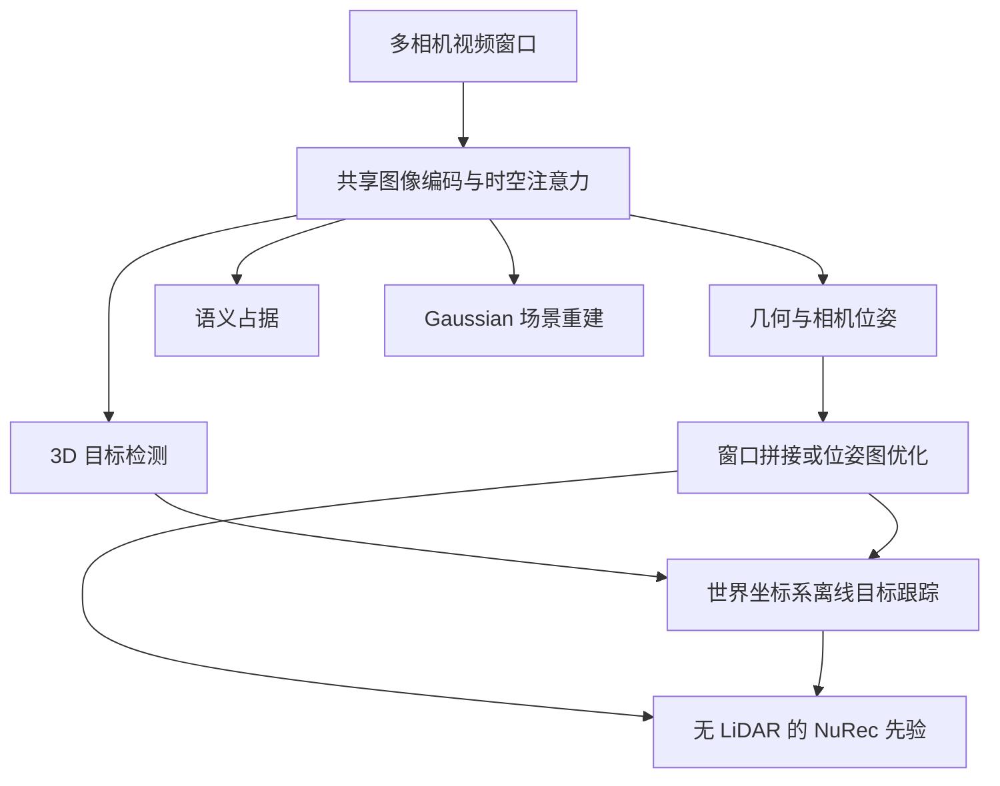

# Foundation4D：迈向自动驾驶车辆的统一感知与重建模型

## 一句话定义

Foundation4D 使用共享视觉骨干从多相机驾驶视频预测几何、3D 目标、语义占据与高斯场景，并在视频级组装轨迹和目标跟踪。

## 英文缩写速查

| 缩写 | 英文全称 | 简要说明 |
|------|----------|----------|
| PGO | Pose Graph Optimization | 通过位姿图约束优化轨迹 |
| BEV | Bird's-Eye View | 俯视表示 |
| ATE | Absolute Trajectory Error | 绝对轨迹误差 |
| mAP | Mean Average Precision | 平均精度均值 |

## 核心信息

| 项 | 内容 |
|----|------|
| 机构 | 英伟达（NVIDIA） |
| 原文 | [arXiv:2610.30340v1](https://arxiv.org/html/2610.30340v1)，2026-10-21 |
| 数据 | [PAI–Foundation4D](https://huggingface.co/datasets/nvidia/PhysicalAI-Autonomous-Vehicles-Foundation4D)，1,253 段驾驶片段 |
| 阅读状态 | 草稿：已核对项目页、摘要和部分方法及实验；全文与附录尚需通读 |

## 流程总览

以下仅概括已核对的论文及项目页主干，详细模块与训练关系待通读复核。

## 方法与数据

- 时空注意力分解跨相机与时间的信息融合；任务解码器共享特征。
- 视频级窗口通过拼接或位姿图优化恢复轨迹；检测结果结合自车轨迹，在统一坐标系进行离线跟踪。
- 标注管线利用 LiDAR 时间聚合、运动补偿与语义信息生成稠密深度和占据标签。模型视觉推理与标签生成使用 LiDAR 是两个不同环节。
- 模型预测的几何与轨迹可为 [NuRec](nvidia-nurec.md) 提供先验；与前馈 [Instant NuRec](paper-instant-nurec.md) 有关联。

## 实验与评测

| 测试 | Foundation4D | 条件 |
|------|-------------|------|
| Waymo 深度 AbsRel | 0.09 | 48 帧窗口，逐窗口尺度对齐；方法间训练数据和几何输入不同 |
| nuScenes 深度 AbsRel | 0.15 | 同上 |
| nuScenes 3D 检测 mAP / NDS | 60.9 / 66.5 | 官方验证集、纯相机、离线 8 关键帧且含未来上下文 |
| OpenOccupancy mIoU / IoU | 18.1 / 27.4 | 16 类、0.2 m 体素，纯相机 |

以上公开基准模型经针对基准的适配，详细配置见论文表 2、7、12；不是同一未微调 checkpoint 在所有任务上的直接结果。项目页称占据展示使用单独微调模型。

## 与其他工作对比

| 维度 | 本页 Foundation4D | [Instant NuRec](paper-instant-nurec.md) | [UniAD](paper-uniad.md) |
|------|-------------------|-----------|-------|
| 输入 | 多相机驾驶视频窗口（视觉推理不依赖 LiDAR） | 标定多相机短日志 + 位姿 + 内参 | 多视角相机 |
| 主要输出 | 几何与位姿、3D 目标、语义占据、Gaussian 场景；视频级轨迹与跟踪 | 分层 3DGS（静 / 动 / 天空 + ISP），供 NuRec / AlpaSim 仿真 | BEV 上 Track / Map / Motion / Occ 与规划轨迹 |
| 优化目标 | 感知与重建多任务共享表示 | 前向重建与渲染质量、策略排序一致性 | 以规划为中心的端到端联合优化 |
| 开放状态 | 论文与数据入口；未列模型代码或权重 | 部分开源（静态 PLY + 天空可跑） | 已开源 |

- **怎么选：** 需要感知结果（检测 / 占据 / 轨迹）并顺带为重建提供先验时看 Foundation4D；目标是快速生成可仿真场景时看 Instant NuRec；需要感知直接服务规划时看 UniAD。
- **读法：** Foundation4D 的基准数值含离线未来帧与逐基准适配，不宜与在线管线的数值直接横比。

## 局限与开放状态

- 截至 2026-11-03，项目页提供论文与数据入口，未列出模型代码或权重。数据文件访问需接受 NVIDIA 许可，使用范围受协议限制。
- 离线未来帧、尺度对齐和基准适配会影响结果解读；不能据此推断在线实时性能。
- 全文、附录和局限部分尚未完成通读，本文为待核查草稿。

## 源码运行时序图

不适用：官方项目页未列出可核实的模型实现入口。

## 结论

Foundation4D 展示了多任务驾驶场景感知与重建共享表示的可行性，实际复现仍需核对模型发布及评测配置。

1. 对比深度指标时保留尺度对齐方式。
2. 评估部署时区分离线窗口与实时输入。
3. 使用数据集前核对许可范围。
4. 补读全文后再确认各模块训练和局限。

## 关联页面

- [Instant NuRec](paper-instant-nurec.md)
- [NVIDIA NuRec](nvidia-nurec.md)
- [机器人视觉感知栈选型闭环](../queries/robot-perception-stack-selection-loop.md) — 本页可归入其 ③ 2D→3D 提升与语义建图层（多相机几何、3D 目标与语义占据）：典型误判是把离线 8 关键帧含未来上下文、逐窗口尺度对齐下的指标当成 ④ 层在线消费时也能拿到的精度与时延。

## 参考来源

- [论文归档](../../sources/papers/foundation4d_arxiv_2610_30340.md)
- [官方项目页归档](../../sources/sites/foundation4d.md)

## 推荐继续阅读

- [论文全文 v1](https://arxiv.org/html/2610.30340v1)
- [NVIDIA 项目页](https://research.nvidia.com/labs/sil/projects/foundation4d/)
