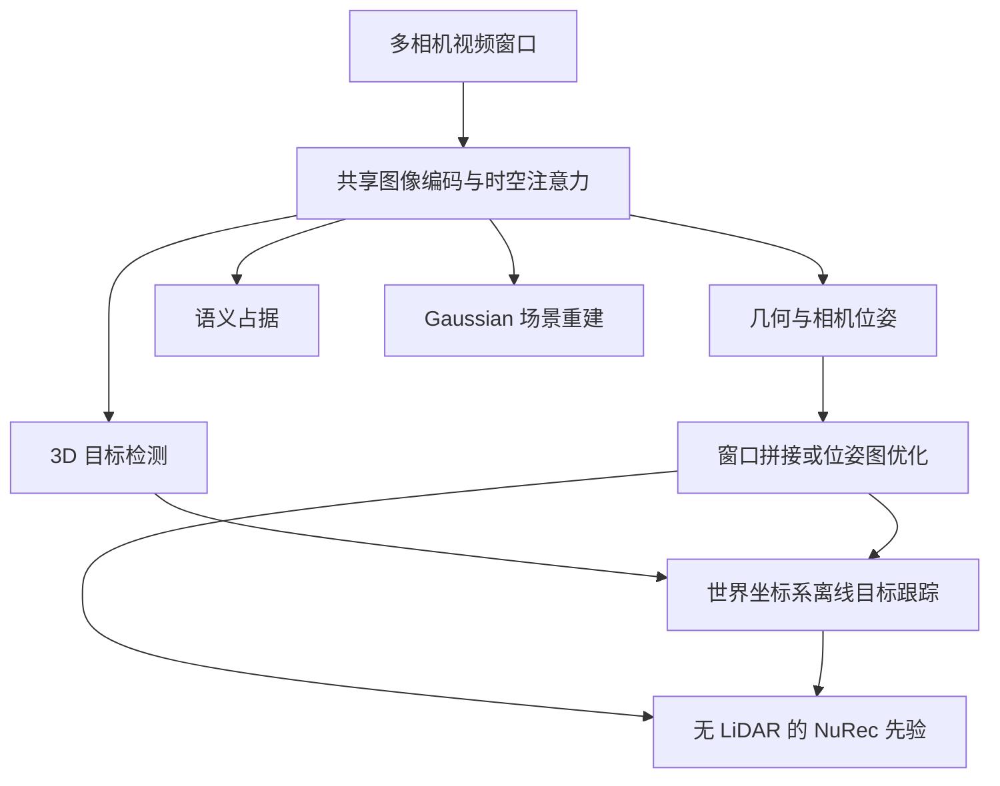

# Foundation4D：迈向自动驾驶车辆的统一感知与重建模型

## 一句话定义

Foundation4D 使用共享视觉骨干从多相机驾驶视频预测几何、3D 目标、语义占据与高斯场景，并在视频级组装轨迹和目标跟踪。

## 英文缩写速查

| 缩写 | 英文全称 | 简要说明 |
|------|----------|----------|
| PGO | Pose Graph Optimization | 把各窗口的相对位姿作为约束，全局求解一条参考相机轨迹 |
| BEV | Bird's-Eye View | 俯视网格；占据分支在 BEV 上做特征，再上采样到体素 |
| AbsRel | Absolute Relative depth error | 深度评测的平均绝对相对误差，越低越好 |
| ATE | Absolute Trajectory Error | 对齐后相机中心的平均误差，用于衡量轨迹精度 |
| mAP | Mean Average Precision | 3D 检测的平均精度均值 |
| NDS | nuScenes Detection Score | nuScenes 综合检测分数，同时考虑框、速度等属性 |
| mIoU | mean Intersection over Union | 语义占据的类别平均交并比 |
| HOTA | Higher Order Tracking Accuracy | 多目标跟踪的综合指标，同时计检测与关联 |
| RTS | Rauch–Tung–Striebel | 带后向平滑的卡尔曼平滑器，用于优化跟踪轨迹 |
| PSNR | Peak Signal-to-Noise Ratio | 高斯重建渲染质量的像素级指标 |

## 核心信息

| 项 | 内容 |
|----|------|
| 机构 | 英伟达（NVIDIA） |
| 原文 | [arXiv:2610.30340v1](https://arxiv.org/html/2610.30340v1)，2026-10-21 |
| 数据 | [PAI–Foundation4D](https://huggingface.co/datasets/nvidia/PhysicalAI-Autonomous-Vehicles-Foundation4D)，1,253 段驾驶片段 |
| 阅读状态 | 已通读论文正文第 1–10 节与附录 A（作者表）；图表依据 PDF 文字层与项目页核对，未逐图目视；参考文献条目未逐条核对 |

## 为什么重要

自动驾驶系统里，深度、3D 目标、占据和场景重建通常由各自的网络单独计算，同一批图像被反复处理。Foundation4D 把这些输出放在一个共享特征上，目的是减少重复计算，并让同一套表示既服务感知，也为仿真重建提供几何与轨迹先验。对想把"感知结果"直接转成"可仿真场景"的团队，它展示了一条不依赖 LiDAR 的路线，但也意味着读者必须分清离线基准数值与在线部署能力。

## 流程总览

以下概括论文第 3、5 节的主干数据流。

## 核心原理

- **输入：** 6 路相机在若干时间步的图像，统一缩放到 1036 × 1036（第 4.3 节）。检测与占据投影还使用已知内参和相机–rig 外参；几何分支的 ego 与 rig 位姿由模型直接预测（第 3.3、3.6、7.1.1 节）。
- **共享骨干：** 每张图经 DINOv2 ViT-L/14 编码（特征宽 1024），再下采样到 37 × 37 网格。聚合器交替做"单图内自注意力"与"同一时刻跨相机"或"同一相机跨时间"的注意力，替代 VGGT 的全局注意力，以降低随窗口长度二次增长的代价（第 3.3 节）。
- **几何输出：** 相机位姿由 rig 变换与 ego 轨迹复合得到，ego 轨迹在各图像采集时刻插值：

$$T_{t,c} = T^{\mathrm{ego}}(\tau_{t,c})\,T^{\mathrm{rig}}_{c}$$

  深度经相机模型反投影为点云，并在窗口参考系内统一表示（第 3.4 节）。
- **检测输出：** 基于 PETR 风格查询、DETR3D 式可变形交叉注意力的解码器，每帧输出 3D 框、类别与平面速度；参考配置为 900 个查询、6 层解码器（第 3.5 节）。
- **占据输出：** 在 0.2 m 体素、BEV 中间特征的基础上，输出二值占据与语义标签；推理时对占据概率阈值化后取最高分语义类（第 3.6 节）。
- **Gaussian 输出：** 每个像素预测一个 Gaussian（中心、颜色、尺度、旋转、不透明度），外加天空立方体贴图；推理时使用模型预测的位姿与轨迹，而非真值（第 3.7 节）。
- **视频级组装：** 两种方式。一是逐窗口用单个 Sim(3) 拼接（第 5.1 节）；二是全局 PGO，先优化旋转再优化平移，并可加入速度变化惩罚的运动先验（第 5.2 节，$\lambda_{\mathrm{motion}}=30$）。之后用卡尔曼滤波、匈牙利匹配与 RTS 平滑把检测关联成轨迹（第 5.3 节）。

## 方法与数据

- **训练数据：** 三个内部驾驶数据集 NRE、PlanNet、MLMCF，约 68k、76k、60k 段片段，平均约 12 s，合计约 695 小时（第 4.1 节）。这些数据为内部数据，论文未公开。
- **训练三阶段：** 先在短窗口上训练编码器、聚合器与几何/检测/占据头；再延长时间窗口并冻结编码器；最后加入 Gaussian 分支，先热身再联合微调（第 4.2 节）。
- **标注管线：** 以 LiDAR 时间聚合（静态点全序列累积，动态点在至多 10 帧的局部窗口内运动补偿）生成深度与占据标签（第 6 节）。这一管线只在训练与评测标注中使用；模型推理的视觉分支不依赖 LiDAR。
- **PAI–Foundation4D：** 在 PAI 数据集的 1,253 个测试片段上提供稠密深度与带速度的语义占据标签，0.1 m 体素，范围 $x\in[-150,150)$ m、$y\in[-100,100)$ m、$z\in[-3,5)$ m（第 6.3 节）。
- **与 NuRec 的衔接：** 模型预测的位姿、稠密几何与轨迹作为 [NuRec](nvidia-nurec.md) 的先验，替代原先依赖 LiDAR 的部分（第 8 节）。与前馈 [Instant NuRec](paper-instant-nurec.md) 相比，两者都用前馈方式得到可渲染场景，但 Foundation4D 同时输出感知结果。

## 工程实践

| 项 | 论文中的设定或数值 | 说明 |
|----|--------------------|------|
| 推理窗口（几何公开基准） | 48 帧窗口，重叠 5 帧 | 与 DVGT-1 对比时采用同一设置（第 7.1.1 节） |
| 推理窗口（PAI 检测） | 32 个时间步，源帧间隔 2 | 评测协议见第 7.2.2 节 |
| 训练速度 | 64 张 H100，4 时间步约 3.8 s/update，8 时间步约 8.3 s/update | 论文报告的训练耗时（第 4.3 节） |
| 显存 | 单张 H100 前向，24 时间步 32.47 GiB，48 时间步 58.41 GiB | 峰值已分配显存，不含数据加载（表 17） |
| 训练周期 | 感知训练约 18 天，Gaussian 与联合微调约 9 天 | 论文第 9 节报告 |
| 关键调参项 | PGO 运动先验 $\lambda_{\mathrm{motion}}=30$；检测 900 查询；占据 BEV 0.2 m | 来自论文正文，未经独立复现 |
| 调试指标 | 轨迹看 ATE、RTE、RRE；深度看 AbsRel、$\delta_{1.25}$；标定看 rig mAA@15；检测与跟踪看 mAP、HOTA | 视频级评测使用每片段一个 Sim(3) 对齐（第 7.1 节） |
| 工作流耗时 | 每片段端到端 NuRec 工作流 16.0 h 降至 3.7 h | 论文自报的整体流程数字，不是单模型消融（表 18） |

**开源状态（已核对）：** 截至 2026-11-06，项目页仅列出论文与 PAI–Foundation4D 数据集的 Hugging Face 入口，未列出模型源码、训练代码或权重；arXiv 摘要页也只有 DOI 与数据入口。因此本页**不适用**源码运行时序图。

## 实验与评测

| 测试 | Foundation4D | 条件 |
|------|-------------|------|
| Waymo 深度 AbsRel / $\delta_{1.25}$ | 0.09 / 91.97% | 官方验证集；48 帧窗口、逐窗口尺度对齐；模型在 NRE 与 Waymo、nuScenes 上微调（表 2） |
| nuScenes 深度 AbsRel / $\delta_{1.25}$ | 0.15 / 86.44% | 同上（表 2） |
| nuScenes 3D 检测 mAP / NDS | 60.9 / 66.5 | 官方验证集、纯相机、离线 8 关键帧且含未来帧；高于 GeoUP-Joint 的 59.2 / 65.3（表 7） |
| OpenOccupancy IoU / mIoU | 27.4 / 18.1 | 16 类、0.2 m 体素，纯相机；高于 SPSC-temporal 的 25.5 / 16.2（表 12） |
| PAI 视频级轨迹 ATE（PGO+LM） | 52.75 cm（对比 VGGT† 拼接 111.12 cm；Foundation4D 拼接 78.06 cm） | 1,253 个 PAI 测试片段，六相机（表 4） |
| PAI 检测（五类平均） | mAP 38.00%，HOTA 34.76% | 全部 12 类为 mAP 29.11%、HOTA 25.66%（第 7.2.2 节） |
| PAI 占据（全 ROI） | IoU 31.5，mIoU 14.1 | 评测在 PAI 测试集上进行，远处区域明显下降（第 7.3.2 节） |
| 高斯重建（内部 99 段） | 总体 PSNR 23.94 dB，对比 Instant NuRec 22.66 dB | Instant NuRec 使用真值 ego 位姿；动态区域 PSNR 为 19.98 dB，低于对比方的 20.01 dB（表 15） |

以上公开基准模型经针对基准的适配，详细配置见论文表 2、7、12。项目页说明：几何与检测使用原始检查点，占据使用单独微调的模型（已核对）。因此这些数字不是同一个未微调 checkpoint 在所有任务上的直接结果。

## 与其他工作对比

| 维度 | 本页 Foundation4D | [Instant NuRec](paper-instant-nurec.md) | [UniAD](paper-uniad.md) |
|------|-------------------|-----------|-------|
| 输入 | 多相机驾驶视频窗口（视觉推理不依赖 LiDAR） | 标定多相机短日志 + 位姿 + 内参 | 多视角相机 |
| 主要输出 | 几何与位姿、3D 目标、语义占据、Gaussian 场景；视频级轨迹与跟踪 | 分层 3DGS（静 / 动 / 天空 + ISP），供 NuRec / AlpaSim 仿真 | BEV 上 Track / Map / Motion / Occ 与规划轨迹 |
| 优化目标 | 感知与重建多任务共享表示 | 前向重建与渲染质量、策略排序一致性 | 以规划为中心的端到端联合优化 |
| 开放状态 | 论文与数据入口；未列模型代码或权重 | 部分开源（静态 PLY + 天空可跑） | 已开源 |

- **怎么选：** 需要感知结果（检测 / 占据 / 轨迹）并顺带为重建提供先验时看 Foundation4D；目标是快速生成可仿真场景时看 Instant NuRec；需要感知直接服务规划时看 UniAD。
- **读法：** Foundation4D 的基准数值含离线未来帧与逐基准适配，不宜与在线管线的数值直接横比。论文自己的消融也显示：任务组合并非越多越好，GEO+OCC 的占据 mIoU（11.82%）高于三任务组合（11.53%）（表 16）。

## 结论

**一句话总判：** Foundation4D 证明了一个共享的多相机视频骨干可以同时支撑几何、检测、占据与重建，但它的收益依赖任务组合与离线视频级组装，部署前必须区分基准数字与在线能力。

1. **共享特征有真实收益但依赖任务组合：** 检测在三任务组合中最好（mAP 42.14%），占据则与几何配对时最好（mIoU 11.82%），不存在对所有任务都最优的组合。
2. **视频级组装影响大：** 在 PAI 片段上，PGO+LM 比逐窗口拼接把 ATE 从 78.06 cm 降到 52.75 cm，选型时应把它视为系统的一部分。
3. **比较深度与检测时要看协议：** 深度用逐窗口尺度对齐，检测用含未来帧的 8 关键帧窗口，与在线方法不可直接横比。
4. **NuRec 先验可替代部分 LiDAR 依赖：** 论文报告工作流耗时从 16.0 h 降至 3.7 h，但这是整体流程的自报数字。
5. **复现门槛高且尚无代码：** 训练数据为内部数据，项目页未列代码或权重，目前只能把论文作为设计参考。

## 局限与风险

- **开放状态：** 截至 2026-11-06，项目页未列出模型代码或权重。PAI–Foundation4D 数据需在 Hugging Face 接受 NVIDIA 数据许可，使用范围受协议限制（许可细节未核实）。
- **训练数据不可复现：** 主模型训练依赖 NRE、PlanNet、MLMCF 三个内部数据集，论文未公开。
- **远距与细结构：** 深度误差随距离增大、在物体边界与细结构处变大；占据在 [50, 100] m 区间 mIoU 降至 6.9（表 13 所示区间值，见第 7.3.2 节）；远处行人与骑行者等小目标也较弱。
- **时序与标定：** 不同相机曝光时刻不同，rig 监督会把固定标定与曝光间的 ego 运动混在一起；插值 ego 轨迹并不能消除这一歧义（第 3.4、9 节）。
- **基准与在线差距：** 离线未来帧、逐窗口尺度对齐、逐基准微调都会抬高基准数字；正文未报告因果、无未来帧设置下的检测或跟踪精度。
- **动态重建：** 论文承认动态区域的新视角外推仍是未来工作，动态 PSNR 与对比方基本持平（第 7.4.2 节）。
- **训练耗时：** 感知训练约 18 天，联合阶段约 9 天，复现与迭代成本高。

## 源码运行时序图

不适用：截至 2026-11-06，官方项目页与 arXiv 摘要页均未列出可核实的模型源码或运行入口，无法绘制基于实际仓库的运行时序图。

## 关联页面

- [Instant NuRec](paper-instant-nurec.md)
- [NVIDIA NuRec](nvidia-nurec.md)
- [机器人视觉感知栈选型闭环](../queries/robot-perception-stack-selection-loop.md) — 本页可归入其 ③ 2D→3D 提升与语义建图层（多相机几何、3D 目标与语义占据）：典型误判是把离线 8 关键帧含未来上下文、逐窗口尺度对齐下的指标当成 ④ 层在线消费时也能拿到的精度与时延。

## 参考来源

- [论文归档](../../sources/papers/foundation4d_arxiv_2610_30340.md)
- [官方项目页归档](../../sources/sites/foundation4d.md)

## 推荐继续阅读

- [论文全文 v1](https://arxiv.org/html/2610.30340v1)
- [NVIDIA 项目页](https://research.nvidia.com/labs/sil/projects/foundation4d/)
