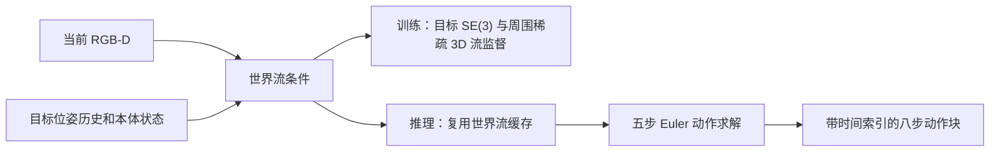
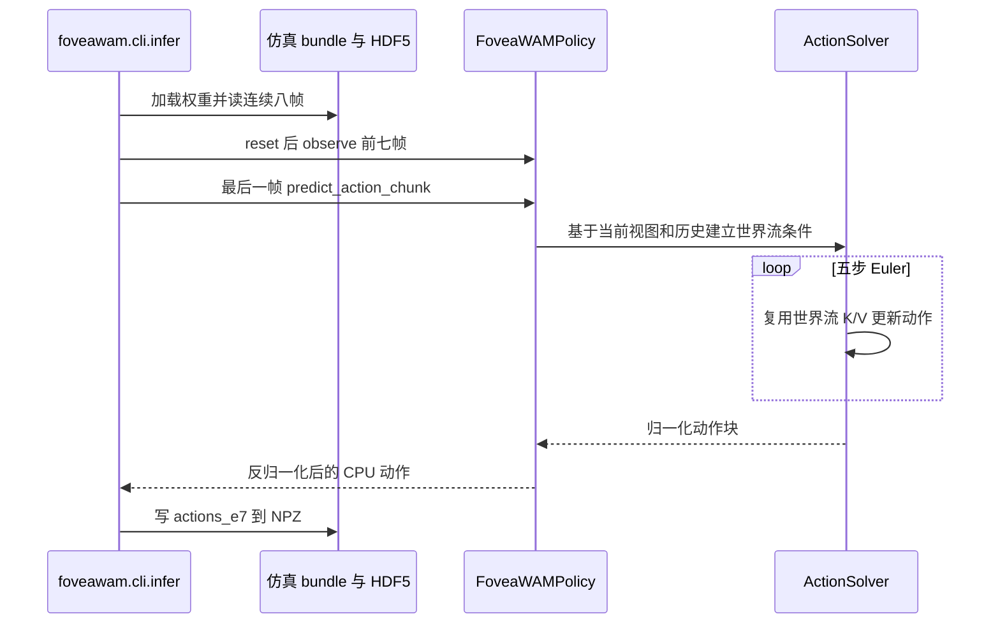

# FoveaWAM：动态操作的角色感知 4D 世界–动作模型 | FoveaWAM: Role-Aware 4D World–Action Modeling for Dynamic Manipulation

## 一句话定义

接触要对准目标物体在执行时的位姿，所以 FoveaWAM 把精细预测留给目标；周围只预测稀疏 3D 流，静态背景沿用当前帧。

## 英文缩写速查

| 缩写 | 全称 | 本页含义 |
|---|---|---|
| WAM | World–Action Model | 学习世界运动表征并生成动作 |
| SE(3) | Special Euclidean Group in 3D | 刚体的旋转和平移 |
| RGB-D | RGB and Depth | 带深度的彩色观测 |
| p95 | 95th percentile | 95% 查询的延迟不超过此值 |

## 为什么重要

只预测目标会漏掉挡路或推动目标的物体；生成整幅未来视频又会增加等待。论文例子中，物体以约 0.9 m/s 运动，200 ms 内已移动 18 cm。评测若在推理时暂停环境，就看不到这类迟到失败。

## 核心原理

以机器人基座为坐标系：单帧 RGB-D 提供静态几何与场景上下文，八个时刻的目标位姿和本体状态进入状态 token；世界流提供动作生成的条件。训练时对上下文监督稀疏 3D 流、对目标监督相对 SE(3) 轨迹。常规部署不解码这两个预测头；世界流仍做一次前向，动作流复用其 K/V 做五步 flow-matching 求解。

## 工程实践

- [仿真代码](https://github.com/ArrebolBlack/FoveaWAM)提供 8×7 末端增量动作示例；位置为米，旋转向量为弧度，另含夹爪命令。目标位姿来自仿真真值或外部追踪，不由 RGB-D 单独推得。
- OnTimeBench Native 在查询期间保持物理推进，继续执行仍有效的旧指令或保持；返回后跳过超过时限的指令。跨设备比较应保留同一测试场景，分别实测时延分布并记录目标位姿来源。
- 真机使用固定相机与在线 FoundationPose 追踪。论文从图像就绪到完整八步动作落到 CPU 的 p95 是 **25.17 ms**，含追踪；**15.1 ms** 是 RTX 5090 上仿真评测相关的首命令查询，不含真实追踪，也不是控制频率。真机执行器为 20 Hz。

### 源码运行时序

静态核对固定源码，未运行 GPU 权重。想实际读取预测轨迹与流时用 `predict_motion`，不能把动作 API 只返回动作理解为训练时没有世界监督。

## 实验与评测

| 协议 | FoveaWAM | 对照 |
|---|---:|---|
| OnTimeBench Native，14 项、1,400 个测试场景 | 82.1% | PUMA 61.4%；论文按未四舍五入结果报 +20.8 个百分点 |
| OnTimeBench 加 150 ms / Paused | 34.1% / 90.3% | 同模型，分别增加延迟与暂停物理，分数不可混用 |
| Flexiv Rizon 4s 真机，六项各 20 次 | 48.3%（58/120） | π0.5 30.8%（37/120），相差 17.5 个百分点 |

真机依次为传送带抓取 70%、移动盒放置 80%、转台抓取 60%、玩具车抓取 35%、截停网球 35%、斜坡小车抓取 10%。对照方法共用示教，但传感输入与初始化不同，真机差距不能只归因于预测结构。

## 与其他工作对比

[Sparse-WAM](./paper-sparse-wam.md)在联合去噪内少算未来视频 token；FoveaWAM 改的是要监督的未来表征和动作接口，不是在视频分支上做相同的剪枝。[DynamicWAM](./paper-rcl-2608-00793-dynamicwam-dual-path-motion-conditioning-for-wor.md)侧重历史光流与运动描述，本工作显式用目标的米制位姿历史。

## 结论

动态抓取要同时评估目标位姿误差与动作到达时间；如果只拿 Paused 成绩或单独比较模型时延，都不足以判断能否抢到正确的接触时机。

## 局限与风险

依赖可靠的目标位姿历史，尤其是遮挡与反光时；粗略场景流在狭窄间隙不一定够。真机仅报告这六项，且最难项仅 2/20。公开模拟 checkpoint 与训练数据不等于真机权重或采集数据已公开。

## 关联页面

- [世界–动作模型](../concepts/world-action-models.md)
- [动作分块](../methods/action-chunking.md)
- [Diffusion Policy](../methods/diffusion-policy.md)
- [机器人操作](../tasks/manipulation.md)

## 参考来源

- [论文原文归档](../../sources/papers/foveawam-arxiv-2611-31705.md)
- [项目页与资源归档](../../sources/sites/foveawam.md)
- [固定源码和许可](../../sources/repos/foveawam.md)

## 推荐继续阅读

- [OnTimeBench 发布仓](https://github.com/ArrebolBlack/OnTimeBench)：先比较 Native、额外延迟与 Paused 的执行差异。
- [论文全文](https://arxiv.org/html/2611.31705v1)：看表 1、4 与附录 B、D，区分仿真和真机。
