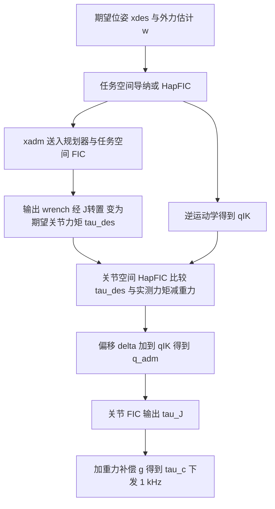

# A Unified Fractal Impedance Control Framework（arXiv:2611.08009）

*A Unified Fractal Impedance Control Framework*（[arXiv:2611.08009](https://arxiv.org/abs/2611.08009)，Sussex / CUHK / Swansea / Edinburgh，2026-11-05 v1）。本页依据论文全文（无附录）整理，数字均来自论文表格或正文。

## 一句话定义

经典阻抗控制的一支：**分形阻抗控制（FIC）用有界、带饱和的非线性力函数让机械臂成为被动的渐近稳定吸引子**；本文把 FIC 的多种架构封装成统一的开源套件，并在真机上实现其「最先进」架构 H-PMP，让同一个控制器在导纳行为（顺从外力）与阻抗行为（保持位置）之间自行过渡（论文摘要、§I、§IV）。

## 英文缩写速查

| 缩写 | 英文全称 | 简要说明 |
|------|----------|----------|
| FIC | Fractal Impedance Control(ler) | 分形阻抗控制，用饱和型非线性力函数实现被动、有界的交互（§IV-A/B） |
| H-PMP | Harmonic-Passive Motion Paradigm | 谐波被动运动范式，任务空间导纳或 HapFIC 嵌套在关节空间 HapFIC 内（§IV-F，图 4） |
| PMP | Passive Motion Paradigm | H-PMP 的前身，模仿人类运动控制（摘要） |
| HapFIC | (Haptic) FIC，力/位置自适应 FIC | 用 FIC 饱和点限制导纳的位置偏移，从而兼具导纳与阻抗（§IV-E；全称论文未展开，缩写含义为推测） |
| LbD | Learning by Demonstration | 示教学习，本文指拖动示教加重放（§V-C） |
| IK | Inverse Kinematics | 逆运动学，论文用 Pinocchio 做 IK（§III、§III-B） |
| MCU | Microcontroller Unit | 微控制器，论文把关节层放到 STM32H5 上（§V-C） |
| RMSE | Root Mean Square Error | 均方根误差，轨迹跟踪的主指标（表 II） |
| ROS2 | Robot Operating System 2 | 套件各组件的通信层（§III） |

## 为什么重要

- 论文动机：机器人进入非结构化场景，学习类方法（示教、生成式 / 智能体 AI）缺鲁棒性与可解释性，作者主张先把交互控制做到有硬性安全保证，再叠加学习（§I，属作者立场，非实验结论）。
- 阻抗与导纳互为对偶且各有短板：阻抗擅长调位置，导纳擅长调交互力（§I）。冗余机器人传统上只能二选一，作者称 FIC 的被动性避免了能量罐等做法的积分漂移（§II，作者论述）。
- 工程价值：此前 FIC 实现分散在各自工作里，本文给出统一库与 GUI（FIC Studio），并附仓库，便于复现（§II、§III，代码 README 已核对结构）。
- 对本 wiki 的位置：是「不靠学习的交互控制」基线参照，与 RL / 模仿学习路线互补；论文本身没有任何学习或 RL 实验。

## 核心原理

整体流程如下（依据 §III–§IV，图 2、图 4）：

要点：

1. **FIC 力函数（式 (1)(2)）**：期望状态附近线性（刚度 K），两侧分别有 n、m 段 tanh 型饱和，力函数平滑且导数有界（Lipschitz）。参数由刚度 K0、断点、饱和力和比例 ρ 描述（§III-A）。
2. **FIC 算法（式 (3)）**：作者称其为临界阻尼 Liénard 方程的算法实现，与 Van der Pol 振子同类；发散阶段用 Γ(x̃)，收敛阶段用以上一次最大误差 x̃_M 构造的回程函数。「渐近稳定、被动」的证明在先前论文 [3] 中，本文未重复。
3. **四个层面的模块（表 I）**：关节 / 笛卡尔空间各有阻抗、带规划器阻抗、导纳、HapFIC 四种模式；姿态用四元数误差 q̃ = q_des ⊗ q*（式 (4)(5)）。FIC 规划器是在粘性场中运动的单位质点，输出受速度 / 位置限幅（式 (6)）。
4. **导纳与 HapFIC（式 (7)）**：ẍ = M⁻¹(dz_b(Γ_d − Γ_c) − μẋ)，用用户设定的虚拟惯量而非物理惯量，因而对奇异点鲁棒（作者论述）。普通导纳偏移累积到关节限位，HapFIC 以 FIC 饱和点封顶偏移。
5. **H-PMP（图 4，式 (8)）**：任务空间层给出 τ_des = Jᵀw，关节空间 HapFIC 把 τ_des 与「实测力矩减重力」比较，产生加到 IK 解上的偏移 δ，再交关节 FIC 出力。

## 实验设置与结果

平台：7 自由度 Kinova Gen3 + Robotiq 2F-85，1 kHz 力矩接口，无力传感器，外力由关节力矩估计（§V，图 1）。对比三种 FIC 架构：带规划器的笛卡尔阻抗、任务空间 HapFIC、笛卡尔阻抗加关节空间 HapFIC。

| 实验 | 指标（H-PMP vs 其他） | 出处 |
|------|----------------------|------|
| A 轨迹跟踪（8 字，A=0.10 m，T=20 s，每种 10 次） | RMSE：H-PMP 7.80 mm；阻抗+关节 HapFIC 12.56；任务空间 HapFIC 21.11；带规划器阻抗 43.19 mm。姿态误差 H-PMP 3.33° 反而高于阻抗+关节 HapFIC 的 1.41° 和带规划器阻抗的 1.94° | §V-A，表 II |
| B 墙面按压（预期最大力 20 N）后突然脱落 | 释放前接触力：阻抗+关节 HapFIC 16.86 N，H-PMP 12.59 N，任务空间 HapFIC 4.59 N；越过墙面最远：68.7 / 23.4 / 36.3 mm | §V-B，表 III |
| C 拖动示教与重放（各示教 1 次） | 重放 RMSE：H-PMP 40.7 mm，任务空间 HapFIC 55.7 mm；扰动下偏离 67 mm（11.3 N）对 132 mm（27.8 N） | §V-C，表 IV |

作者自述的结论是 H-PMP 在阻抗与导纳间取得「平衡折中」，且能在 MCU 上运行（§VI）。

## 工程实践

- **套件结构（§III，图 2，README 已核）**：三部分经 ROS2 通信：FIC Studio（桌面 / 网页 GUI，含拖放调参、Python 实时脚本、动作序列与拖动示教录制、每页急停）、机器人节点（任务层 1 kHz，关节内环通过 UDP / 共享内存，仿真时与 MuJoCo 同步）、C++ FIC 核心库（模板类 ficControl）。
- **机器人接入**：每个供应商一个驱动，只交换关节状态与力矩；新机器人只需驱动加 YAML 配置；硬件链路仅在 Kinova Gen3 与 Franka FR3 上测试（§III-A），README 另列 KUKA iiwa 14 与 Pendulum 仅配置。
- **依赖**：Pinocchio 做运动学（可替换），MuJoCo 做仿真；调好的配置 XML 档在仿真与真机间无需改动即可加载（§III-A，作者论述，未见定量验证）。
- **复现要点**：Docker 版本只支持仿真；真机需供应商驱动。实验被实现为 FIC Studio 的无界面 Python 扩展（§V）。本文未运行代码，复现情况未核实。
- **MCU 部署（§V-C）**：关节层在 STM32H5 上 1 kHz 运行，当前控制环加机器人通信约 100 µs；任务层因依赖 Pinocchio 仍在板载 Linux 上，约 95 Hz 与 MCU 通信。结论中提到 MCU 最大功耗约 400 mW 对比整板 15–17 W（§VI，数据来自引用的厂商资料）。

## 局限

论文自己承认的：

- 关节空间 HapFIC 以位置精度换力矩跟踪，造成 H-PMP 轨迹振荡（§V-A）；触墙时先出现末端脱离的「过补偿」（§V-B）；改进需要动力学模型或在线调参，目前没有（§V-A/B、§VI）。
- 任务层未能放进 MCU（依赖 Pinocchio，§V-C）。
- 未做自适应调参，列为后续工作（§VI）。

我看到的未验证之处（判断，非作者自述）：

- 统计量很小：墙面实验每控制器 2 次（任务空间 HapFIC 仅 1 次），示教实验每设置 1 次且各设置的推力与示教速度不同（H-PMP 11.3 N，基线 27.8 N，MCU 版 51.3 N；示教速度 144 / 150 / 75 mm/s），表 IV 的柔顺度不可直接比较。「H-PMP 优于」在示教上主要靠重放 RMSE 一项，作者的 6.0 与 4.8 mm/N 柔顺度实际是基线更低。
- 对比对象仅限同一作者团队的 FIC 变体，没有与非 FIC 的主流阻抗 / 导纳 / 统一力-阻抗控制（如文中 [6]、[7]）或能量罐方法做同平台对比。
- 轨迹跟踪里 H-PMP 的姿态误差不是最优，且文中称轨迹「较不平滑」。
- 摘要说「无计算开销」切换模式，正文没有对应的计时实验（仅有 MCU 上约 100 µs 的陈述）。
- 论文把「硬性安全保证」当作 FIC 的已知性质（引用 [3]）；本文实验只展示了所测场景的行为，不能当作普遍安全保证，尤其没有人体接触或故障注入测试。
- 外力来自关节力矩估计，没有独立力传感器作真值，接触力数值的准确度未验证。

## 关联页面

- [阻抗控制（Impedance Control）](../concepts/impedance-control.md)
- [导纳控制（Admittance Control）](../methods/admittance-control.md)
- [接触丰富操作](../concepts/contact-rich-manipulation.md)
- [安全滤波器](../concepts/safety-filter.md)
- [模仿学习](../methods/imitation-learning.md)
- [Kinova Gen3](../entities/kinova-gen3.md)
- [MuJoCo](../entities/mujoco.md)
- [Pinocchio](../entities/pinocchio.md)
- [ros2_control](../entities/ros2-control.md)

## 参考来源

- [fractal-impedance-control-framework_arxiv_2611_08009.md](../../sources/papers/fractal-impedance-control-framework_arxiv_2611_08009.md)
- [arXiv:2611.08009](https://arxiv.org/abs/2611.08009)
- [FIC_Interface 仓库](https://github.com/TRL-Sussex/FIC_Interface)

## 推荐继续阅读

- [阻抗控制](../concepts/impedance-control.md)：从经典阻抗 / 导纳的对偶关系读起。
- [导纳控制](../methods/admittance-control.md)
- [arXiv PDF](https://arxiv.org/pdf/2611.08009v1)
