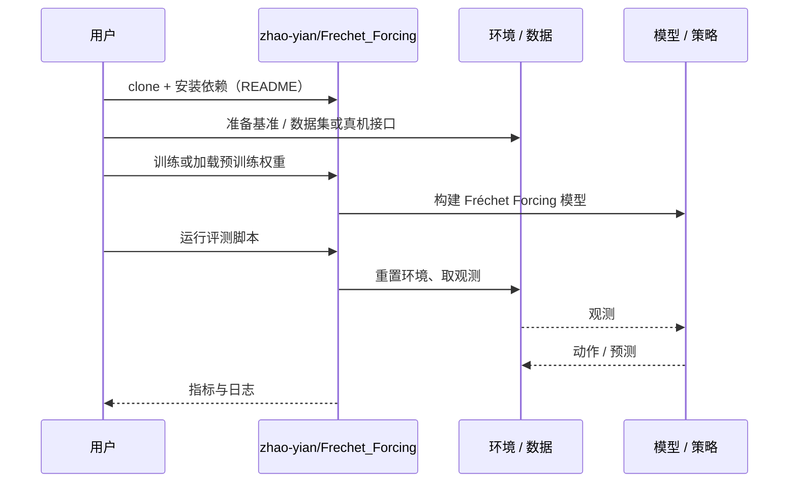

# Fréchet Forcing（arXiv:2610.25666）

**Fréchet Forcing**（*Fréchet Forcing: Training Long-Horizon Streaming World Models from Short Clips*，[arXiv:2610.25666](https://arxiv.org/abs/2610.25666)，[项目页](https://zhao-yian.github.io/Frechet_Forcing)，[代码](https://github.com/zhao-yian/Frechet_Forcing)）来自 [具身智能小站 2026-11-01 盘点](../../sources/blogs/wechat_embodied_station_56_papers_libero_dynamic_latency_eval_2026-11-01.md)，属「世界模型与在线适配」组。

## 一句话定义

**Fréchet Forcing用真实短片段的统计约束自生成历史，无需额外教师或长视频；两类视频世界模型实验显示漂移减轻，但不等于长期物理一致性。**

## 英文缩写速查

| 缩写 | 英文全称 | 简要说明 |
|------|----------|----------|
| Fréchet Forcing | Fréchet Forcing: Training Long-Horizon Streaming World Models from Short Clips | 本文方法 / 基准的简称 |

## 为什么重要

- 短视频训练，减轻长滚动漂移。
- 开源结论：**已开源**（步骤 2.5，2026-11-01）。仓库可达（git ls-remote）。项目页 HTTP 200。
- 同期同组工作见 [动态评测、技能编译与环境潜变量适配：具身智能小站 11-01 期 56 篇阅读坐标](../overview/embodied-station-2026-11-01-56-papers-technology-map.md)。

## 核心机制

| 项 | 内容 |
|----|------|
| **arXiv** | [2610.25666](https://arxiv.org/abs/2610.25666) |
| **开源** | **已开源** |
| **要点** | Fréchet Forcing用真实短片段的统计约束自生成历史，无需额外教师或长视频；两类视频世界模型实验显示漂移减轻，但不等于长期物理一致性。 |
| **文内指标** | 公众号未给具体数字，本页不引用。 |

## 源码运行时序图

以下为按仓库入口（`zhao-yian/Frechet_Forcing`）推断的通用运行链路；入库日仅核实仓库可达，未逐文件阅读，具体脚本名以 README 为准。

## 实验与评测

- 公众号未给具体数字，本页不引用。
- **读法：** 本页为索引级摘要，依据公众号转述的官方摘要与仓库信息整理；逐项数字与 baseline 以原文 PDF 为准。

## 与其他工作对比

- 横向索引见 [动态评测、技能编译与环境潜变量适配：具身智能小站 11-01 期 56 篇阅读坐标](../overview/embodied-station-2026-11-01-56-papers-technology-map.md)；同 arXiv 不重复造页。

## 结论

**短视频训练，减轻长滚动漂移：Fréchet Forcing用真实短片段的统计约束自生成历史，无需额外教师或长视频；两类视频世界模型实验显示漂移减轻，但不等于长期物理一致性。**

1. 开源边界：**已开源** — 仓库可达（git ls-remote）。项目页 HTTP 200。
2. 核心机制：Fréchet Forcing用真实短片段的统计约束自生成历史，无需额外教师或长视频；两类视频世界模型实验显示漂移减轻，但不等于长期物理一致性。
3. 复现与选型前核对任务协议、硬件与基准口径，勿直接横比公众号摘录数字。

## 关联页面

- [world-action-models](../concepts/world-action-models.md)
- [generative-world-models](../methods/generative-world-models.md)
- [vla](../methods/vla.md)
- [embodied-station-2026-11-01-56-papers-technology-map](../overview/embodied-station-2026-11-01-56-papers-technology-map.md)

## 参考来源

- [frechet_forcing_arxiv_2610_25666.md](../../sources/papers/frechet_forcing_arxiv_2610_25666.md)
- [wechat_embodied_station_56_papers_libero_dynamic_latency_eval_2026-11-01.md](../../sources/blogs/wechat_embodied_station_56_papers_libero_dynamic_latency_eval_2026-11-01.md)
- [arXiv:2610.25666](https://arxiv.org/abs/2610.25666)

## 推荐继续阅读

- [arXiv PDF](https://arxiv.org/pdf/2610.25666)
- [项目页](https://zhao-yian.github.io/Frechet_Forcing)
- [https://github.com/zhao-yian/Frechet_Forcing](https://github.com/zhao-yian/Frechet_Forcing)
