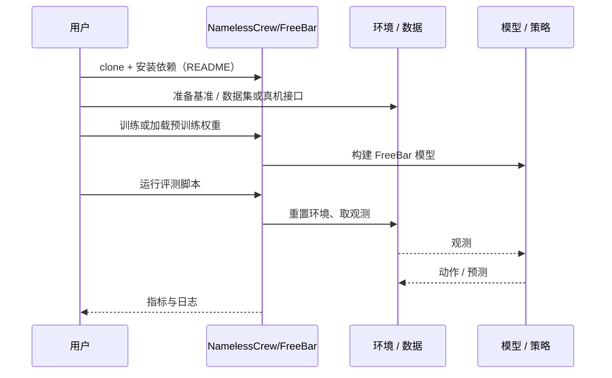

# FreeBar（arXiv:2610.14997）

**FreeBar**（*Barrier-Constrained Guidance For Real-time Asynchronous VLA Execution*，[arXiv:2610.14997](https://arxiv.org/abs/2610.14997)，[代码](https://github.com/NamelessCrew/FreeBar)）来自 [具身智能小站 2026-10-14 盘点](../../sources/blogs/wechat_embodied_station_41_papers_streamingwam_2026-10-14.md)，属「VLA 与动作生成」组。

## 一句话定义

**推理期用障碍约束引导对齐异步 VLA 的动作块边界：已承诺前缀严格约束、近未来柔性衔接、远未来保留自由度。**

## 英文缩写速查

| 缩写 | 英文全称 | 简要说明 |
|------|----------|----------|
| VLA | Vision-Language-Action | 视觉–语言–动作策略 |
| CBF | Control Barrier Function | 障碍函数约束 |
| FM | Flow Matching | 流匹配生成 |

## 为什么重要

- 异步执行时新动作块必须接上机器人正在执行的旧动作；硬拼接或全局约束都会牺牲远期调整空间。
- 开源结论：**已开源**（步骤 2.5，2026-10-14）。仓库可达；复现需另备策略检查点与场景资产。
- 同期同组工作见 [流式动作块与世界模型记忆：具身智能小站 10-14 期 41 篇阅读坐标](../overview/embodied-station-2026-10-14-41-papers-technology-map.md)。

## 核心机制

| 项 | 内容 |
|----|------|
| **arXiv** | [2610.14997](https://arxiv.org/abs/2610.14997) |
| **开源** | **已开源** |
| **要点** | 按时间分区施加一致性约束，用 barrier 形式在采样过程中引导流匹配策略，不改训练；仿真与真机报告改善。 |
| **文内指标** | 作者在仿真与真机报告改善；具体数字以原文为准。 |

## 源码运行时序图

以下为按仓库入口（`NamelessCrew/FreeBar`）推断的通用运行链路；入库日仅核实仓库可达，未逐文件阅读，具体脚本名以 README 为准。

## 实验与评测

- 作者在仿真与真机报告改善；具体数字以原文为准。
- **读法：** 本页为索引级摘要，依据公众号转述的官方摘要与仓库信息整理；逐项数字与 baseline 以原文 PDF 为准。

## 与其他工作对比

- 横向索引见 [流式动作块与世界模型记忆：具身智能小站 10-14 期 41 篇阅读坐标](../overview/embodied-station-2026-10-14-41-papers-technology-map.md)；同 arXiv 不重复造页。

## 结论

**分区对齐是异步动作块执行的通用配方：约束强度随时间衰减，比整块硬约束更保留策略原有能力。**

1. 开源边界：**已开源** — 仓库可达；复现需另备策略检查点与场景资产。
2. 核心机制：按时间分区施加一致性约束，用 barrier 形式在采样过程中引导流匹配策略，不改训练；仿真与真机报告改善。
3. 复现与选型前核对任务协议、硬件与基准口径，勿直接横比公众号摘录数字。

## 关联页面

- [vla](../methods/vla.md)
- [flow-matching-embodied-policy](../concepts/flow-matching-embodied-policy.md)
- [action-chunking](../methods/action-chunking.md)
- [paper-streamingwam](./paper-streamingwam.md)
- [embodied-station-2026-10-14-41-papers-technology-map](../overview/embodied-station-2026-10-14-41-papers-technology-map.md)

## 参考来源

- [freebar_barrier_guidance_async_vla_arxiv_2610_14997.md](../../sources/papers/freebar_barrier_guidance_async_vla_arxiv_2610_14997.md)
- [wechat_embodied_station_41_papers_streamingwam_2026-10-14.md](../../sources/blogs/wechat_embodied_station_41_papers_streamingwam_2026-10-14.md)
- [arXiv:2610.14997](https://arxiv.org/abs/2610.14997)

## 推荐继续阅读

- [arXiv PDF](https://arxiv.org/pdf/2610.14997)
- [https://github.com/NamelessCrew/FreeBar](https://github.com/NamelessCrew/FreeBar)
