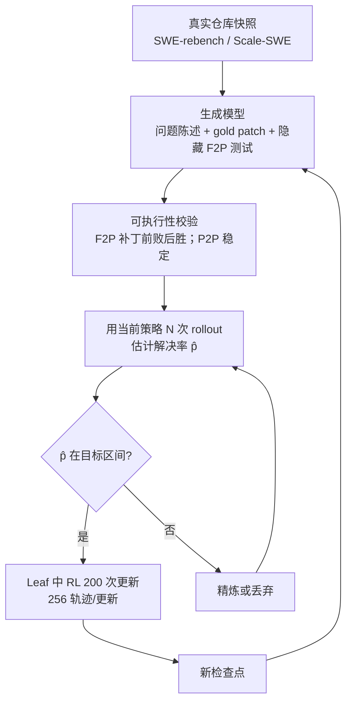
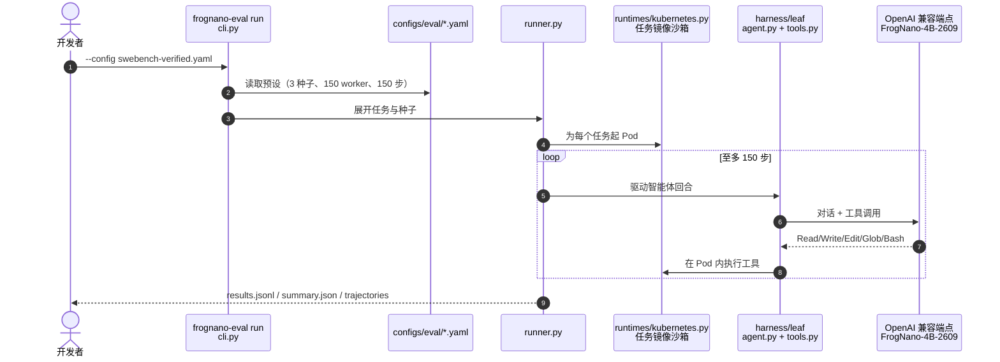

# FrogNano：用在线任务合成训练 4B 编码智能体

**FrogNano**（[arXiv:2609.07925](https://arxiv.org/abs/2609.07925)，Microsoft Research Montréal 的 Froggy 团队；[项目页](https://microsoft.github.io/debug-gym/#frognano)、[代码](https://github.com/microsoft/FrogNano)）以 Qwen3.5-4B 为基座，只做基于合成任务的 RL 后训练，不使用大模型教师的蒸馏轨迹，面向最小硬件上的仓库级编码智能体。

## 一句话定义

**一个 4B 编码智能体：由 TaskPilot 每轮按当前检查点的解决率把合成任务校准到“勉强可解”区间，再在 Leaf 框架里做 RL，不蒸馏前沿模型。**

## 英文缩写速查

| 缩写 | 英文全称 | 简要说明 |
|------|----------|----------|
| RL | Reinforcement Learning | 唯一的后训练手段 |
| DPPO | （论文使用的 PPO 类策略优化变体，全称原文读到的部分未给） | 组内相对优势 + 非对称重要性采样掩码，无 KL/熵项 |
| F2P / P2P | Fail-to-Pass / Pass-to-Pass tests | 补丁前失败后通过 / 前后都应通过的测试，用于校验任务可执行性 |
| SWE-bench | Software Engineering benchmark | 真实 GitHub issue 修复基准（Verified、Pro 两个子集） |
| TaskPilot | Online task synthesis pipeline | 从仓库快照合成并校准任务的流水线 |
| Leaf | Lightweight agent harness | 带五个类型化工具的轻量框架 |

## 为什么重要

- **去掉教师依赖：** 小模型常靠前沿模型轨迹蒸馏；论文给出不经教师也能到有竞争力水平的证据，利于本地与资源受限部署。
- **投资点在任务生成器：** 论文主张“在智能体当前可学习性边缘生成任务”是关键，而不是合成数据量。
- **有可运行评测栈：** Leaf 与 4 个基准预设公开，可复算同口径评测。

## 方法栈 / 流程总览

## 方法

- **TaskPilot：** 迭代 1–4 的目标是 p̂=0.5；修订后的迭代 5 改为 0<p̂≤0.5，并换用更强的生成模型。每轮约生成 300 个合成任务；基线混合约 1500 个任务。
- **Leaf 框架：** 五个类型化工具 Read / Write / Edit / Glob / Bash（模式取自 Claude Code 工具子集）；无工具调用的回复结束回合；推理、答案文本、工具调用计入损失，任务提示与工具输出被掩码。
- **RL：** 组内（8 条轨迹）标准化优势，方差为零的组丢弃；非对称重要性采样掩码（Δp>0.2 时丢正优势 token，Δp<−0.2 时丢非正优势 token）；无 KL、熵奖励、参考模型。每次迭代 200 次更新、每次 32 组×8 = 256 条轨迹；单节点 8×B200（2 卡训练，6 卡 SGLang 推理）。
- **奖励：** 测试通过二值奖励 + 成功门控的对数长度惩罚；截断但正确得 0.5，失败 0。N、α、学习率等在已读部分未给出（附录后半未读到）。

## 实验与评测

- **评测设置：** Leaf、150 步、131K 上下文、temperature 0.6、3 个种子平均。
- **SWE-bench Verified 随 TaskPilot 迭代：** 39.4% → 49.1% → 53.1% → 56.7% → 59.1% → 61.5%；对照：同口径约 300 个真实 SWE-rebench 任务（按 4B 可学习性过滤）为 48.0%。
- **留出集：** SWE-bench Pro 37.6%，Terminal-Bench v2 31.1%，PatchEval-Verified 47.3%；论文称可比肩 32B–100B+ 模型，但已读部分没有完整对比表，具体对手与数字原文未核实。
- **框架依赖：** Qwen3.5-4B 在 R2E-Gym 框架 8.3%、在 Leaf 37.2%；MiniMax-M2.5 两者均 66.5%。未见过的 mini-SWE-agent 框架上 43.8%→56.4%。
- **推理期选择与整合：** 3 候选时循环赛验证器 62.8%、单次验证 61.4%、随机 61.53%；多工具调用强化使平均步数 53.5→36.6；一版整合达 62.3%（pass@3 72.3%）。上下文压缩下 64K 预算可恢复 131K 的表现。
- **奖励破解：** 约 21.3% 轨迹被正则标记，2.5% 经 LLM 判官确认为破解尝试，均被脚手架阻止，FrogNano 无靠破解得分。
- **校准 vs 数量：** 已读文本中没有单独变动二者的受控消融，“校准优于数量”是论文论断而非被量化的结论。

## 源码运行时序图

官方仓库 [microsoft/FrogNano](https://github.com/microsoft/FrogNano)（浅克隆核查）只含 Leaf 与评测工具，入口为 `frognano-eval`（`frognano/cli.py`）：

- TaskPilot 与 RL 训练代码未在仓库中，故时序图只覆盖评测。

## 工程实践

| 项 | 建议 |
|----|------|
| 运行评测 | Python ≥3.12、Kubernetes 集群权限、OpenAI 兼容端点；Qwen3.5 + SGLang 用 `--reasoning-parser qwen3`、`--tool-call-parser qwen3_coder` |
| 对齐分数 | 检查点、分词器、服务配置、任务镜像、协议需一致（仅 SWE-bench Verified 有镜像摘要锁） |
| 任务校准 | 每轮用当前检查点重新估计 p̂，再筛任务 |
| 安全 | 论文建议隔离环境、受限凭据、人工审查补丁 |

## 与机器人学习的关系

无直接关系；“按学习者当前能力在线校准任务难度”与机器人 RL 中的自动课程（见 [课程学习](../concepts/curriculum-learning.md)）思路同类，但本文只在编码任务上验证。

## 结论

**对小编码智能体，把合成任务始终调到“勉强可解”并做 RL，可以不靠教师蒸馏就把 SWE-bench Verified 提到 61.5%。**

1. 逐轮用当前检查点估计解决率并筛任务，比一次性堆数据更值得投入。
2. 迭代 5 改成 0<p̂≤0.5 并换更强生成器，是后期继续提升的一环。
3. 框架适配影响很大：同一 4B 基座在 R2E-Gym 与 Leaf 上 8.3% 对 37.2%。
4. 评测要求环境对齐，论文数字不等于任意环境复现。
5. 奖励要防破解：约 2.5% 轨迹被确认为破解尝试。
6. 评测覆盖英文、偏 Python 任务，别外推到其他语言。

## 局限与风险

- 仅测英文、偏 Python 仓库；其他语言、模糊需求、无可靠测试的项目未验证。
- 奖励与评测依赖测试，通过的补丁仍可能错误或不安全。
- 未测其他工具接口、提示和预算；“校准优于数量”无受控消融。
- 版本已到 v5（2026-10-05），数字可能随修订变化，引用时对版本。
- **开源状态：** 已核查——[项目页](../../sources/sites/frognano.md)、[GitHub microsoft/FrogNano](../../sources/repos/frognano.md)（MIT，Leaf + 评测）与 Hugging Face 权重 `microsoft/FrogNano-4B-2609` 均可访问；TaskPilot、RL 训练代码与合成数据集截至 2026-10-12 未发现。

## 与其他工作对比

| 对照 | 差异读法 |
|------|----------|
| 蒸馏型小编码智能体 | 依赖前沿教师轨迹；FrogNano 不用教师解题轨迹 |
| [GRPO](../methods/grpo.md) | 同为组内相对优势思路；FrogNano 用 DPPO 变体与非对称掩码 |
| [Procedural Graphs](paper-procedural-graphs-self-evolving-llm-agents.md) | 同期周报论文：改外部结构 vs 改模型权重 |
| [EmbodiedSWE](paper-embodiedswe.md) | wiki 内涉及软件工程智能体的另一页，可对照 SWE 任务设定 |

## 关联页面

- [WaytoAGI 本周顶级 AI 论文技术地图](../overview/waytoagi-top-ai-papers-2026-09-07-09-13-technology-map.md)
- [智能体编码软件基础](../concepts/agentic-coding-software-fundamentals.md)
- [AI 智能体评测](../concepts/ai-agent-evaluation.md)
- [课程学习](../concepts/curriculum-learning.md)
- [GRPO](../methods/grpo.md)

## 参考来源

- [frognano_arxiv_2609_07925.md](../../sources/papers/frognano_arxiv_2609_07925.md) — 论文摘录
- [frognano.md（站点）](../../sources/sites/frognano.md) — 项目页核查
- [frognano.md（仓库）](../../sources/repos/frognano.md) — GitHub 核查
- [WaytoAGI 周报归档](../../sources/blogs/waytoagi_feishu_top_ai_papers_2026-09-07-09-13.md) — 线索来源
- [arXiv:2609.07925](https://arxiv.org/abs/2609.07925)

## 推荐继续阅读

- [FrogNano GitHub](https://github.com/microsoft/FrogNano)
- [FrogNano-4B-2609 权重](https://huggingface.co/microsoft/FrogNano-4B-2609)
- [项目页](https://microsoft.github.io/debug-gym/#frognano)
