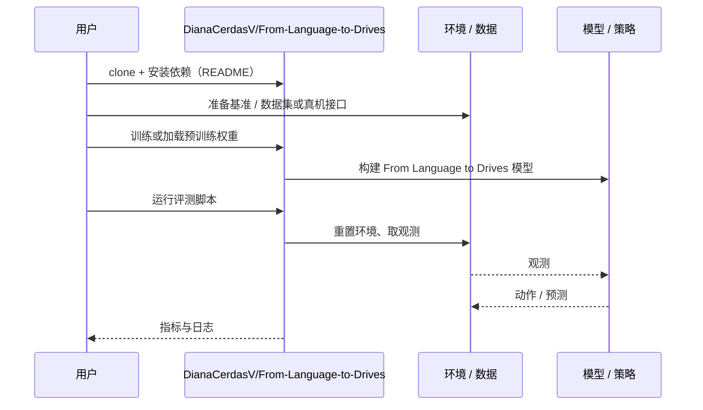

# From Language to Drives（arXiv:2610.35629）

**From Language to Drives**（*From Language to Drives: A Multimodal Framework for Aligning Autonomous Robots with Human Purposes*，[arXiv:2610.35629](https://arxiv.org/abs/2610.35629)，[代码](https://github.com/DianaCerdasV/From-Language-to-Drives)）来自 [具身智能小站 2026-10-28 盘点](../../sources/blogs/wechat_embodied_station_59_papers_human_video_to_robot_experience_2026-10-28.md)，属「VLA 与策略后训练」组。

## 一句话定义

**通过语义对齐、任务生成和驱动力建模，把自然语言目标嵌入自主学习架构。**

## 英文缩写速查

| 缩写 | 英文全称 | 简要说明 |
|------|----------|----------|
| From Language to Drives | From Language to Drives: A Multimodal Framework for Aligning Autonomous Robots with Human Purposes | 本文方法 / 基准的简称 |

## 为什么重要

- 把人的目的转为机器人的驱动力。语言与视觉语言模型构成反馈环，在仿真和实体机器人上检验任务与用户意图的对应。
- 开源结论：**已开源**（步骤 2.5，2026-10-28）。仓库可达（git ls-remote）。
- 同期同组工作见 [潜在动作、免渲染事件仿真与机器人评测：具身智能小站 10-28 期 59 篇阅读坐标](../overview/embodied-station-2026-10-28-59-papers-technology-map.md)。

## 核心机制

| 项 | 内容 |
|----|------|
| **arXiv** | [2610.35629](https://arxiv.org/abs/2610.35629) |
| **开源** | **已开源** |
| **要点** | 通过语义对齐、任务生成和驱动力建模，把自然语言目标嵌入自主学习架构。 |
| **文内指标** | 公众号转述：语言与视觉语言模型构成反馈环，在仿真和实体机器人上检验任务与用户意图的对应。 |

## 源码运行时序图

以下为按仓库入口（`DianaCerdasV/From-Language-to-Drives`）推断的通用运行链路；入库日仅核实仓库可达，未逐文件阅读，具体脚本名以 README 为准。

## 实验与评测

- 公众号转述：语言与视觉语言模型构成反馈环，在仿真和实体机器人上检验任务与用户意图的对应。
- **读法：** 本页为索引级摘要，依据公众号转述的官方摘要与仓库信息整理；逐项数字与 baseline 以原文 PDF 为准。

## 与其他工作对比

- 横向索引见 [潜在动作、免渲染事件仿真与机器人评测：具身智能小站 10-28 期 59 篇阅读坐标](../overview/embodied-station-2026-10-28-59-papers-technology-map.md)；同 arXiv 不重复造页。

## 结论

**把人的目的转为机器人的驱动力：语言与视觉语言模型构成反馈环，在仿真和实体机器人上检验任务与用户意图的对应。**

1. 开源边界：**已开源** — 仓库可达（git ls-remote）。
2. 核心机制：通过语义对齐、任务生成和驱动力建模，把自然语言目标嵌入自主学习架构。
3. 复现与选型前核对任务协议、硬件与基准口径，勿直接横比公众号摘录数字。

## 关联页面

- [vla](../methods/vla.md)
- [imitation-learning](../methods/imitation-learning.md)
- [reinforcement-learning](../methods/reinforcement-learning.md)
- [llm-robotics-control-interfaces](../concepts/llm-robotics-control-interfaces.md)
- [embodied-station-2026-10-28-59-papers-technology-map](../overview/embodied-station-2026-10-28-59-papers-technology-map.md)

## 参考来源

- [from_language_to_drives_arxiv_2610_35629.md](../../sources/papers/from_language_to_drives_arxiv_2610_35629.md)
- [wechat_embodied_station_59_papers_human_video_to_robot_experience_2026-10-28.md](../../sources/blogs/wechat_embodied_station_59_papers_human_video_to_robot_experience_2026-10-28.md)
- [arXiv:2610.35629](https://arxiv.org/abs/2610.35629)

## 推荐继续阅读

- [arXiv PDF](https://arxiv.org/pdf/2610.35629)
- [https://github.com/DianaCerdasV/From-Language-to-Drives](https://github.com/DianaCerdasV/From-Language-to-Drives)
