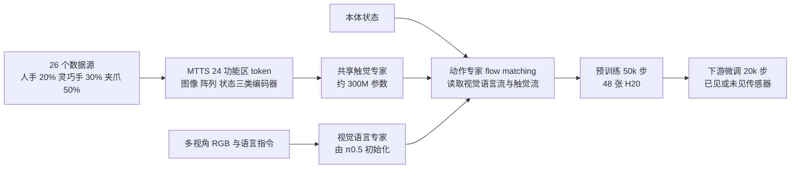
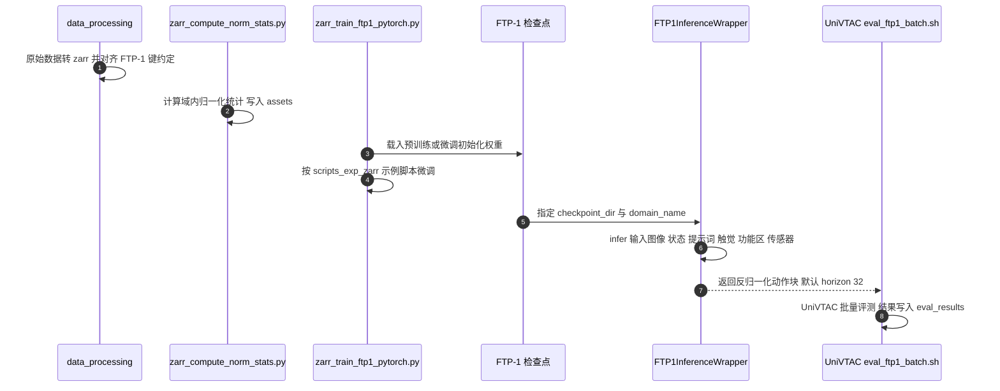

# FTP-1：跨触觉传感器的通用基础触觉策略

**FTP-1**（*FTP-1: A Generalist Foundation Tactile Policy Across Tactile Sensors for Contact-Rich Manipulation*，[arXiv:2606.13102](https://arxiv.org/abs/2606.13102)，[项目页](https://ftp1-policy.github.io/)）由清华大学、Sharpa、上海交通大学、加州大学伯克利分校、苏黎世联邦理工学院（ETH Zurich）、复旦大学、上海期智研究院、上海创智学院等机构的 17 位作者完成（机构取自论文 PDF 与项目页）。它要回答的问题是：视觉有 π0.5 这样可直接微调的基础策略，触觉能不能也有一个，让换传感器、换机器人时不必从头训练？

## 一句话定义

**FTP-1 = π0.5 的视觉语言专家与动作专家 + 一个跨传感器共享的独立触觉专家：先用 MTTS 把图像、阵列、状态三类异构触觉编码成同一套功能区 token，再在约 3000 小时异构数据上预训练，供下游微调到已见与未见传感器。**

## 英文缩写速查

| 缩写 | 英文全称 | 简要说明 |
|------|----------|----------|
| FTP-1 | Foundation Tactile Policy | 本文跨传感器通用触觉基础策略 |
| MTTS | Morphology-Aware Tactile Token Space | 形态感知触觉 token 空间：24 个功能区、每区一个 token，是跨传感器的统一接口 |
| VLA | Vision-Language-Action | 视觉-语言-动作模型；FTP-1 基于 π0.5 这类多专家 VLA |
| VTLA | Vision-Tactile-Language-Action | 在 VLA 上再加触觉的模型族；Tactile-VLA、OmniVTLA 属此类 |
| UAS / FAAS | Unified Action Space / Function–Actuator–Aligned Space | 定长稀疏统一动作向量；手部关节按功能对齐到同一槽位（沿用 UniDex 的 FAAS） |
| NTP-1 | No-Tactile-Pretraining（微调时接入触觉结构） | 消融对照：同数据、同优化设置但预训练不含触觉 |
| T3 | Transferable Tactile Transformers | 图像类触觉的共享预训练主干，FTP-1 以其权重初始化 |
| AdaRMS | Adaptive RMSNorm | 把本体状态以自适应归一化注入注意力块的方式 |
| UniVTAC | A Unified Simulation Platform for Visuo-Tactile Manipulation Data Generation, Learning, and Benchmarking | 本文仿真评测基准，取其 8 个任务中的 6 个接触丰富任务 |

## 为什么重要

- **触觉策略长期是定制品。** 论文称现有触觉策略绑定固定传感器、本体与任务；一个 GelSight 图像、一个 Contactile 阵列和一个六维力矩读数都编码「触」，但格式、分辨率、形态互不兼容，所以经验难以跨系统累积。
- **朴素加触觉并不稳赚。** 论文自己的真机表里，把触觉 token 注入视觉语言专家的 Tactile-VLA 平均 35.8%，低于不带触觉的 π0.5 的 45.3%；作者推测触觉输入若没有合适的融合方式会干扰视觉语言感知。
- **给触觉一个「共同起点」。** 论文把 FTP-1 定位为统一的基础基线（foundation baseline）：后续触觉策略可以从共享检查点微调，而非各自从头训练。
- **与 Sharpa 叙事的位置（文章转述）。** 微信文章把 FTP-1 作为「触觉是跨本体锚点」判断的最直接验证：拿杯子要用多大力，与用人手、机械手还是夹爪无关，这类信息主要来自触觉。文章同时把 EgoScale、T-Rex 并入同一主线，但它们走的是「第一视角人类数据 + 成对人机中期训练」另一条路。

## 核心信息

| 项 | 内容 |
|----|------|
| **机构** | 清华大学、上海期智研究院、Sharpa（夏帕机器人）、上海交通大学、加州大学伯克利分校、苏黎世联邦理工学院、复旦大学、上海创智学院 |
| **arXiv** | [2606.13102](https://arxiv.org/abs/2606.13102)，v1 2026-06-11；最新 v3 2026-10-13（页脚 CoRL 2026） |
| **基座** | π0.5（视觉编码器、分词器、视觉语言专家、动作专家用其初始化） |
| **预训练数据** | 约 3000 小时，26 个数据源，21 种触觉传感器（图像 7、阵列 5、状态 9），人类 / 灵巧手 / 夹爪约 20% / 30% / 50% |
| **评测** | 5 个独立机构、4 种触觉传感器、14 个任务；对比 π0.5、Tactile-VLA、FTP-π0.5 |
| **项目页 / 代码** | [项目页](https://ftp1-policy.github.io/)、[GitHub](https://github.com/michaelyuancb/ftp1-policy)；权重在 Hugging Face / ModelScope；数据部分开源 |

## 流程总览

## 核心机制

### 1）MTTS：用功能区做跨传感器的公共坐标

触觉信号被组织成 24 个功能区，每区一个 token：槽位 0–14 对应手内触觉区域，15–20 对应腕 / 指的力矩信号，21–23 预留；平行夹爪两侧传感器映射到拇指尖（0）与食指尖（1）槽，对应其两指抓取功能。所有传感器共享一套可学习的功能区嵌入，左右手各用独立嵌入。这样「不同传感器上语义相近的部位」落在同一个槽位，是跨传感器共享知识的前提。

### 2）异构编码器：三类输入各走各的入口

- **图像类**（如 GelSight）：传感器专属轻量 ViT 加共享的预训练 T3 主干，取 [CLS] 作触觉 token。
- **阵列类**（如 Contactile）：傅里叶编码后过 3 层 CNN 与 MLP，每个功能区压成一个 token。
- **状态类**（如力矩）：傅里叶编码加 MLP。
- 同形状的多个功能区共享编码器，减少传感器专属参数。

### 3）独立触觉专家 + 块注意力

FTP-1 在视觉语言专家与动作专家之外再加一个独立的触觉专家（论文自述约 300M 参数）。三个专家有各自的注意力投影与前馈参数，注意力按块掩码：视觉语言流与触觉流各自只看自己，动作流看全部三路。论文给出的理由是：独立专家便于在未见传感器上复用共享触觉专家，不扰动视觉语言先验，并优于轻量适配器式注入（对比 Tactile-VLA）；更复杂的 MoE 融合没有带来一致增益，所以取最简多专家设计。

### 4）统一动作空间

不同本体的动作空间用 UAS 对齐：定长稀疏向量，含左右臂（腕平移、6D 旋转、臂关节、32 个规范手关节槽）、头部与补充槽位；手部沿用 UniDex 的 FAAS，缺失维度在损失里掩码。

### 5）训练细节（论文自报）

视觉语言与动作部分用 π0.5 初始化，触觉编码器、触觉专家、AdaRMS 注入器与动作投影从零训。预训练 48 张 NVIDIA H20、50k 步、全局 batch 768、学习率 1e-4 衰减到 5e-5，论文称 50k 步后饱和，并归因于触觉数据多样性有限与「保留 π0.5 知识」之间的权衡。作者自建了按域把样本分到不同 GPU 的训练基础设施，使同一 batch 内数据格式一致。优化器取 AdamW：Muon 收敛更快、离线动作 MSE 更低，但真机泛化变差。

### 6）数据

26 个来源涵盖人手、灵巧手、平行夹爪与 UMI 式数据，另新采 Sharpa North-FTP-1 约 4000 条长程灵巧示范；按来源规模设置采样比以缓解失衡，语言指令由外部大语言模型改写以增加多样性。

## 源码运行时序图

官方仓库已开源，按 README 与目录整理的微调到评测路径如下（**本次未运行**，需 GPU 与 UniVTAC 环境）。

图下说明：关键复现路径是「数据转 zarr、算归一化统计、从检查点微调、`FTP1InferenceWrapper.infer` 推理、UniVTAC 评测」。预训练侧仓库只给 `scripts_exp_zarr/pretrain_small` 小规模示例，多域联合训练时由仓库的异构预训练基础设施自动按域分配 GPU。

## 实验与评测

以下数字均为 **论文自报**（PDF；Table 1–3 在 v1 与 v3 一致，v3 新增第 4.3 节与附录 F）。仿真每任务 100 次、真机每任务 20 次，故真机单任务成功率以 5 个百分点为一步。

### 已见传感器

| 方法 | UniVTAC 仿真平均 | 去掉 Lift 两项平均 | 真机平均（Sharpa North + Sharpa&Dexmate） |
|------|-----------------|--------------------|------------------------------------------|
| π0.5（无触觉） | 49.16 | 31.5 | 45.3 |
| Tactile-VLA | 41.83 | 34.75 | 35.8 |
| FTP-π0.5（无 FTP-1 预训练） | 45.16 | 42 | 41.6 |
| **FTP-1** | **66.66** | **59.5** | **62.5** |

- Lift Bottle、Lift Can 在仿真里无触觉即可大部分解决（π0.5 分别 97%、72%），所以作者另报去掉这两项的平均；FTP-1 相比第二名领先约 17.5 个百分点。
- 真机已见传感器上 FTP-1 与第二名 π0.5 的差为 62.5 − 45.3 = 17.2 个百分点，与摘要的「+17.2%」吻合。真机逐任务：Draw Balloon 45、Fix Hand 撕贴纸 80、Fix Hand 完成 40、Twist Cap 65、Flip Book 85、Wipe Dish 60。

### 未见传感器（真机）

| 方法 | FlexivXense Insert Hanoi | Insert USB | TactileUMI Wipe Board | 平均 |
|------|------------------------|-----------|----------------------|------|
| π0.5 | 25 | 0 | 20 | 15.0 |
| Tactile-VLA | 0 | 10 | 15 | 8.3 |
| FTP-π0.5 | 5 | 10 | 30 | 15.0 |
| **FTP-1** | **55** | **30** | **55** | **46.6** |

摘要的「+31%」对应 46.6 − 15.0 = 31.6 个百分点（项目页写作 +31.6%）。这里的「%」是百分点差，不是相对提升。

### 增益从哪来：消融与 v3 新增分析

- **NTP-1：** 同数据、同优化设置，预训练去掉触觉输入与触觉结构，微调时再接入同样触觉结构。UniVTAC 平均 50.00（去 Lift 36.5），低于 FTP-1 的 66.66（59.5）；FlexivXense 上 FTP-1 比 NTP-1 高 37.5 个百分点（论文文字）。作者据此支持「增益来自可迁移的触觉知识，而非数据分布更近」。
- **匹配 VLA 预训练（v3）：** π0.5 在同样机器人轨迹和预算上继续预训练，UniVTAC 平均 57.0、去 Lift 44.0；FTP-1 分别高 9.7 与 15.5 个百分点。
- **预训练预算缩放（v3）：** 数据与步数同比例缩放，0%、50%、100% 的 UniVTAC 平均为 45.2、59.0、66.7，去 Lift 为 42.0、46.0、59.5；数据与步数是联合缩放，无法拆开各自贡献。
- **冻结特征探测（v3）：** slip F1 由 T3 的 0.725 升到 FTP-1 主干 0.780（tokenizer 0.786，参考模型 0.922）；力估计 MAE 在 T1 上与 T3 相当（0.106 / 0.107 / 0.116 N），在 FeelAnyForce 上反而更高（0.273 / 0.314 / 0.424 N，参考 0.041 N）。表征层证据温和：滑移信息增加，定量力读数没有改善。

### 文章转述

微信文章转述的数字与论文一致：已见传感器提升 17.2%、两种未见传感器提升 31%、约 3000 小时与 21 种传感器；NTP-1 在迁移任务上弱于 FTP-1（文章转述）。文章没有区分百分点与相对提升，读数时以论文表格为准。

### 他方评测（二手，口径不同）

库内 [TouchWorld](./paper-touchworld-tactile-foundation-dexterous-manipulation.md) 页记载其评测中 FTP-1 为最强基线（宏平均干净 49.3%、扰动 35.2%，TouchWorld 为 65.0% / 53.7%）；[OpenViTac](./paper-openvitac.md) 页记载 FTP-1 在其基准上仿真 61.2%、真机 51.9%（OpenVTLA 为 68.7% / 54.6%）。三份评测任务集与协议不同，数字不可跨表比较，只说明 FTP-1 已被后续工作当作强基线。

## 与其他工作对比

- **[Tactile-VLA](./paper-sa-2507-09160-tactile-vla-unlocking-vision-language-action-mod.md) / [OmniVTLA](./paper-sa-2508-08706-omnivtla-vision-tactile-language-action-model-wi.md)：** 同属 VTLA 族，触觉多以适配器或 token 注入视觉语言骨干；FTP-1 改用独立触觉专家加块注意力，并在自家表里显示 Tactile-VLA 式注入不如不带触觉的 π0.5（真机平均 35.8 对 45.3）。
- **[T-Rex](./paper-trex-tactile-reactive-dexterous-manipulation.md)：** 文章把二者放在同一条「跨本体 / 以触觉为锚」主线。T-Rex 在 Sharpa Wave 上用 100 小时触觉同步遥操作数据与变频率专家做触觉反应；FTP-1 的重点是跨传感器异构预训练，二者互补而非可替换。
- **[EgoScale](./paper-sa-2602-16710-egoscale-scaling-dexterous-manipulation-with-div.md)：** 用 20854 小时第一视角人类视频预训练（文章转述），不显式处理人机差距；FTP-1 的数据以触觉为核心，规模约 3000 小时，且只覆盖带触觉标注的数据。
- **[Tacmap](./paper-tacmap.md) / [SaTA](./paper-sata.md)：** 同属 Sharpa 触觉叙事——Tacmap 在仿真侧统一几何表示，SaTA 把触觉锚到手部运动学坐标系，FTP-1 在策略层统一异构触觉输入。
- **[UniVTAC](./paper-sa-2602-14433-univtac-a-unified-simulation-platform-for-visuo.md)：** 本文仿真评测所用基准，数据与 6 个任务取自它（排除 Grasp Classify 与 Insert HDMI 两项）。

## 结论

**FTP-1 说明触觉策略也能走「预训练 + 微调」，但增益来自独立触觉专家、MTTS 统一输入与触觉预训练三者合力，而不是简单给 VLA 加一路触觉输入；证据面仍窄，应读作有对照的强基线，不是通用结论。**

1. **先看融合方式再谈触觉** — 自报真机已见传感器上 Tactile-VLA（35.8）低于无触觉 π0.5（45.3），FTP-π0.5（41.6）也低于它；没有合适融合与预训练时，触觉可能拖后腿。
2. **增益是百分点，样本很小** — +17.2 与 +31.6 均为百分点差；真机每任务 20 次，未见传感器仅 2 个配置共 3 个任务，别把它读成普适的跨传感器保证。
3. **NTP-1 对照是最关键证据** — 同数据、去掉触觉预训练后在 FlexivXense 低 37.5 个百分点，说明收益主要来自触觉预训练本身，而非数据分布更近。
4. **规模是联合信号** — 0% → 50% → 100% 的平均 45.2 → 59.0 → 66.7，但数据与步数同比缩放，且论文称 50k 步后饱和、数据多样性有限；继续放大要先扩多样性。
5. **表征证据温和** — 冻结特征上滑移 F1 提升，定量力估计未改善（FeelAnyForce 上 MAE 更高）；不要期望该检查点直接给出准确力读数。
6. **部署读法是微调而非零样本** — 官方路径是转 zarr、算归一化、从检查点微调；未见传感器需新训传感器专属编码器，复用触觉专家与功能区嵌入。
7. **评测要看去 Lift 的口径** — Lift Bottle、Lift Can 靠视觉即可大部分解决，对比触觉价值应看去 Lift 的平均（FTP-1 59.5，对 π0.5 31.5）。

## 局限与风险

- **未覆盖触觉伺服与力控制：** 论文自述主要做通用触觉感知，不含基于触觉 / 力的伺服控制；扩展到触觉预测与基于预测的低层控制是后续方向。
- **预训练数据规模与多样性有限：** 论文自述；50k 步后饱和也指向数据多样性瓶颈。
- **评测面窄：** 5 个机构各用不同任务集，每个配置仅 1–6 个任务；各方法在同一 π0.5 代码库、相近规模下实现，但并非独立复现。
- **「首个」口径在 v3 被弱化：** v1 写「first generalist foundation tactile policy」，v3 改为「据作者所知的首个」并限定为「用于微调迁移」；使用此说法时宜引用 v3 措辞。
- **数据与来源口径：** 公开数据集页自述 18 个压缩包、实际列 15 个名称，按目录名比对未见论文表中的 EgoTac-*、OpenTouch、OmniSharingDB 等来源；全量预训练数据未必能复现。
- **版本口径差异：** v3 PDF 摘要写模型、数据、代码「将在未来发布」，与项目页和仓库现状不一致，以实际可打开的链接为准。

## 复现边界

| 项 | 结论（核对日 2026-10-16） |
|----|------|
| 项目页 | 有：<https://ftp1-policy.github.io/>，头部列 Paper / arXiv / Code / Model / Dataset |
| 官方代码 | **已开源**：[michaelyuancb/ftp1-policy](https://github.com/michaelyuancb/ftp1-policy)，基于 openpi，Python 3.11 + uv；Apache-2.0，另附第三方模型许可文本；最近提交 2026-07-15 |
| 权重 | **已开源**：预训练 50k 步 `ftp1_v0426_50kstep`、UniVTAC 微调 `ftp1_univtac_finetune`（HF 与 ModelScope） |
| 数据 | **部分开源**：HF / ModelScope 的 FTP-1-Dataset，页面自述 18 个压缩包，列出 15 个名称；未核对数据集许可 |
| 预训练复现 | 仓库仅给 `scripts_exp_zarr/pretrain_small` 小规模示例；论文全量预训练为 48 张 H20、50k 步（自报） |
| 评测复现 | UniVTAC 仿真评测脚本齐全；真机需 Sharpa North、Dexmate、Flexiv、Xense、Contactile 等对应硬件 |
| 源码运行时序图 | 见上文，据 README 与目录整理，**未运行** |

## 关联页面

- [夏帕机器人（Sharpa Robotics）](../entities/sharpa-robotics.md) — 公司页与「以触觉为锚」主线
- [Tactile Sensing（触觉感知）](../concepts/tactile-sensing.md) / [视触觉融合](../concepts/visuo-tactile-fusion.md)
- [Foundation Policy](../concepts/foundation-policy.md) / [VLA](../methods/vla.md) — 基础策略与 VLA 背景
- [Contact-Rich Manipulation](../concepts/contact-rich-manipulation.md)
- [Tactile-VLA](./paper-sa-2507-09160-tactile-vla-unlocking-vision-language-action-mod.md)、[OmniVTLA](./paper-sa-2508-08706-omnivtla-vision-tactile-language-action-model-wi.md) — VTLA 对照
- [T-Rex](./paper-trex-tactile-reactive-dexterous-manipulation.md)、[EgoScale](./paper-sa-2602-16710-egoscale-scaling-dexterous-manipulation-with-div.md)、[EgoScale 方法页](../methods/egoscale.md) — 文章同一主线的另两项工作
- [Tacmap](./paper-tacmap.md)、[SaTA](./paper-sata.md) — 同公司触觉叙事
- [UniVTAC](./paper-sa-2602-14433-univtac-a-unified-simulation-platform-for-visuo.md) — 仿真评测基准
- [TouchWorld](./paper-touchworld-tactile-foundation-dexterous-manipulation.md)、[OpenViTac](./paper-openvitac.md) — 后续将 FTP-1 作基线的工作

## 参考来源

- [ftp-1_arxiv_2606_13102.md](../../sources/papers/ftp-1_arxiv_2606_13102.md) — 原始摘录与开源核查
- [机器之心 / Sharpa 微信文章归档](../../sources/blogs/wechat_sharpa_dexterous_manipulation_2026-10-16.md) — 文中 FTP-1 段落转述
- [arXiv:2606.13102](https://arxiv.org/abs/2606.13102)
- [项目页](https://ftp1-policy.github.io/)

## 推荐继续阅读

- [arXiv PDF](https://arxiv.org/pdf/2606.13102)
- [官方仓库 ftp1-policy](https://github.com/michaelyuancb/ftp1-policy)
- [预训练检查点（Hugging Face）](https://huggingface.co/MJJJJ1064/ftp1_v0426_50kstep)
- [FTP-1-Dataset（Hugging Face）](https://huggingface.co/datasets/MJJJJ1064/FTP-1-Dataset)
