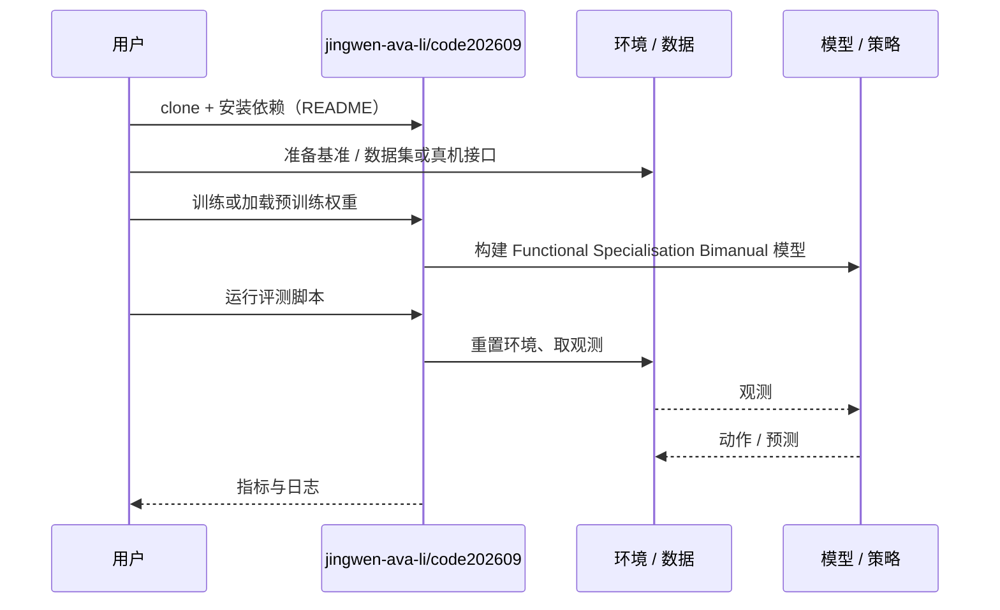

# Functional Specialisation Bimanual（arXiv:2610.33947）

**Functional Specialisation Bimanual**（*Learning Functional Specialisation for Bimanual Robotic Control*，[arXiv:2610.33947](https://arxiv.org/abs/2610.33947)，[代码](https://github.com/jingwen-ava-li/code202609)）来自 [具身智能小站 2026-10-28 盘点](../../sources/blogs/wechat_embodied_station_59_papers_human_video_to_robot_experience_2026-10-28.md)，属「灵巧与接触操作」组。

## 一句话定义

**在双循环控制器的肌骨系统中，比较共享与差异目标、固定与变化手部角色。**

## 英文缩写速查

| 缩写 | 英文全称 | 简要说明 |
|------|----------|----------|
| Functional Specialisation Bimanual | Learning Functional Specialisation for Bimanual Robotic Control | 本文方法 / 基准的简称 |

## 为什么重要

- 双臂专业分工与角色互换的取舍。固定分工可提高特定任务效率，却降低角色反转时的灵活性，指标必须连同训练组织一起看。
- 开源结论：**已开源**（步骤 2.5，2026-10-28）。仓库可达（git ls-remote）。
- 同期同组工作见 [潜在动作、免渲染事件仿真与机器人评测：具身智能小站 10-28 期 59 篇阅读坐标](../overview/embodied-station-2026-10-28-59-papers-technology-map.md)。

## 核心机制

| 项 | 内容 |
|----|------|
| **arXiv** | [2610.33947](https://arxiv.org/abs/2610.33947) |
| **开源** | **已开源** |
| **要点** | 在双循环控制器的肌骨系统中，比较共享与差异目标、固定与变化手部角色。 |
| **文内指标** | 公众号转述：固定分工可提高特定任务效率，却降低角色反转时的灵活性，指标必须连同训练组织一起看。 |

## 源码运行时序图

以下为按仓库入口（`jingwen-ava-li/code202609`）推断的通用运行链路；入库日仅核实仓库可达，未逐文件阅读，具体脚本名以 README 为准。

## 实验与评测

- 公众号转述：固定分工可提高特定任务效率，却降低角色反转时的灵活性，指标必须连同训练组织一起看。
- **读法：** 本页为索引级摘要，依据公众号转述的官方摘要与仓库信息整理；逐项数字与 baseline 以原文 PDF 为准。

## 与其他工作对比

- 横向索引见 [潜在动作、免渲染事件仿真与机器人评测：具身智能小站 10-28 期 59 篇阅读坐标](../overview/embodied-station-2026-10-28-59-papers-technology-map.md)；同 arXiv 不重复造页。

## 结论

**双臂专业分工与角色互换的取舍：固定分工可提高特定任务效率，却降低角色反转时的灵活性，指标必须连同训练组织一起看。**

1. 开源边界：**已开源** — 仓库可达（git ls-remote）。
2. 核心机制：在双循环控制器的肌骨系统中，比较共享与差异目标、固定与变化手部角色。
3. 复现与选型前核对任务协议、硬件与基准口径，勿直接横比公众号摘录数字。

## 关联页面

- [manipulation](../tasks/manipulation.md)
- [contact-rich-manipulation](../concepts/contact-rich-manipulation.md)
- [dexterous-kinematics](../concepts/dexterous-kinematics.md)
- [bimanual-manipulation](../tasks/bimanual-manipulation.md)
- [embodied-station-2026-10-28-59-papers-technology-map](../overview/embodied-station-2026-10-28-59-papers-technology-map.md)

## 参考来源

- [functional_specialisation_bimanual_arxiv_2610_33947.md](../../sources/papers/functional_specialisation_bimanual_arxiv_2610_33947.md)
- [wechat_embodied_station_59_papers_human_video_to_robot_experience_2026-10-28.md](../../sources/blogs/wechat_embodied_station_59_papers_human_video_to_robot_experience_2026-10-28.md)
- [arXiv:2610.33947](https://arxiv.org/abs/2610.33947)

## 推荐继续阅读

- [arXiv PDF](https://arxiv.org/pdf/2610.33947)
- [https://github.com/jingwen-ava-li/code202609](https://github.com/jingwen-ava-li/code202609)
