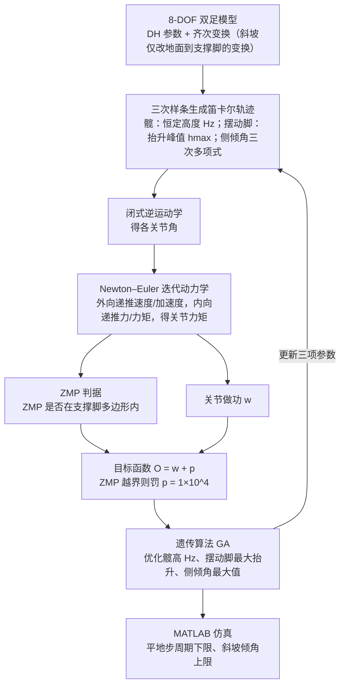

# GA 坡面双足（arXiv:2609.20570）

**GA 坡面双足**（*Walking on the Slope: Stable Bipedal Gaits with Genetic-Algorithm-Optimized Trajectories*，[arXiv:2609.20570](https://arxiv.org/abs/2609.20570)）来自 [senlanke 具身运控lab 周更盘点](../../sources/blogs/wechat_senlanke_weekly_humanoid_quadruped_2026-09-14_18.md)（2026-09-14–18）。

## 一句话定义

**8-DoF 运动学 + Newton–Euler 动力学；GA 优化三项轨迹参数 + ZMP 惩罚；最快 0.5 s 步周期、最高 22.5° 坡面仿真稳定。**

## 英文缩写速查

| 缩写 | 英文全称 | 简要说明 |
|------|----------|----------|
| GA | Genetic Algorithm | 遗传算法 |
| ZMP | Zero Moment Point | 零力矩点 |
| DoF | Degrees of Freedom | 自由度 |

## 为什么重要

- 坡面双足需轨迹级 ZMP 可行优化；GA 可探索非凸步态参数空间。

## 流程总览

图依据：论文 §III–§VI（Eq.1–9）；「GA 更新参数回到轨迹生成」为 GA 迭代搜索的标准流程，论文未单独画流程图。

## 核心机制

| 项 | 内容 |
|----|------|
| **arXiv** | [2609.20570](https://arxiv.org/abs/2609.20570) |
| **开源** | **待发布**（步骤 2.5，2026-09-20） |
| **方法摘要** | GA trajectory optimization with ZMP feasibility penalty on 8-DoF biped model. |

## 源码运行时序图

**不适用**（截至 2026-09-20 未发布可运行官方代码或待核实）。

## 实验与评测

- Sim: 0.5 s step period, up to 22.5° slope stability boundary.
- 读法：先对齐任务设定、传感器与成功定义，再解读 headline 数字。

## 与其他工作对比

| 维度 | 读法 |
|------|------|
| **同周对照** | 见对应 [周更盘点](../../sources/blogs/wechat_senlanke_weekly_humanoid_quadruped_2026-09-14_18.md) 映射表，勿跨任务直接比 SR |
| **方法定位** | 离线低维轨迹参数的 [遗传算法](../methods/genetic-algorithm.md) 外层搜索 + ZMP 惩罚筛选，不等价于用 GA 学高频闭环策略 |
| **开源状态** | **待发布** — 部署前以项目页/arXiv 为准 |

## 结论

**GA+ZMP 为坡面双足提供仿真级轨迹优化基线，真机迁移未报告。**

1. 开源：**待发布**；勿凭公众号摘要臆断可复现性。
2. 指标须连同实验条件解读（仿真/真机、平台、成功阈值）。
3. 关注 arXiv 版本更新与代码发布。

## 关联页面

- [zmp-lip](../formalizations/zmp-lip.md)
- [humanoid-locomotion](../tasks/humanoid-locomotion.md)
- [locomotion](../tasks/locomotion.md)
- [遗传算法（GA）](../methods/genetic-algorithm.md) — 编码、选择、交叉与变异的方法总览

## 参考来源

- [ga-biped-slope-gait_arxiv_2609_20570.md](../../sources/papers/ga-biped-slope-gait_arxiv_2609_20570.md)
- [wechat_senlanke_weekly_humanoid_quadruped_2026-09-14_18.md](../../sources/blogs/wechat_senlanke_weekly_humanoid_quadruped_2026-09-14_18.md)
- [genetic_algorithms_foundations.md](../../sources/papers/genetic_algorithms_foundations.md) — GA 一手资料与「离线轨迹参数优化 ≠ GA 学闭环策略」边界
- [arXiv:2609.20570](https://arxiv.org/abs/2609.20570)
- [arXiv PDF](https://arxiv.org/pdf/2609.20570)：已通读方法部分（实验与附录以略读为准）：§III 运动学模型、§IV 轨迹生成与逆运动学、§V 动力学与稳定判据、§VI GA 轨迹优化、§VII 结果

## 推荐继续阅读

- [arXiv PDF](https://arxiv.org/pdf/2609.20570)
