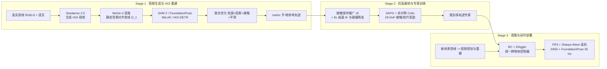
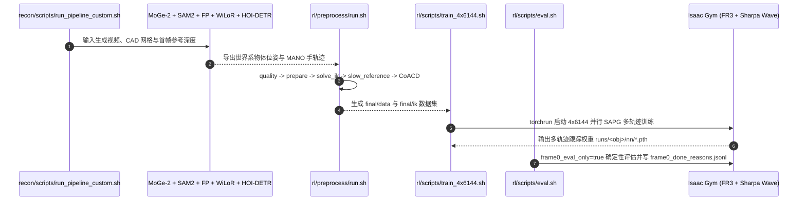

# GALATEA（arXiv:2609.10050）

**GALATEA**（*Grounding Generated Video Plans in Simulation Towards Versatile Dexterous Controllers*，UC Berkeley / Sharpa / HKU，[arXiv:2609.10050](https://arxiv.org/abs/2609.10050)，[项目页](https://boyuan-an.github.io/GALATEA/)，[代码](https://github.com/boyuan-an/GALATEA)）把**生成式 HOI 视频**当作可扩展的运动参考库：训练期用重建轨迹在仿真中学多物体 HOI tracker，部署期由视频模型出 motion plan、tracker 闭环执行，真机使用 **Franka Research 3（7 DoF）+ Sharpa Wave（22 DoF）右手**。

## 一句话定义

**生成视频当「运动提案」、仿真当「落地过滤器」——先以联合优化重建 metric 手–物轨迹并用 SAPG 在仿真中接地，再经 BC+DAgger 蒸馏成跨物体闭环灵巧控制器。**

## 英文缩写速查

| 缩写 | 英文全称 | 简要说明 |
|------|----------|----------|
| GALATEA | Grounding Generated Video Plans in Simulation Towards Versatile Dexterous Controllers | 本文方法名 |
| HOI | Hand–Object Interaction | 手–物交互 |
| SAPG | Split and Aggregate Policy Gradients | 仿真中用于多轨迹噪声参考跟踪的探索聚合 PPO 算法 |
| BC | Behavior Cloning | 行为克隆，用于合并多类别专家 |
| DAgger | Dataset Aggregation | 交互式模仿聚合，缓解专家蒸馏的分布偏移 |
| BPS | Basis Point Set | 基点集形状编码，用于策略观测中的物体几何表示 |
| SR | Success Rate | 任务/grounding 成功率 |

## 核心信息

| 字段 | 内容 |
|------|------|
| **机构** | 加州大学伯克利分校（UC Berkeley）、Sharpa、香港大学（HKU） |
| **作者** | Tianyue Wu⋆‡、Boyuan An⋆、Shuqi Zhao、Heyu Guo、Wanli Xing、Yi Ma、Kaifeng Zhang、Ruihai Wu†、Masayoshi Tomizuka† |
| **平台** | Franka Research 3（7 DoF）+ Sharpa Wave（22 DoF）右手（29 DoF，30 Hz 位置 PD）；仿真使用 Isaac Gym（PhysX） |
| **开源** | **已开源**（[boyuan-an/GALATEA](https://github.com/boyuan-an/GALATEA) 于 2026-11-03 发布 `recon/` NVIDIA 非商业许可、`rl/` GPL-3.0 许可及 `rl-v1.0` 示例数据与权重） |
| **规模** | ~2500 生成 clip（Seedance 2.0）→ ~2000 可用参考（83% 质检通过）→ **1500+** 仿真 grounding；10 物体基准上专家较基线 **+25 pp** 以上 |
| **真机** | 40 次未见视频计划评测（`27/40` 成功）；项目页另展示 66 段功能抓取、非抓取推拉与抓后姿态调整 rollout |

## 为什么重要

- **把「视频生成」从 demo 接到可执行控制：** 生成模型在真实首帧与指令条件下提供多样 HOI 提案，仿真 tracker 负责接触可行性与物理执行，部署时两者解耦，便于独立升级视频模型或底层控制器。
- **HOI 参考的可扩展性：** 传统 mocap/遥操作难覆盖多物体多轨迹，野外视频过滤损耗高（Do as I Do 在 100DOH 仅约 `4.2%` 可重建）；可控条件视频生成将可用率提到约 `83%`，把瓶颈转移到重建精度与仿真接地率。
- **与纯 IL/VLA 的对照轴：** 不是端到端像素→扭矩，而是 **plan（生成视频+重建）+ track（RL 蒸馏策略）** 两阶段架构。

## 核心原理

### 流程总览

### 1）HOI 重建（Sec. III-A2）

给定生成视频、已知物体刚体 CAD 网格及首帧立体深度 `D_1^st`：先由 MoGe-2 预测逐帧深度，并在静态背景区域用截尾最小二乘拟合尺度/偏移对齐至 `D_1^st`；随后用 GroundingDINO + SAM 2 提取前景与物体掩码，FoundationPose 给出初始 6-DoF 物体位姿，WiLoR 给出初始 MANO 手网格，HOI-DETR 估计接触帧；最后在保持手指关节活动度下联合优化逐帧刚体修正 `ΔT^O`、`ΔT^H`，损失涵盖 FoundationPose 投影、2D 关键点重投影、互遮挡掩码轮廓、接触距离与一/二阶时序平滑。

### 2）参考增广与单阶段跟踪 RL（Sec. III-B）

- **增广与筛选：** 每条重建轨迹采样 5 组接触保持扰动（接触前仅扰动手接近，接触后手–物共用 `SE(3)` 变换以保相对构型），经 FR3 逆运动学求解并插值减速 `8×`、剔除碰撞与超速轨迹。
- **非对称 SAPG 训练：** Actor 输入关节角、上步动作、腕姿、指尖、加噪物体位姿、HOI 追踪误差、5 指参考表面距离与 BPS 物体形状编码（**不输入关节速度、力或质量**）；Critic 额外读取无噪物体位姿与关节速度。训练从开放手型初始化以避免指尖穿模爆炸，奖励联合手/物体追踪项、指尖接近与多指接触正则（4/5 指奖励）及抬升门控。
- **两步蒸馏（Sec. III-B3）：** 按物体类别训练最多 2 个多技能专家，再经行为克隆（BC）合并后用 DAgger 微调消除分布偏移。

## 源码运行时序图

官方仓库 [boyuan-an/GALATEA](https://github.com/boyuan-an/GALATEA) 已于 2026-11-03 完整公开 `recon/` 与 `rl/` 两部分代码：

图依据：`boyuan-an/GALATEA@36b9048`，核对 `README.md`、`recon/README.md`、`rl/README.md`、`recon/scripts/run_example.sh`、`recon/scripts/run_pipeline_custom.sh`、`rl/scripts/train_4x6144.sh` 与 `rl/scripts/eval.sh`（未在本地 GPU 运行）。

## 工程实践

| 项 | 复现与工程要点（基于 `boyuan-an/GALATEA` README） |
|----|----------------------------------------------------|
| **混合许可边界** | `recon/` 采用 **NVIDIA License（非商业研究）**，`rl/` 采用 **GPL-3.0**；MANO 参数与第三方模型权重需向原提供方单独申请/下载，仓库不统一再分发 |
| **重建环境** | Linux x86_64 + Conda + CUDA 12.1（RTX 50 系列支持 `--cuda128`）；支持 `Provided RGB-D`（论文默认配置）与 `--rgb-only`（MoGe-2 首帧预测深度，不可与论文数值混比） |
| **RL 环境与算力** | Python 3.8 + Isaac Gym Preview 4；训练推荐 `4×RTX 4090`（`train_4x6144.sh`）或 `2×RTX 4090`（`train_2x12288.sh`），评测需 `1×RTX 4090`；Release `rl-v1.0` 已附带 `power_drill`、`dog`、`old_camera2` 数据与权重 |
| **真机标定注意** | 论文实机使用 D455 提供实时 FoundationPose 位姿（D435 仅拍首帧条件图后移走），并采用手部刚性抓取已知端效器位姿标定 FoundationPose 平移常偏 |

## 实验与评测

以下数字均取自 arXiv:2609.10050v2（论文自报）：

- **HOI 重建对比（Table I & 480 次人工盲评）：** 在 120 段生成视频上 87%（417/480）被评为第一，平均排名 `1.17`（VideoManip `2.16`、DO AS I DO `2.88`、EgoInfinity `3.47`）；H2O / HO-Cap ADD-S 达 `4.82 cm` / `3.88 cm`（DO AS I DO 为 `5.52 cm` / `14.50 cm`）。2500 生成片段约 `83%`（~2000 条）可用，1500+ 在仿真成功落地。
- **仿真 RL 与蒸馏（Sec. IV-B）：** 42 训练物体上专家策略达 `78.6%` 宏平均成功率（中位 `80.5%`）；蒸馏仅降低 `4.2` / `6.0` pp，在 300 条未见基准轨迹和 5 个新物体上分别取得 `66.6/68.8%` 与 `54.2/52.2%`（mean/median）。在 10 物体基准上专家均值 `77.4%`，去掉 SAPG（改标准 PPO）、去掉 lift 奖励或改两阶段训练分别导致 `10/10`、`7/10`、`10/10` 物体掉点；跟踪误差 pos `10.2 mm`、rot `17.4°`、hand `36.2 mm`（Table II）。
- **真机闭环（Table III，40 次未见视频计划）：** 总体 `27/40`（`jar-neck` 姿态调整 `6/10`、`jar-top` 抓移 `6/10`、`mug-rim` 推 `7/10`、`mug-handle` 拉 `8/10`），保留的功能抓取方式（如抓罐颈以留出罐口 vs 捏罐口）与视频提案一致。

## 结论

**GALATEA 的核心价值在于将「可控视频生成」与「抗噪仿真 RL 跟踪」串联成可复用管线：~83% 生成参考可用率与 1500+ 仿真接地率证明生成先验能显著降低数据筛选成本，而单阶段非对称 SAPG 是消化含噪视频重建的关键。**

1. **可控首帧生成提高可用率**：以真实首帧 RGB-D 为条件的视频生成将可用参考率提到 ~83%（对比野外 100DOH 仅 ~4.2%），大幅压缩人工筛片代价。
2. **一阶段 SAPG 优于两阶段残留策略**：在含噪视频参考上，先模仿手再学残差的两阶段结构（如 ManipTrans 风格）会被误差手姿锁定，在 10/10 基准物体上均逊于单阶段非对称 SAPG。
3. **保留手+物双轨迹优于纯物体轨迹**：相比只跟踪物体点/位姿，保留手爪运动使真机能复现不同功能抓握语义（如罐颈抓持 vs 罐口捏持）。
4. **注意蒸馏与跨物体泛化衰减**：42 物体均值约 `78.6%` → 蒸馏约 `74.4%` → 未见轨迹 `66.6%` → 新物体 `54.2%` → 真机 `27/40`（`67.5%`），跨阶段存在可量化损耗。
5. **已可分层复现**：2026-11 公开仓库已覆盖 `recon/` 重建与 `rl/` 预处理/训练/评测全链，但真机硬件桥接脚本与闭环视觉标定流程需按现场平台自建。

## 局限与风险

- **手内细操作覆盖不足：** 生成视频与重建噪声易掩盖精细手指相对运动，论文明确指出策略未系统学习手内重定位（in-hand manipulation）。
- **薄物体与掌心摩擦动作困难：** 贴桌面薄物体抓取及人类依赖掌心摩擦的非力封闭抬升动作在仿真和基线中均表现较弱。
- **脱离参考后的恢复边界：** 接触切换处对 Sim2Real 误差敏感，虽有基本重试行为，但一旦大幅偏离参考轨迹常难以恢复。
- **两阶段推理延迟与许可拆分：** 部署期视频生成与重建耗时叠加控制器延迟；且代码横跨 NVIDIA 非商业许可（`recon/`）与 GPL-3.0（`rl/`），商用集成须注意合规。

## 与其他工作对比

| 对照 | 差异读法 |
|------|----------|
| [Do as I Do](./paper-do-as-i-do.md) | 同属人类/视频→重建→物理接地路线；Do as I Do 从野外/日常单目视频逐段跑 MuJoCo Warp MPPI 输出轨迹数据，GALATEA 用首帧条件生成视频并训练/蒸馏出单一闭环 RL 控制器 |
| [SimToolReal](./simtoolreal.md) | 同用 SAPG + 非对称 Critic + Sharpa Wave 手；SimToolReal 仅跟踪物体 6D 位姿以程序化原语泛化工具，GALATEA 同时跟踪手与物体以保留功能抓型 |
| [Generative World Models](../methods/generative-world-models.md) | 同用生成式视觉先验；GALATEA 聚焦 **HOI 轨迹→灵巧控制**，不是通用环境 rollout |
| [Blind Dexterity](./paper-blind-dexterity.md) | 同强调仿真学 dexterous；GALATEA 监督来自 **生成视频重建**，非纯 RL 探索 |

## 关联页面

- [Manipulation](../tasks/manipulation.md)
- [Reinforcement Learning](../methods/reinforcement-learning.md)
- [Generative World Models](../methods/generative-world-models.md)
- [Imitation Learning](../methods/imitation-learning.md)
- [Sim2Real](../concepts/sim2real.md)
- [Blind Dexterity](./paper-blind-dexterity.md) / [Do as I Do](./paper-do-as-i-do.md) / [SimToolReal](./simtoolreal.md)
- [夏帕机器人（Sharpa Robotics）](./sharpa-robotics.md)

## 参考来源

- [galatea_arxiv_2609_10050.md](../../sources/papers/galatea_arxiv_2609_10050.md) — arXiv:2609.10050v2 全文摘录
- [galatea.md（项目页）](../../sources/sites/galatea.md) — 项目页核查
- [galatea.md（仓库）](../../sources/repos/galatea.md) — `boyuan-an/GALATEA@36b9048` 源码入口核查
- [arXiv:2609.10050](https://arxiv.org/abs/2609.10050)

## 推荐继续阅读

- [项目页](https://boyuan-an.github.io/GALATEA/)
- [arXiv v2 HTML 全文](https://arxiv.org/html/2609.10050v2)
- [官方代码仓库 boyuan-an/GALATEA](https://github.com/boyuan-an/GALATEA)
