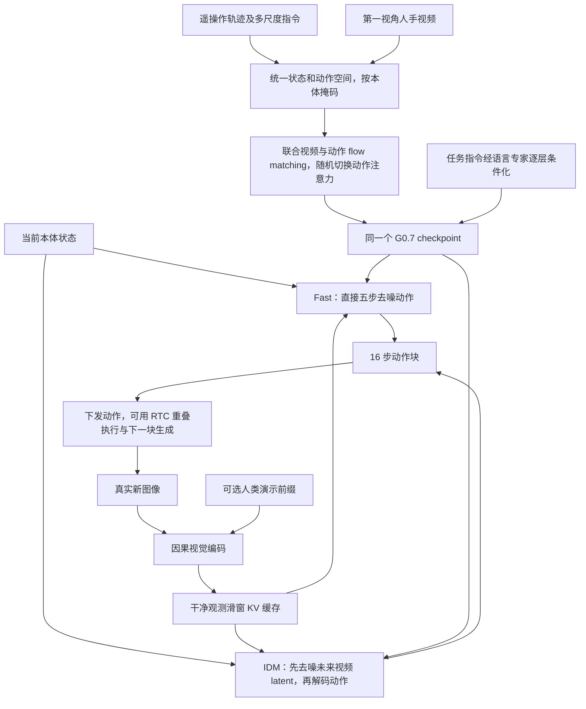

# 星海图 G0.7：规模化长上下文快速世界动作模型 | Scaling Up a Fast World Action Model with Long Context

## 一句话定义

G0.7 把真实观测的滑窗 KV 缓存接入联合视频–动作训练；同一组权重推理时既能先想象未来再出动作，也能直接从历史生成动作块。

## 英文缩写速查

| 缩写 | 英文全称 | 简要说明 |
|---|---|---|
| WAM | World Action Model | 联合预测视觉未来与动作 |
| KV | Key–Value | 缓存历史观测的注意力键和值 |
| IDM | Inverse Dynamics Model | 此处指先去噪未来视觉 latent，再以此解码动作 |
| ICL | In-Context Learning | 部署时用上下文示例指定任务，不等于训练阶段从未接触该任务 |
| RTC | Real-Time Chunking | 当前动作块执行时异步生成下一块 |
| TCP | Tool Center Point | 用于对齐机器人夹爪和估计人手腕姿态的工具坐标约定 |

## 为什么重要

原版 [Fast-WAM](./paper-fast-wam.md) 主要研究单帧输入。G0.7 把该设计放到长时观测预训练、较大规模的人机混合数据和真机评测中，独立检查**训练时视频监督、推理时生成视频、实机控制周期**三件事。

| 项目 | 内容 |
|---|---|
| 机构 | 星海图（Galaxea Team） |
| 原文 | [arXiv v1，2026-11-24](https://arxiv.org/abs/2611.31822v1) · [v2 HTML，2026-11-25](https://arxiv.org/html/2611.31822v2) |
| 输入与输出 | 指令、视频观测与本体状态 → 16 步动作块；可选未来视频 latent |
| 公开边界 | 技术报告和演示公开；未找到 G0.7 代码、权重或完整训练集合发布 |

## 核心机制

- **长历史是训练条件，不是外挂存储。** 语言专家逐层为共享视觉–动作专家提供条件；因果 VAE latent 与按块因果注意力建模序列。预训练变化块数及位置偏移；推理缓存干净的真实观测，滑动更新，可先放入一次人类演示。最多五分钟不是每个任务都使用五分钟，也不是五分钟预测跨度。
- **用随机掩码训练两条推理路。** Teacher forcing 下按样本以 0.5 概率允许动作读当前块的未来视觉 latent（IDM）；其余样本的动作只读历史/当前观测（Fast）。两路始终保留视频监督。Fast 推理五步去噪 16 步动作，不生成未来视频。
- **跨本体在表示层对齐。** 机器人轨迹与人手统一映射并用按本体维度掩码。Ego 视频估计双手 3D 轨迹，每手用对齐 R1 夹爪 TCP 的六自由度腕姿态与五指端 3D 位置；手部跟踪不可靠的片段仍可贡献视觉监督。遥操指令分整段、子目标、原子动作，按训练窗口粒度取标注。

## 流程总览

## 源码运行时序图

不适用：截至 2026-11-26 未找到 G0.7 专用可运行发布；[Fast-WAM](./paper-fast-wam.md) 和 [G0.5](./paper-galaxea-g05.md) 的源码不能代替 G0.7 调用路径。上图是报告 §§2–3 的方法抽象。

## 实验与评测

| 检查项 | 作者报告 | 读数边界 |
|---|---|---|
| 每动作块推理 | RTX 5090，Fast FP8 60 ms、Fast BF16 eager 156 ms、IDM BF16 eager 457 ms | 7.6×跨配置；同 BF16 eager 约 2.9×；不是机器人端到端时延或伺服频率 |
| 仿真后训练 | 五套综合 70.8，RMBench 86.2%，RoboDojo 41.46 | RoboDojo 为基准分数，综合值不是统一任务成功率 |
| 真机零样本 | 取放：R1 Pro 12/25（48%）、R1 Lite 27/50（54%），R1 Lite 纯机器人数据对照 6/50（12%） | 这里只测取放，没有该任务专用后训练 |
| 视觉 ICL | 壳杯跟踪与按例分拣；无 ICL 中训时两项 OOD 平均 73.3%，有中训时 ID/OOD 平均 96.7%/93.3% | 每任务每设定 15 次；各模型仍做任务后训练，不是完全未训练任务 |
| 真机后训练 | 七任务平均进度 86.9%；装箱、柠檬茶、装袋分别为 90%、100%、63% 完整成功 | 进度是每试次完成阶段的比例；量化三项长流程约五小时示教/项，四项工具各 20 次示教 |

## 与其他工作对比

| 工作 | 对照维度 |
|---|---|
| [Fast-WAM](./paper-fast-wam.md) | 前作验证单观测设置中的训练期视频监督和直接动作推理；G0.7 把真实观测历史纳入同一训练策略，并在同一检查点对照两种推理路径。 |
| [Long-WAM](./paper-long-wam-scaling-context.md) | 同样研究长历史，但其动作路径以因果预测的未来视频 latent 为条件；G0.7 的 Fast 路保留历史并跳过未来生成。以报告图 10 为准，不用不同硬件和观察窗的独立数据比较速度。 |
| [G0.5](./paper-galaxea-g05.md) | 前代将推理与动作 token 放在统一自回归流；G0.7 用联合视频–动作训练和多块视觉历史。图 12 的对照采用相同后训练数据，均值差异是任务进度，不是成功率。 |

## 结论

**报告支持在这组任务和配置下把未来生成移出动作关键路径，但不支持把所有延迟、泛化和任务进度合成一个数字。**

- 选择 Fast / IDM 时，先锁定同 checkpoint、精度、硬件和评测协议；部署优化的收益另记。
- 测记忆时，分别控制当前画面、历史顺序和演示内容，区分行为跟随与当前帧捷径。
- 验收长流程时同时保留完整成功率、阶段进度和动作块切换延迟，避免进度掩盖末段失败。

## 工程实践

- RTC 可以重叠下一块去噪与当前执行，保留已承诺前缀并补全剩余部分；实机验收应另测图像采集、缓存更新、通信与控制排队，以及 chunk 衔接抖动。
- 对比 [Long-WAM](./paper-long-wam-scaling-context.md) 时，保持动作块长度和任务分布可比，记录真实观测缓存长度和未来预测长度两个量。

## 局限与风险

- 五分钟是该报告配置支持的上下文上限，没有形成面向所有任务或本体的保证；两个 ICL 任务的样本数也有限。
- 作者没有公开整套训练数据量及版本清单，不能由约五小时的**单任务后训练**倒推预训练规模。
- [发布核验](../../sources/sites/galaxea-g07.md)未发现 G0.7 专用代码或权重；本文只复核报告，不声称已复现实验。

## 关联页面

- [世界动作模型](../concepts/world-action-models.md) · [生成式世界模型](../methods/generative-world-models.md) · [双臂操作](../tasks/bimanual-manipulation.md)
- [Fast-WAM](./paper-fast-wam.md) · [Long-WAM](./paper-long-wam-scaling-context.md) · [WAM 纵深 Stage 3](../../roadmap/depth-wam.md)

## 参考来源

- [论文原文归档](../../sources/papers/arxiv-2611-31822-galaxea-g07.md)
- [官方技术页与发布状态](../../sources/sites/galaxea-g07.md)

## 推荐继续阅读

- [Galaxea 官方技术报告与演示](https://www.galaxea-ai.com/en/model-g07.html) · [RTC 原始工作](https://www.pi.website/research/real_time_chunking)
