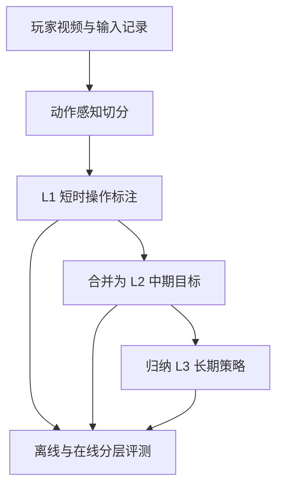

# GameHorizon Suite：游戏理解的多时间尺度数据与评测

## 一句话定义

GameHorizon Suite 将 AAA 游戏中的视频、玩家动作和从短时操作到长程策略的指令对齐，并以离线与在线基准评估模型理解和执行游戏目标的能力。

## 英文缩写速查

| 缩写 | 英文全称 | 简要说明 |
| --- | --- | --- |
| AAA | Triple-A | 指制作规模较大的商业游戏；数据集覆盖多类此类游戏 |
| VLM | Vision-Language Model | 以视觉和语言输入完成理解或推理的模型家族之一 |
| MCQ | Multiple-Choice Question | GameHorizon 离线轨采用的选择题格式 |
| L1/L2/L3 | Level 1 / Level 2 / Level 3 | 分别对应短时操作、中期目标和长期策略指令层级 |

## 为什么重要

游戏智能体评测常把视觉理解、目标分解与动作控制混在单一总分里，难以知道模型具体在哪个时间尺度出错。GameHorizon 把指令和动作标成不同跨度，并提供分步验证，使研究者能观察模型是没识别当前动作、没把目标拆成子任务，还是无法完成较长的任务链。它适合与 [AI Agent 评测](../concepts/ai-agent-evaluation.md) 中的 task、trial、grader 与终态指标一起阅读。

## 核心原理与流程总览

数据管线先按游戏动作将原始视频切成短片段，再从底向上生成三层文本标注：

- **L1：短时操作**，大约数秒范围内的动作（如瞄准、移动、攻击）。
- **L2：中期目标**，将连续操作归纳为一个局部目标。
- **L3：长期策略**，把多个目标放进更长时间跨度的行动计划。

基准包含离线和在线两部分：离线轨测试动作识别、多层目标分解和跨层一致性；在线轨在真实游戏任务中逐个判定可验证子任务，区分有顺序依赖的因果任务与顺序可变的主题任务。

## 方法与数据

项目报告 GameHorizon-Data 覆盖 21 款游戏和 5,000 小时原始录制，由 100 名经验玩家采集，含同步视频、动作与多时间尺度指令。作者使用 VLM 标注并基于动作连续性和语义一致性逐层合并短片段。基准报告 5,000 道离线 MCQ、20 个在线任务及 62 个可验证子任务；论文总体评测 47 个模型。

## 实验与评测

论文报告模型总体能力随任务时间跨度和分解要求变化。在线榜中，最好的模型短程子任务成功率为 66.1%，长程任务成功率为 45.0%；其他受测模型长程成功率更低。这个差距说明完整任务链比局部动作更难，可作为规划、目标分解与持续执行存在瓶颈的证据，但不能仅凭总分把失败归因于其中某个单独模块。论文整体称评测 47 个模型；项目页的当前离线主榜列出 44 个，在线轨受成本限制仅测 12 个。

## 与其他工作对比

| 工作 | 主要回答的问题 | 训练或数据特点 |
| --- | --- | --- |
| GameHorizon Suite | 模型能否理解并完成不同时间跨度的游戏任务？ | AAA 玩家轨迹、多层指令、离线与在线分层评测 |
| [Player-1](paper-player-1.md) | 合成环境交互能否改善通用游戏控制？ | 示范监督初始化后，在 16 个可验证奖励环境中做 RL |
| [GameScaling](paper-gamescaling.md) | 数据量、多样性和模型规模如何影响跨游戏泛化？ | 游戏轨迹持续预训练，分析训练内、近域与远域迁移 |

因此，GameHorizon 更接近**数据与测评基础设施**；Player-1 是**后训练路线与策略能力实验**。两者互补，但数据集规模、指标和模型设置不同，不宜直接把榜单数字横向比较。

## 源码运行时序图

**不适用（截至 2026-10-23，官方仓库尚未发布可运行的训练、推理或评测实现。）**

## 工程实践

- 先用离线轨定位模型在动作识别、目标分解或跨层一致性中的短板，再用在线轨检查实际执行链。
- 报告模型数量、所测轨道和任务数时需同时注明口径：总体 47 个模型不等于每一轨都完整覆盖 47 个。
- 复现结论前需确认官方数据和任务环境已发布，并固定模型版本、提示词、游戏状态和重复试验次数。
- **开源状态（2026-10-23）：** 论文、项目页与公开排行榜已发布；官方计划称注释器、评测代码和 5,000 小时数据将逐步发布，当前 README 仍把它们列为待发布。暂无可执行官方实现可按其完整流程复现。

## 结论

**GameHorizon 的关键价值是把游戏理解拆成可检查的时间尺度，并让长程任务的失败可被定位。**

1. 不要只看离线总分；检查短程操作、目标分解与长程在线任务的逐层成绩。
2. 66.1% 短程子任务与 45.0% 长程任务的差距支持“长程组合更难”，但不证明单一规划模块是唯一瓶颈。
3. 5,000 小时是录制规模；有效时长、过滤比例、标注数量应一并报告。
4. 截至 2026-10-23，核心数据与基准代码待开放，当前结果可读但尚不等同于可完整复现实验。

## 局限与风险

- 项目页声明的大规模数据与多轨基准在此日期尚未完全开放，外部读者暂时不能独立复跑完整报告。
- 在线评测成本使受测模型数少于论文总模型数；不同榜单上的模型覆盖并不一致。
- MCQ 测量选择题中的理解，不等价于连续实际控制；在线任务的成功也受模型、提示、动作接口和游戏状态影响。
- 多步骤任务失败可能来自感知、记忆、分解、动作执行或环境噪声。分层指标帮助定位，但不自动识别唯一因果原因。

## 关联页面

- [Player-1：从合成经验中学习游戏控制](paper-player-1.md)
- [AI Agent 评测](../concepts/ai-agent-evaluation.md)
- [深度强化学习游戏里程碑](../concepts/deep-rl-game-milestones.md)

## 参考来源

- [GameHorizon Suite 论文来源归档](../../sources/papers/gamehorizon_suite_arxiv_2609_25001.md)
- [GameHorizon Suite 项目页归档](../../sources/sites/gamehorizon-suite.md)
- [TencentARC/GameHorizon 仓库归档](../../sources/repos/tencentarc-gamehorizon.md)

## 推荐继续阅读

- [GameHorizon Suite 论文](https://arxiv.org/abs/2609.25001)
- [AI Agent 评测](../concepts/ai-agent-evaluation.md)
