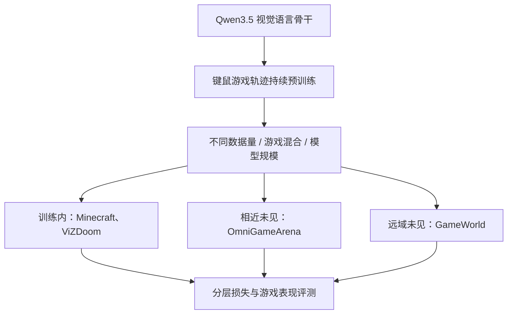
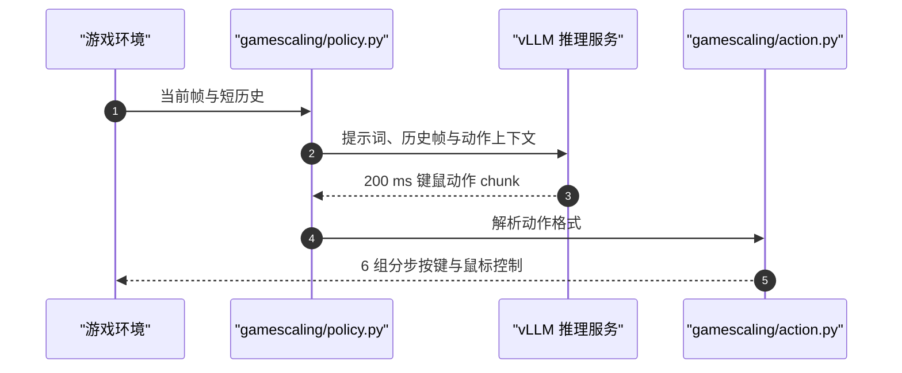

# GameScaling：虚拟世界具身智能体的持续预训练

## 一句话定义

GameScaling 是一项受控研究，比较游戏轨迹持续预训练中的数据规模、世界多样性与模型容量，并测量智能体从训练内游戏向未见虚拟世界迁移的能力。

## 英文缩写速查

| 缩写 | 英文全称 | 简要说明 |
| --- | --- | --- |
| CPT | Continued Pre-Training | 从已有视觉语言模型出发，用游戏交互数据继续预训练 |
| VLM | Vision-Language Model | 接收视觉与语言输入的模型；此处以 Qwen3.5 为骨干 |
| MCU | Minecraft Understanding | 论文中的 Minecraft 游戏任务基准 |
| OGA | OmniGameArena | 论文使用的未见、但动作机制相近的 3D 世界基准 |
| FLOPs | Floating-Point Operations | 论文统计训练计算量的指标 |

## 为什么重要

机器人学习常利用多场景经验提升迁移能力，但游戏世界的视觉风格、动力学、控制接口和目标差异更大。GameScaling 用受控实验拆开数据量、环境多样性和模型规模，显示这些因素对训练内、相近与远域世界的作用并不相同。它也提醒机器人研究者：只把更多虚拟轨迹混在一起，并不能保证模型获得跨域通用控制能力。

## 核心原理与流程总览

研究从 Qwen3.5 视觉语言模型出发，沿三条轴建立 120 组继续预训练配置：

1. **模型规模：** 0.8B、2B、9B、27B。
2. **数据预算：** 50–1,600 小时，共六档。
3. **游戏混合：** 五种多样性配置，从 Minecraft 单世界到多游戏语料。

训练语料覆盖 80 款游戏。评测按世界距离分层：Minecraft 和 ViZDoom 属于训练内环境；OmniGameArena 是未见但动作相近的 3D 环境；GameWorld 代表控制与视觉差异更大的远域游戏。

## 实验与评测

论文比较 120 组配置，采用三层验证损失与四类游戏基准。主要结果是：更多数据改善训练内表现；多样性更有利于相近世界迁移，对远域世界的收益有限；较大模型提升数据效率，但单世界训练时对远域世界泛化更差。训练早期的界面学习带来较广跨世界收益，后期则更多优化训练内与相近世界。

项目页还报告实时设置中的推理耗时差异：GameScaling 每步约 0.13–0.69 秒，所比较前沿模型约 4–24 秒。暂停设置隔离模型决策能力，实时设置则将延迟纳入结果；解读分数时应保留这一协议差异。

## 与其他工作对比

| 工作 | 主要贡献 | 与 GameScaling 的互补关系 |
| --- | --- | --- |
| [GameHorizon Suite](./paper-gamehorizon-suite.md) | 游戏视频、动作与多层指令数据及评测 | 更偏数据和能力诊断；GameScaling 更偏持续预训练规律 |
| [Player-1](./paper-player-1.md) | 示范初始化后，在可验证合成环境中强化学习 | 探索交互式后训练；GameScaling 聚焦离线游戏轨迹继续预训练 |

## 源码运行时序图

此图对应官方仓库的推理客户端路径；它不表示论文训练过程，因为训练代码和训练语料均未公开。

## 工程实践

- 仓库提供客户端、标准 system prompt、示例、测试及 vLLM 服务脚本；模型输入包含当前帧和短历史，输出覆盖约 200 ms 键鼠动作。
- 检查点覆盖 0.8B–27B，S1 为 Minecraft 单游戏训练，S3 为 27% Minecraft 加其他游戏的混合训练；权重以 bfloat16 发布。
- 代码与权重标注 Apache-2.0；训练代码、训练语料未公开，且该许可不涵盖游戏画面或游戏内容版权。
- 实时评价包含推理延迟；部署比较应统一硬件、暂停/实时协议与动作步长，不能直接将不同协议分数等同。

## 结论

**一句话总判：增加数据与环境多样性可以改善训练内及相近世界表现，但仍不足以消除远域游戏的控制与视觉差距。**

1. **先看世界距离，再谈泛化。** 训练内、相近 3D 与远域 2D/2.5D 基准测的是不同迁移难度，单一总分会掩盖差异。
2. **游戏多样性有边界。** 多样混合对相近世界迁移更有帮助，不能据此推断对控制接口和视觉范式差异很大的世界同样有效。
3. **模型更大不自动等于更通用。** 论文观察到单世界训练的大模型远域泛化更弱；训练数据分布仍是关键变量。
4. **实时能力要把延迟算进指标。** 暂停式成绩反映决策质量，实时式成绩还反映系统响应速度。
5. **复现范围受开放状态限制。** 公开检查点和推理客户端可供部署试验，但缺少训练代码与语料，无法独立复现训练缩放实验。

## 局限与风险

- 论文结论来自游戏环境；外推到实体机器人时，还需考虑真实传感器噪声、接触动力学、安全约束与硬件时序。
- 训练数据来自 80 款游戏，但原始 gameplay 语料不公开，外部研究者难以完全复核数据构成及训练流程。
- 项目页演示与摘要数值应结合论文中的基准定义、计算预算和暂停/实时协议阅读。
- Apache-2.0 仅覆盖代码与权重；游戏资产和录制画面的授权需另行确认。

## 关联页面

- [GameHorizon Suite](./paper-gamehorizon-suite.md) — 评估游戏理解、目标分解和长程执行的数据与基准。
- [Player-1](./paper-player-1.md) — 从示范初始化到可验证奖励强化学习的游戏智能体路线。
- [AI Agent 评测](../concepts/ai-agent-evaluation.md) — 任务、试验、评分器与终态指标。
- [深度强化学习游戏里程碑](../concepts/deep-rl-game-milestones.md) — 游戏智能体训练与评测的历史脉络。

## 参考来源

- [GameScaling 论文归档](../../sources/papers/gamescaling_arxiv_2610_28698.md)
- [GameScaling 项目页核查](../../sources/sites/gamescaling-project.md)
- [官方推理仓库核查](../../sources/repos/thusi-lab-gamescaling.md)

## 推荐继续阅读

- [论文：Scaling in Games](https://arxiv.org/abs/2610.28698)
- [项目主页与演示](https://gamescaling.github.io/)
- [官方代码与检查点说明](https://github.com/THUSI-Lab/GameScaling)
