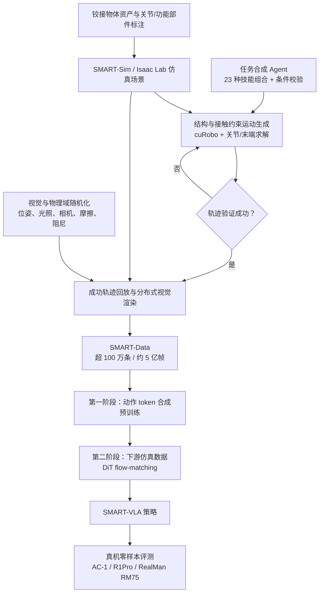
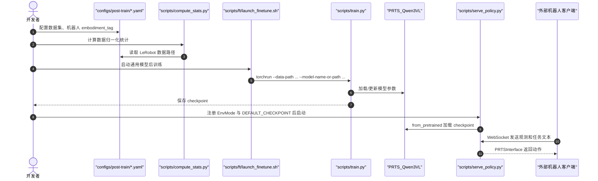

# Gamma-Art / SMART：百万级合成轨迹驱动的铰接物体零样本 Sim-to-Real

## 一句话定义

**SMART**（*Zero-Shot Sim-to-Real Articulated Object Manipulation via Large-Scale Synthetic Pretraining*，arXiv:2610.07652）是 TeleAI 与伽马智能联合研究的铰接物体操作方案：在仿真中大规模生成视觉—动作示范、预训练 SMART-VLA，再迁移到真实机器人。Gamma-Art 为该研究的对外传播名称线索，**论文正式名称为 SMART**。

## 英文缩写速查

| 缩写 | 英文全称 | 简要说明 |
|---|---|---|
| SMART | 论文/系统正式名称 SMART | 仿真合成预训练的铰接物体操作系统 |
| VLA | Vision-Language-Action | 视觉、文本与动作联合建模 |
| Sim2Real | Simulation-to-Real | 仿真策略直接迁移真实机器人 |
| DR | Domain Randomization | 视觉、物理与几何条件域随机化 |
| DiT | Diffusion Transformer | 动作流匹配阶段的专家网络 |
| CRL | Contrastive Reinforcement Learning | PRTS 独立工作中使用；SMART 阶段一未采用 |

## 为什么重要

开抽屉、关柜门、推拉滑轨、转动关节部件并非普通抓放：操作路径必须同时满足铰接约束、接触几何与碰撞避让。手动采集真机示范难以穷尽环境/关节配置变化；论文验证了结构约束仿真轨迹与大规模随机化的另一条训练路线。

## 核心信息

| 项目 | 事实 |
|---|---|
| 机构 | 中国电信人工智能研究院（TeleAI）与伽马智能（Gamma Robotics） |
| 论文 | [SMART，arXiv:2610.07652v1](https://arxiv.org/html/2610.07652v1)，2026-10-06 |
| 仿真基础 | Isaac Lab；铰接结构/功能部件标注、cuRobo 规划及约束优化 |
| 数据集 | [TeleEmbodied/SMART-Data](https://huggingface.co/datasets/TeleEmbodied/SMART-Data)，LeRobot v3.0 |
| 策略权重 | [TeleEmbodied/SMART-VLA](https://huggingface.co/TeleEmbodied/SMART-VLA) |
| 共享模型实现 | [TeleHuman/PRTS](https://github.com/TeleHuman/PRTS)（非 SMART-Sim 专用实现） |
| 代码开放状态 | 数据、权重与 PRTS 通用后训练/推理代码公开；完整 SMART-Sim 合成源码未核实到公开 |

## 流程总览

图为论文中的**方法/数据流**，不是宣称开源的 SMART-Sim 代码调用图。

## 核心原理

1. **结构先验：** 把铰接关节、可操作部件与运动约束显式放进仿真，生成可接触、可达、避障的末端运动，区别于直接依赖无约束随机动作。
2. **可组合任务：** agent 基于资产、23 类操作技能、任务目标及终止判据生成单阶段/多阶段操作；生成任务需仿真验证。
3. **规模化渲染：** 成功轨迹回放后，对物体局部姿态、视角、灯光、外观及动力学参数施加随机化；多进程分工收集、渲染及数据转换。
4. **两段策略训练：** 在 SMART-Data 上先学动作 token 预测，再用下游合成数据的 DiT / flow-matching 动作头后训练。论文明确该预训练**不使用** PRTS 的 CRL 对比损失。
5. **迁移边界：** “零样本”特指不采集任务专属真机示范进行策略训练，并不意味着无资产建模、标定或机器人接口适配。

## 实验与评测

| 指标 | 论文结果 | 如何解读 |
|---|---:|---|
| 合成轨迹 | 超过 100 万条 | 约 5 亿帧、超过 4,600 小时 |
| 铰接物体/场景 | 2,507 / 1,122 | 数据集中覆盖 23 类功能对象，资产库共 88 类 |
| 技能/原子任务 | 23 / 44 | 5 种数据采样机器人配置 |
| LIBERO 平均成功率 | **96.8%** | 未预训练 94.7%；另一真实数据预训练基线 97.8% |
| RoboCasa365 平均成功率 | **28.8%** | 无阶段一预训练 20.0%；Composite Unseen 只有 7.5% |
| 真机平均成功率 | **76.7%** | 无合成预训练 50.0%，提升 26.7 个百分点 |

真机实验为三款机器人（AC-1、R1Pro、RealMan RM75 双臂）共 **12 项指定任务，每项 15 次测试**。不同任务难度、样本量和环境设置均有限，不能解读为所有铰接操作的通用成功率。

## 结论

**SMART 提供了大规模结构约束仿真数据提升铰接物体真机泛化的证据，但完全复现仍受未开放的 SMART-Sim 数据生成系统限制。**

1. 从“铰接结构 + 接触规划”构造可执行示范，是区别于一般纯随机合成数据的关键。
2. 把几何/动力学/视觉随机化纳入数据引擎，主要价值在覆盖场景分布，而非单一照片级真实感。
3. 真机 76.7% 与无预训练 50.0% 比较需保留 **12 任务 × 15 次** 的限定口径。
4. RoboCasa365 的 28.8% 提醒不能以百万轨迹直接推断高长程泛化成功率。
5. 若要复用数据或权重，必须核对 LeRobot 版本、action/state 语义与具体机器人配置。
6. 不应把 PRTS GitHub 代码直接当作 SMART-Sim 数据合成器或完整 SMART 预训练配方。

## 源码运行时序图

官方 SMART-Sim 资产标注、任务编排和分布式生成器未见公开运行入口；以下仅表示**已阅读的 TeleHuman/PRTS 共享模型后训练与策略服务路径**，不等于 SMART 论文完整执行流程。

参见 [PRTS 实际入口归档](../../sources/repos/telehuman_prts_smart_vla.md)。**SMART-Data 为 LeRobot v3.0，而该仓库默认示例使用 v2.1**；需自行核对数据转换及输入/输出，不应把上述流程宣称为零改动可复现。

## 工程实践

| 步骤 | 工程建议 |
|---|---|
| 获取数据 | 查官方 SMART-Data 元数据与许可；对本体维度/动作标注作抽样检查 |
| 加载权重 | SMART-VLA 模型卡指向通用 PRTS；确认处理器、动作维数、归一化 |
| 模型后训练 | PRTS 提供通用 `scripts/ft/launch_finetune.sh` 与 `scripts/train.py`，非 SMART 第一阶段完整再现 |
| 推理服务 | `scripts/serve_policy.py` 使用 `PRTSInterface` 与 WebSocket；注册自定义 checkpoint 后核对机器人客户端协议 |
| 仿真合成 | SMART-Sim 未发布完整任务/规划/渲染入口，无法按论文数值直接重跑 |

## 局限与风险

- **长时序生成瓶颈：** 多阶段操作的规划失败导致合成效率下降。
- **自动任务质量：** 语言模型生成的程序可能幻觉，必须对资产与成功条件验证。
- **资产标注投入：** 铰接结构和功能部件的后处理仍依赖显著人工工作量。
- **评测外推风险：** 特定仿真任务和三类真机，不能代表所有机器人形态和场景。
- **可复现性：** 官方发布数据与权重，但没有完整 SMART-Sim 流水线；PRTS 是独立项目，与 SMART 共享模型实现但不应混称。
- **站点访问说明：** 本轮项目站点的网页读取受限，开源状态以论文、官方 Hugging Face 页面及 GitHub 仓库交叉核验。

## 与其他工作对比

| 方法 | 数据/部署差异 |
|---|---|
| [SimVLA](paper-simvla-zero-shot-mobile-manipulation.md) | 同属纯仿真到真机的 VLA，但主要面向移动家庭操作，合成监督与目标场景不同 |
| [Sim2Real 综述](../concepts/sim2real.md) | 提供感知与动力学 gap / 域随机化的通用背景；SMART 将其落实到铰接操作数据规模化 |
| [VLA 方法](../methods/vla.md) | SMART-VLA 属视觉语言动作策略的具体训练及数据方案，不是全新机器人控制范式 |

## 关联页面

- [Sim2Real 基础与部署](../concepts/sim2real.md)
- [Manipulation 机器人操作](../tasks/manipulation.md)
- [VLA 方法](../methods/vla.md)
- [SimVLA 纯仿真移动操作](paper-simvla-zero-shot-mobile-manipulation.md)

## 参考来源

- [SMART 原始论文通读归档](../../sources/papers/gamma_art_smart_arxiv_2610_07652.md)
- [官方项目主页来源归档](../../sources/sites/gamma_art_smart_project.md)
- [SMART-Data 官方数据集归档](../../sources/datasets/gamma_art_smart_data.md)
- [SMART-VLA 模型与共享实现归档](../../sources/repos/telehuman_prts_smart_vla.md)

## 推荐继续阅读

- [arXiv HTML 原文（v1）](https://arxiv.org/html/2610.07652v1)
- [官方 SMART-Data](https://huggingface.co/datasets/TeleEmbodied/SMART-Data)
- [官方 SMART-VLA 权重](https://huggingface.co/TeleEmbodied/SMART-VLA)
- [TeleHuman/PRTS 代码与独立论文](https://github.com/TeleHuman/PRTS)
