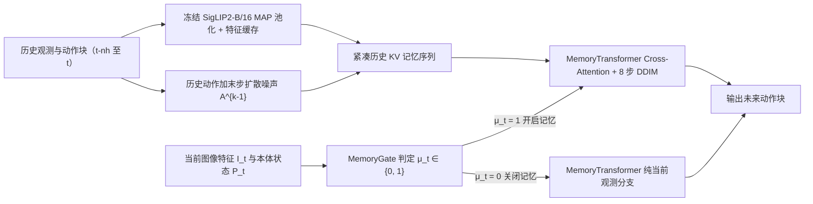
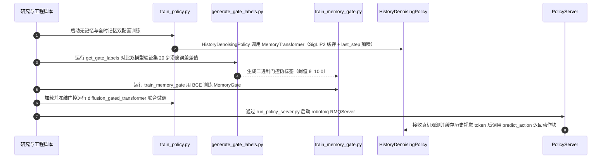

# Gated Memory Policy（arXiv:2604.18933）

**Gated Memory Policy（GMP）**（Yihuai Gao, Jeff Jinyun Liu, Shuang Li, Shuran Song；Stanford University；RSS 2026；[arXiv:2604.18933v2](https://arxiv.org/abs/2604.18933)，[项目页](https://gated-memory-policy.github.io/)，[代码](https://github.com/real-stanford/gated-memory-policy)）针对长程和跨试次操作中「全局堆砌历史容易过拟合、缺乏历史又无法消解状态歧义」的两难问题，提出**缓存紧凑历史摘要 + 历史动作末步扩散噪声 + 离线误差标定的学习型二进制门控**。

## 一句话定义

**通过冻结缓存每块历史观测与末步加噪历史动作降低长历史计算与过拟合风险，并利用无记忆与全时记忆策略在验证集上的误差差值训练二进制门控，让扩散策略只在真正需要历史依据的时刻开启记忆。**

## 英文缩写速查

| 缩写 | 英文全称 | 简要说明 |
|------|----------|----------|
| GMP | Gated Memory Policy | 本文门控记忆 visuomotor 扩散策略 |
| DiT | Diffusion Transformer | 本文承载历史交叉注意力的骨干结构（`MemoryTransformer`） |
| STE | Straight-Through Estimator | 二进制门控微调梯度直通估计器（`BinaryGatingSTE`） |
| BCE | Binary Cross-Entropy | 训练 `MemoryGate` 预测何时开启记忆的二分类损失 |
| MemMimic | Memory Mimic Benchmark | 本文提出的 6 项非马尔可夫与跨试次自适应评测基准 |

## 为什么重要

- **解决长历史「不记会错、乱记掉点」的双重困境：** 在 RoboMimic `Tool Hang` 等马尔可夫强反应任务上，盲目接入 120 步历史上下文会使策略过拟合历史轨迹伪相关而性能大幅下滑；而记忆任务又离不开数百步前的线索。
- **跨分钟尺度仍保持恒定推理耗时：** 通过每块仅保留 1 个 MAP 池化的冻结 SigLIP2 图像 token 并在重叠训练与推理时缓存，使 5–600 秒（高达 6,000 帧 @ 10 fps）长延迟任务推理耗时稳定在 **0.16 s**（RTX 5090，8 步 DDIM）。
- **证明跨试次在线学习也可被写入紧凑上下文：** 在多次投抛、推挤或试探性翻杯任务中，机器人无需更新权重即可依靠前期失败动作与结果证据实时修正下一次动作。

## 核心信息

| 字段 | 内容 |
|------|------|
| **论文** | Gated Memory Policy: In-Context Memorization and Adaptation（[arXiv:2604.18933v2](https://arxiv.org/abs/2604.18933)，RSS 2026） |
| **作者 / 机构** | Yihuai Gao, Jeff Jinyun Liu, Shuang Li, Shuran Song（Stanford University） |
| **网络结构** | `HistoryDenoisingPolicy` + `MemoryTransformer`（DiT） + 冻结 SigLIP2-B/16 MAP + `MemoryGate`（BCE 离线标定） |
| **平台与基准** | `MemMimic`（仿真 + 真机 UR5+WSG50 与 ARX X5+iPhUMI）、`MIKASA-Robo`（5 任务）、`RoboMimic`（Tool Hang / Square / Transport） |
| **开源状态** | **全链路已开源** — MIT 代码（含环境子模块与 `PolicyServer`）+ HF 数据及预训练模型权重 |

## 流程总览

## 核心原理

### 1. 紧凑特征缓存与线性历史 Cross-Attention

为防止自回归注意力随历史步数二次增长，GMP 将过往历史划分为轨迹块，每个块仅压缩为 **1 个冻结 SigLIP2-B/16 注意力池化（MAP）视觉 token** 与 `h` 个动作 token，并在重叠轨迹训练（Overlapped Trajectory Training）及在线推理时缓存历史图像特征避免重复前向计算。当前动作去噪序列通过 `MemoryTransformer` 中的 `HistoryCrossAttention` 线性读取该记忆池。

### 2. 历史动作末步扩散加噪（`last_step` Noise Injection）

训练阶段，如果把干净的地面真实历史动作直接喂给网络，模型会学会复制刚过去的动作速度/方向而忽略视觉变化。GMP 向历史动作区间 $A_{t-nh:t}$ 注入接近扩散推理末步强度的微弱噪声（$A_{t-nh:t}^{k-1}$，对应仓库中的 `last_step` 模式）。实验证实其表现明显优于无噪声、纯随机噪声以及独立逐时间步加噪的 Diffusion Forcing 方式。

### 3. 基于验证集误差标定的二进制门控（Offline Gate Calibration）

门控并不是凭主观标签硬写，而是两阶段自动化标定并训练：
1. **误差对比打标（`generate_gate_labels.py`）：** 在验证集 $D_{\text{val}}$ 上同时评估无记忆基线 $\pi$ 的预测误差 $\delta_t$ 与全时开启记忆模型 $\pi_{\text{mem}}$ 的误差 $\delta_t^{\text{mem}}$；当 20 步滑动窗口内的记忆收益超过阈值（默认 $\theta = 10.0$）时标为 $\mu_t^* = 1$（需要记忆），否则为 $0$。
2. **BCE 训练与冻结联合微调：** 用上述伪标签经二元交叉熵训练 `MemoryGate`（`train_memory_gate.py`），再冻结门控参数以 `BinaryGatingSTE` 微调最终策略 `diffusion_gated_transformer`。

## 实验与评测

| 基准 | 任务与评估设置 | 核心表现 |
|------|----------------|----------|
| **MemMimic（6 任务）** | T1 Match Color（仿真）、T2 Discrete Place Back（仿真）、T3' Continuous Place Back（真机 UR5+WSG50）、T3 Flip & Place Back（真机 ARX X5，6 未见环境/10 杯/20 episodes）、T4 Iterative Pushing（仿真 6 次）、T5 Iterative Flinging（仿真 5 次）、T6 Iterative Casting（真机 3 次） | 相对多种长历史基线（帧堆叠 / RNN / 固定窗口等），全集平均成功率 **+30.1%** |
| **超长时延压力测试** | T1 Match Color 在展示线索后人工插入 **5–600 s** 延迟（最长 6,000 帧 @ 10 fps） | 依然稳定达到 **`99.0%±1.0%`** 成功率，单步推理耗时维持在 **0.16 s** |
| **MIKASA-Robo** | 5 项经典视觉记忆操作任务（每任务 250 demos） | 平均成功率相对 **MemoryVLA** 提升 **+26.6%** |
| **RoboMimic 马尔可夫基准** | Tool Hang / Square / Transport（ph/mh） | 门控主动学习在马尔可夫阶段保持关闭（Match Color 关门率 **73%**、Iterative Pushing **58%**），保留近无记忆基线的反应性能而不掉点 |

## 结论

**GMP 用可审计的双策略误差差值回答了「什么时候该看历史」——只有当历史上下文确实能降低验证动作误差时才打开门控，否则果断退回纯当前观测反馈控制。**

- **门控本身不是必选项而是防退化保险（Finding 8.9）：** 论文在真机全长跨度任务 **T3 ARX X5** 上采用了始终开启记忆的无门控变体并取得高成功率；门控在包含大量高频马尔可夫交互阶段（如 Tool Hang、Match Color 等待前奏）的任务中最能抑制误触过拟合。
- **训练历史动作加噪方式决定策略是否偷懒：** `last_step` 弱噪声迫使扩散解码器结合当前观察而非机械外推过去轨迹。
- **工程性价比高：** 缓存冻结 SigLIP2 视觉 token 使推理耗时与数分钟级别的历史跨度基本解耦。
- **相比 VLA 记忆插件更贴近高频连续控制：** 直接在轻量 DiT 扩散策略层集成，端到端 8 步 DDIM 约 0.16 s 即完成推演。

## 源码运行时序图

代码仓 [real-stanford/gated-memory-policy](https://github.com/real-stanford/gated-memory-policy)（含核心子模块 `imitation-learning-policies/`）的三阶段训练、标定与 `PolicyServer` 真机服务流水线如下：

- **主要代码模块：** `imitation-learning-policies/scripts/{train_policy,generate_gate_labels,train_memory_gate,eval_model,run_policy_server}.py`、`imitation_learning/policies/history_denoising_policy.py`（`HistoryDenoisingPolicy`）、`imitation_learning/models/denoising_networks/memory_transformer.py`（`MemoryTransformer`）、`imitation_learning/models/common/memory_gate.py`（`MemoryGate`）及 `imitation_learning/envs/policy_server.py`（`PolicyServer`）。

## 工程实践

| 实践项 | 具体说明与注意事项 |
|--------|--------------------|
| **子模块初始化** | 克隆主仓后需同步 `git submodule update --init` 以拉取 `imitation-learning-policies`、`mujoco-env`、`mikasa-robo-env` 与 `real-env`（`gated-memory-policy` 分支） |
| **公开权重与数据** | Hugging Face `yihuai-gao/gated-memory-policy` 已托管全套 MemMimic/仿真数据集与训练好的 checkpoint |
| **真机服务通信** | 真机依托 `robotmq.RMQServer`（`PolicyServer._predict_action`）做远程低延迟服务，历史视频帧视觉 token 在服务器端递增缓存 |
| **是否启用门控决策** | 纯长跨度记忆（如 T3 真机）可直接部署无门控全开版本省去一轮标定；混合强反应长程任务则强烈建议执行门控标定防止反应精度下降 |

## 局限与风险

- **两阶段三模型训练开销：** 完整门控方案需先分别训好无记忆和有记忆基线、跑验证集打标、再训门控、最后二阶段微调策略，工作流长于单阶段策略。
- **固定块压缩对超精细空间对齐的损失：** 每块仅压缩为 1 个 SigLIP2 MAP 全局特征，主要记忆物体属性、容器关系与尝试结果，不适合重建需要像素级亚毫米对齐的过往几何细节。
- **验证集阈值与窗口依赖：** $\theta=10.0$ 与 20 步滑动窗口在跨任务量纲差异大（如末端位移尺度与关节空间差异）时需重新校准，否则门控可能全开或全关。

## 与其他工作对比

| 方法 | 骨干与记忆载体 | 何时/如何筛选记忆 | 适用侧重 |
|------|----------------|-------------------|----------|
| **GMP（本页）** | DiT 扩散策略 + SigLIP2 MAP 缓存 + 加噪历史动作 | 验证集双模型误差标定的二进制 `MemoryGate` | 低延迟高频连续控制 + 跨数分钟与跨试次自适应 |
| **[KEMO](./paper-kemo-event-driven-keyframe-memory-vla.md)** | $\pi_{0.5}$ VLA + SigLIP 关键帧 4×4 池化 | 运动学减速显著峰 + DINOv2 视觉去重 | 长程双臂 VLA 阶段消歧（门控作用于视觉残差） |
| **[BPP](./paper-behavior-prompting-policy.md)** | Transformer + Diffusion UNet | 外部给定单条人类示教 `behavior prompt` | 零梯度迁移未见任务与风格（不以记忆自身长期试错为主） |
| **MemoryVLA / 帧堆叠** | VLA token merge / 稠密窗口 | 全时段无差别写入压缩记忆 | 易被冗余帧稀释；在 MIKASA-Robo 上显著落后 GMP（−26.6 pt） |

## 关联页面

- [Diffusion Policy](../methods/diffusion-policy.md) — 扩散动作生成基座与时序多模态特性
- [Imitation Learning](../methods/imitation-learning.md) — 非马尔可夫模仿学习策略定位
- [Behavior Prompting Policy（BPP）](./paper-behavior-prompting-policy.md) — 外部提示式上下文策略对比
- [KEMO](./paper-kemo-event-driven-keyframe-memory-vla.md) — 事件驱动关键帧记忆 VLA 对照
- [机器人 In-Context Learning](../concepts/robot-in-context-learning.md) — 上下文记忆与跨试次适应谱系
- [Manipulation](../tasks/manipulation.md) — 桌面物体操作与长时记忆任务场景
- [REALab 14 篇技术地图（2026）](../overview/realab-14-papers-technology-map-2026.md) — 脉络 #01（基础模型与策略微调 #05）
- [具身上下文学习（ICL）纵深路线](../../roadmap/depth-icl.md) — Stage 4 长程上下文记忆代表

## 参考来源

- [arXiv 论文全文精读笔记（2604.18933v2）](../../sources/papers/gated_memory_policy_arxiv_2604_18933.md)
- [官方项目页核查归档](../../sources/sites/gated-memory-policy-github-io.md)
- [GitHub 仓库源码解析（real-stanford/gated-memory-policy）](../../sources/repos/real-stanford-gated-memory-policy.md)
- [深蓝 AI：斯坦福 REALab 14 篇工作盘点](../../sources/blogs/wechat_shenlan_realab_14_papers_2026.md)

## 推荐继续阅读

- 论文 PDF：<https://arxiv.org/abs/2604.18933>
- 官方项目页：<https://gated-memory-policy.github.io/>
- GitHub 源码：<https://github.com/real-stanford/gated-memory-policy>
- Hugging Face 数据与模型：<https://huggingface.co/datasets/yihuai-gao/gated-memory-policy>
