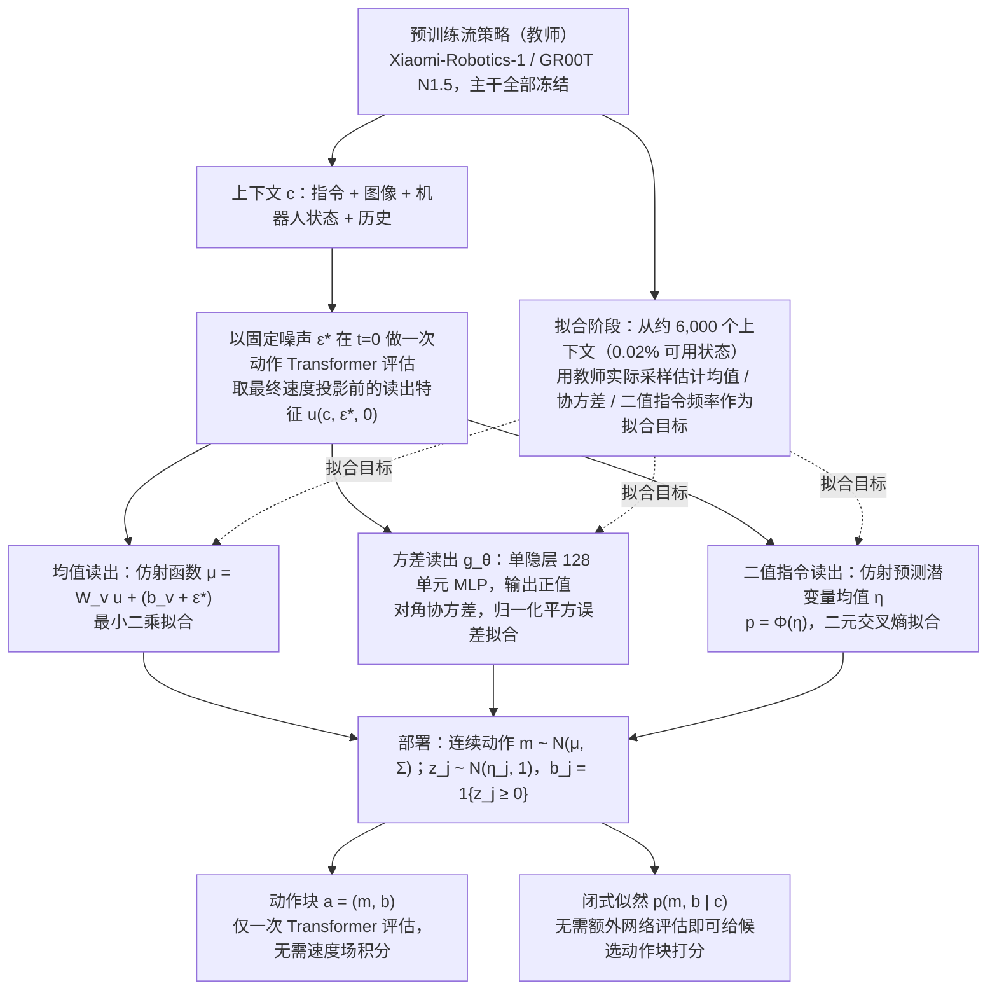

# 流策略高斯蒸馏：Flow 策略的高斯蒸馏

**流策略高斯蒸馏**（*Gaussian Distillation of Flow Policies*，[arXiv:2610.40271](https://arxiv.org/abs/2610.40271)）收录于 senlanke「具身运控lab」10-26–10-30 前沿论文动态（Manipulation）。本页依据**周报条目 + arXiv 摘要页**整理，流程图依据论文方法部分（见参考来源），未逐页核对实验数字；指标与结论以论文为准。

## 一句话定义

**流策略高斯蒸馏：Flow 策略的高斯蒸馏——提出 Gaussian Action Readout（GAR），用预测高斯均值和协方差的输出层替换 Flow Policy 最后一层，冻结其余网络。只使用约 0.02% 的可用训练状态拟合输出层，即可实现单次网络前向采样，并获得闭式动作概率密度。在 RoboCasa365 的 50 个任务中，蒸馏策略保持接近教师的成功率，推理速度最高提升约 2 倍。**

## 英文缩写速查

| 缩写 | 英文全称 | 简要说明 |
|------|----------|----------|
| VLA | Vision-Language-Action | 视觉–语言–动作模型 |
| IL | Imitation Learning | 模仿学习 |

## 为什么重要

- 周报所述待解决的问题：Flow Policy 需要多次网络前向传播才能生成动作，推理成本较高，也难以直接计算动作概率密度。

## 流程总览

图依据：论文 §4.1–4.2、式 (1)–(11) / Fig. 3。

## 核心机制

| 项 | 内容 |
|----|------|
| **arXiv** | [2610.40271](https://arxiv.org/abs/2610.40271) · [PDF](https://arxiv.org/pdf/2610.40271) |
| **作者（arXiv）** | Saied, Youssef, Sheebaelhamd, Ziyad, Vernade, Claire, Fleuret, François |
| **机构（周报所述，未逐条核实）** | 日内瓦大学、蒂宾根大学等。 |
| **arXiv 评论栏** | （无） |
| **开源** | arXiv 摘要页与评论未见代码或项目页链接（仅核对 arXiv 摘要页，不代表未发布）（2026-11-02） |
| **周报所述创新点** | 提出 Gaussian Action Readout（GAR），用预测高斯均值和协方差的输出层替换 Flow Policy 最后一层，冻结其余网络。只使用约 0.02% 的可用训练状态拟合输出层，即可实现单次网络前向采样，并获得闭式动作概率密度。在 RoboCasa365 的 50 个任务中，蒸馏策略保持接近教师的成功率，推理速度最高提升约 2 倍。 |

### arXiv 摘要节选（英文原文）

> Flow policies are among the strongest robot controllers and are well suited to modelling multimodal action distributions. Our analysis shows that the continuous-action distributions of the studied flow policies are well approximated by Gaussians.

## 源码运行时序图

**不适用**：arXiv 摘要页与评论未见代码或项目页链接（仅核对 arXiv 摘要页，不代表未发布），无可对齐的官方代码流程。

## 实验与评测

- 周报与摘要给出的数字/场景已写入上表「创新点」与摘要节选；其余实验细节、基线与成功率定义请回到论文正文。
- 读法：先对齐任务设定、传感器与成功定义（仿真/真机），再解读 headline 数字，勿跨论文直接比较。

## 与其他工作对比

| 维度 | 读法 |
|------|------|
| **同周对照** | 见 [Manipulation周报技术地图](../overview/senlanke-weekly-2026-10-26-30-manipulation-technology-map.md)，按方向浏览同期论文 |
| **开源状态** | arXiv 摘要页与评论未见代码或项目页链接（仅核对 arXiv 摘要页，不代表未发布） |

## 结论

**流策略高斯蒸馏：Flow 策略的高斯蒸馏。**

1. 本页是入库级摘要，复现前请核对论文正文、附录与代码仓库。
2. 指标须连同实验条件解读。
3. 关注 arXiv 版本更新与代码发布。

## 关联页面

- [senlanke-weekly-2026-10-26-30-manipulation-technology-map](../overview/senlanke-weekly-2026-10-26-30-manipulation-technology-map.md)
- [manipulation](../tasks/manipulation.md)
- [vla](../methods/vla.md)

## 参考来源

- [gaussian-distillation-flow-policies_arxiv_2610_40271.md](../../sources/papers/gaussian-distillation-flow-policies_arxiv_2610_40271.md)
- [wechat_senlanke_weekly_manipulation_2026-10-26_30.md](../../sources/blogs/wechat_senlanke_weekly_manipulation_2026-10-26_30.md)
- [arXiv:2610.40271](https://arxiv.org/abs/2610.40271)
- [arXiv PDF](https://arxiv.org/pdf/2610.40271)：已通读方法部分（实验与附录以略读为准）：§3 高斯性分析、§4 高斯蒸馏（GAR 的均值/方差/二值指令读出、拟合与执行）及 §5 实验设定（RoboCasa365、LIBERO-Long）

## 推荐继续阅读

- [arXiv PDF](https://arxiv.org/pdf/2610.40271)
