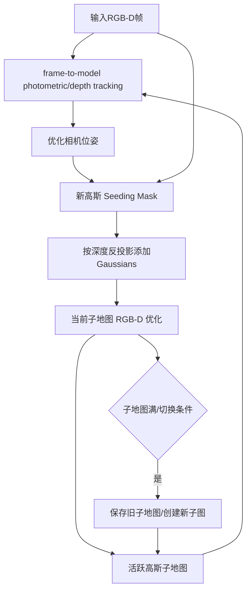
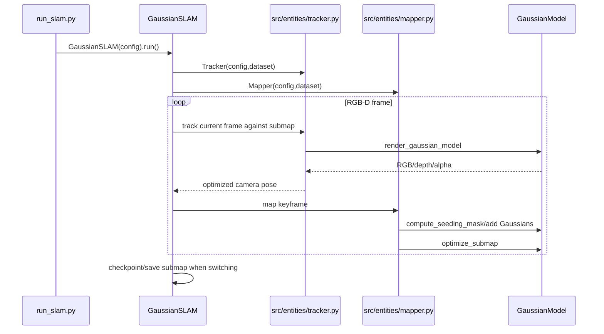

# Gaussian-SLAM — 论文与作者源码深读

## 一句话定义

Gaussian-SLAM 用分块 3D Gaussians 子地图对 RGB-D 视频做帧到地图相机追踪与局部渲染优化，实现可扩展且逼真的稠密 SLAM。

## 英文缩写速查

| 缩写 | 英文全称 | 简要说明 |
|---|---|---|
| SLAM | Simultaneous Localization and Mapping | 同步定位与建图 |
| RGB-D | Red Green Blue Depth | 彩色和对齐深度 |
| ATE | Absolute Trajectory Error | 位姿估计误差 |
| PSNR | Peak Signal-to-Noise Ratio | 渲染质量指标 |
| 3DGS | 3D Gaussian Splatting | 显式高斯场景表示 |

## 为什么重要

在机器人三维感知中，隐式体积场、显式高斯和传统点云的选择会影响在线相机跟踪、地图更新、渲染质量与系统时延。Gaussian-SLAM 的关键设计需要区分**地图表示、位姿优化、显式新区域处理和系统运行时间**。

## 核心原理与方法

主循环对每帧 RGB-D 先用已有子地图可微渲染相机视角的 color/depth，再结合光度和几何损失直接优化相机位姿；Mapper 用透明度与深度误差构造新高斯 seeding mask，对已知区域做稀疏采样更新。地图分为独立 submaps，只优化活跃子图，其他子图可卸载；区分场景大小和地图局部开销。论文 §3.2/3.3/3.4 均有明确算法。

## 流程总览（原论文）

## 源码运行时序图

README：python run_slam.py configs/Replica/room0.yaml --input_path ... --output_path ...；run_slam.py 装配 GaussianSLAM，src/entities/gaussian_slam.py::run 调用 src/entities/tracker.py 和 mapper.py；mapper.py::compute_seeding_mask/seed_new_gaussians/optimize_submap。 以下图依据作者源码主循环，不等于已在本环境运行。

## 实验与评测

原论文 arXiv:2312.10070v2 Table2 TUM-RGBD 八个序列 train-view RGB 渲染 PSNR 平均 **42.08 dB**、SSIM **0.996**、LPIPS **0.018**。**这是训练视角的 PSNR，不是未知相机视角的新视图指标**；与 SplaTAM/MonoGS 的其它 split 不应直接同列。作者 README 声称随机种子 0/1/2 三次结果取平均，Gaussian rasterizer 仍可能非确定性。

## 结论

**Gaussian-SLAM 用分块 3D Gaussians 子地图对 RGB-D 视频做帧到地图相机追踪与局部渲染优化，实现可扩展且逼真的稠密 SLAM。**

- 跟踪和建图使用不同梯度目标，不能把渲染速度等同在线 SLAM 总帧率。
- 数据集划分与 metric 必须与原论文一致，避免比较不同深度、相机位姿来源的结果。
- 对机器人部署必须先完成相机内参、深度外参、时间同步及真实硬件测量。

## 工程实践

README：python run_slam.py configs/Replica/room0.yaml --input_path ... --output_path ...；run_slam.py 装配 GaussianSLAM，src/entities/gaussian_slam.py::run 调用 src/entities/tracker.py 和 mapper.py；mapper.py::compute_seeding_mask/seed_new_gaussians/optimize_submap。

建议分别记录 ATE、深度 L1、PSNR 和关键帧时间成本，并把源码 commit、GPU、分辨率与传感器参数写入实验日志。

## 局限与风险

分块子地图存在跨边界地图一致性和全局回环的工程挑战；深度质量、初始位姿和 RGB-D 数据同步会改变优化；GPU 上 Gaussian rasterizer 非完全确定，必须报告重复 seed 的波动。未经测试不可把论文渲染质量解释为机器人在任意低纹理环境里成功定位。

## 关联页面

- [4D-GS（动态新视角合成）](./paper-4d-gaussian-splatting-wu.md)
- [COLMAP 稀疏/稠密重建](./colmap.md)
- [LVI-SAM](./paper-lvi-sam.md)

## 参考来源

- [论文深读来源档案](../../sources/papers/vision3d_gaussian_slam_primary_paper_20261108.md)
- [官方仓库深读档案](../../sources/repos/vision3d_gaussian_slam_20261108.md)
- [原文全文](https://arxiv.org/html/2312.10070)
- [原作者源码](https://github.com/VladimirYugay/Gaussian-SLAM)

## 推荐继续阅读

- [作者论文和补充材料](https://arxiv.org/html/2312.10070)
