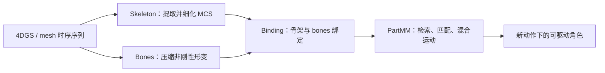

# GaussiAnimate：从 4D 角色序列自动构建可驱动绑定

**GaussiAnimate**（*Reconstruct and Rig Animatable Categories with Level of Dynamics*，arXiv:2604.08547，SIGGRAPH Asia 2026）提出 **Skelebones**：将 4D Gaussian Splatting（4DGS）或网格动画序列压缩为一层可控运动学骨架和一层表达柔性形变的自由形态 bones，再通过 Partwise Motion Matching（PartMM）合成新动作。

## 英文缩写速查

| 缩写 | 英文全称 | 简要说明 |
|------|----------|----------|
| 4DGS | 4D Gaussian Splatting | 随时间变化的三维高斯表示 |
| MCS | Mean Curvature Skeleton | 从规范形状提取的均值曲率骨架 |
| PartMM | Partwise Motion Matching | 按部件检索、匹配并混合已有运动 |
| LBS | Linear Blend Skinning | 线性混合蒙皮，用骨骼运动驱动表面 |
| Skelebones | Scaffold-Skin Rigging System | 骨架与自由形态 bones 结合的绑定表示 |

## 核心信息

| 项 | 内容 |
|----|------|
| 任务 | 从重建后的 4DGS 或网格序列自动建立角色绑定，并驱动未见动作 |
| 方法 | Skelebones：Bones 压缩、Skeleton 提取与时序细化、Binding 绑定 |
| 动作驱动 | 非参数 PartMM，匹配、检索和混合已有部件运动 |
| 适用对象 | 项目页展示穿衣人物、动物与服装等形变角色 |
| 机构 | 西湖大学、南京大学、香港大学、澳门科技大学 |
| 代码状态 | 截至 2026-10-15，项目页标注 Code Coming Soon，暂无公开代码仓库 |

## 为什么重要

- **把可控性与柔性形变拆层处理：** 内层骨架保留清楚的运动学结构，外层 bones 负责拟合衣物、软组织等复杂表面运动。
- **从表演重建到新动作驱动：** 输入是带时间变化的 Gaussian 或 mesh 序列；输出是可以继续驱动的角色绑定，而不是一段只能回放的表面动画。
- **PartMM 不等于通用动作生成模型：** 它从现有片段中匹配、检索与混合运动；覆盖范围受已有动作库与相似度匹配质量影响。
- **对机器人是上游资产思路：** 分层表示可启发数字人、仿真角色和动作资产编辑，但论文没有把动作映射到机器人关节，也没有报告机器人动力学或真机验证。

## 流程总览

## 核心机制

### 1. Bones：保留外观和非刚性细节

从时序一致的可变形高斯或网格中压缩出自由形态 bones，让其近似角色表面和局部形变。它补足传统细骨架对衣物飘动、软组织等非刚性动态表达不足的问题。

### 2. Skeleton：提取运动学控制结构

从规范形状计算均值曲率骨架（MCS），再按时间细化拓扑和运动学结构。骨架承担可理解的控制层，使表示能够跨对象类别适配，而不要求输入绑定到单一模板骨架。

### 3. Binding：用 PartMM 驱动外层形变

PartMM 将骨架和外层 bones 联系起来。面对新动作时，系统按部件匹配、检索并混合已有运动片段，以生成对应的 bones 运动。这个匹配过程是非参数的，不应把它误读为一个已训练的通用动作策略。

## 实验与评测

论文在合成和真实世界数据上验证再动画效果，覆盖未见姿态，并测试 Gaussian 与 mesh 两类表示。作者报告其在复杂非刚性动态角色上改善再动画表现，同时维持较高重建保真度；低数据量设置约 1,000 帧时，PartMM 相对 LBS 的 RMSE 改善明显。具体数据集、基线定义和数值应以论文表格为准，不能直接当作机器人策略或控制器性能指标。

## 结论

GaussiAnimate 的主要价值是从时序重建资产中自动得到兼顾运动学控制与柔性表面形变的角色绑定。

- 若输入是 4DGS / 网格动画且目标是重新驱动数字角色，可重点看 Skelebones 的分层表示。
- 若已有动作片段可复用，PartMM 提供了不依赖专门 motion predictor 的匹配与混合路线。
- 评估时应区分几何重建质量、再动画质量和动作检索覆盖度。
- 该方法不是机器人动作重定向器；到机器人仍需关节空间映射、约束处理与物理可行性验证。
- 复现计划应等官方代码链接发布后再确认；截至入库日项目页未开放代码仓库。

## 源码运行时序图

**不适用：** 截至 2026-10-15，项目页未公开可运行实现或代码仓库，无法据公开入口还原源码运行时序。

## 局限与风险

- **输入前提：** 方法以重建后的一致 4DGS 或网格序列为输入；不能把它等同于从单张图片直接完成扫描、建模、绑骨和动画。
- **动作库依赖：** PartMM 从已有片段进行检索和混合，未见动作效果取决于可用运动片段与匹配质量。
- **控制语义有限：** 可驱动角色不意味着符合关节力矩、接触或稳定性约束；项目没有给出机器人动力学验证。
- **开放状态：** 论文可读，项目演示可访问；代码尚待发布。

## 与其他工作对比

| 工作 | 输入 | 绑定 / 运动表示 | 新动作来源 | 开放状态 |
|------|------|------------------|------------|----------|
| GaussiAnimate | 4DGS 或网格时序序列 | MCS 骨架 + 自由形态 bones（Skelebones） | 非参数 PartMM 检索、匹配、混合已有片段 | 截至 2026-10-15 代码未发布 |
| [RigMo](./rigmo.md) | 原始变形 mesh 序列 | 无标注学习 Gaussian bones / skinning 与 SE(3) 运动 | 结构感知潜空间上的 Motion-DiT 生成 | VAE 训练与数据已开源，DiT 未发布 |
| 传统 LBS 绑定 | 静态网格 + 模板骨架 | 骨骼 + 线性混合蒙皮 | 外部动画 / 动捕 | 工具链成熟 |
| [GMR](../methods/motion-retargeting-gmr.md) | 人体参考运动 | 机器人关节空间 | 重定向已有人体运动 | 已开源 |

GaussiAnimate 与 RigMo 都从时序资产中发现可驱动结构，差别在于前者显式保留曲率骨架并以检索合成动作，后者把运动交给学习式生成模型；两者都停在角色动画层，与 GMR 这类机器人关节空间重定向不是同一阶段。

## 关联页面

- [Motion Retargeting Pipeline（动作重定向流水线）](../concepts/motion-retargeting-pipeline.md) — 4D 角色资产进入机器人动作链路前仍需重定向和物理筛选
- [Character Animation vs Robotics](../concepts/character-animation-vs-robotics.md) — 角色动画表示与机器人控制的边界
- [RigMo](./rigmo.md) — 从变形 mesh 序列联合发现 Gaussian bones / skinning 与运动的相邻方向
- [GMR（General Motion Retargeting）](../methods/motion-retargeting-gmr.md) — 把人体参考运动映射为机器人关节轨迹的实现

## 参考来源

- [GaussiAnimate 论文归档](../../sources/papers/gaussianimate_arxiv_2604_08547.md)
- [GaussiAnimate 官方项目页归档](../../sources/sites/gaussianimate.md)

## 推荐继续阅读

- [GaussiAnimate 官方项目页](https://cookmaker.cn/gaussianimate/) — 方法概览与演示
- [arXiv:2604.08547](https://arxiv.org/abs/2604.08547) — 论文全文
- [RigMo](./rigmo.md) — 对比无标注网格 rig 发现与动作表征路线
