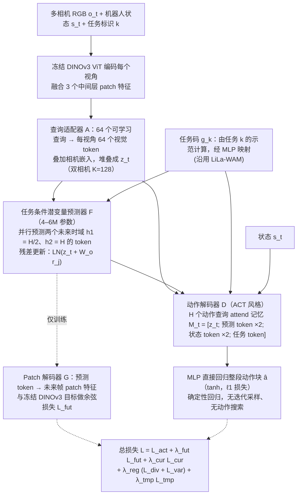

# GAWM：面向多任务机器人操作的紧凑潜在世界动作模型

**GAWM**（*GAWM: A Compact Latent World-Action Model for Multi-Task Robot Manipulation*，[arXiv:2610.37091](https://arxiv.org/abs/2610.37091)）收录于 senlanke「具身运控lab」10-26–10-30 前沿论文动态（Manipulation）。本页依据**周报条目 + arXiv 摘要页**整理，流程图依据论文方法部分（见参考来源），未逐页核对实验数字；指标与结论以论文为准。

## 一句话定义

**GAWM：面向多任务机器人操作的紧凑潜在世界动作模型——使用冻结的 DINOv3 Encoder，将每个相机视角压缩成少量 Token。轻量预测器根据任务条件预测两个未来时间尺度的视觉 Latent，再由动作 Decoder 生成动作块。模型参数量低于 100M，无需机器人或视频预训练，在 RoboTwin 2.0 上超过论文比较的部分十亿参数 WAM。**

## 英文缩写速查

| 缩写 | 英文全称 | 简要说明 |
|------|----------|----------|
| WAM | World Action Model | 世界–动作联合建模 |
| VLA | Vision-Language-Action | 视觉–语言–动作模型 |

## 为什么重要

- 周报所述待解决的问题：大型 WAM 通常依赖数十亿参数的视觉语言或视频生成模型，训练成本和推理延迟较高。

## 流程总览

图依据：论文 §III-A–E / Fig. 2、式 (1)–(6)。

## 核心机制

| 项 | 内容 |
|----|------|
| **arXiv** | [2610.37091](https://arxiv.org/abs/2610.37091) · [PDF](https://arxiv.org/pdf/2610.37091) |
| **作者（arXiv）** | Liu, Yang, Liu, Xiaoli, Li, Liuzhao, Song, Yuduo, Liu, Muyuan, Gao, Xiang |
| **机构（周报所述，未逐条核实）** | Genisom AI。 |
| **arXiv 评论栏** | （无） |
| **开源** | arXiv 摘要页与评论未见代码或项目页链接（仅核对 arXiv 摘要页，不代表未发布）（2026-11-02） |
| **周报所述创新点** | 使用冻结的 DINOv3 Encoder，将每个相机视角压缩成少量 Token。轻量预测器根据任务条件预测两个未来时间尺度的视觉 Latent，再由动作 Decoder 生成动作块。模型参数量低于 100M，无需机器人或视频预训练，在 RoboTwin 2.0 上超过论文比较的部分十亿参数 WAM。 |

### arXiv 摘要节选（英文原文）

> World-action models (WAMs) incorporate the prediction of future observations into robot policy learning. However, most WAMs build on billion-parameter vision-language or video-generation backbones, which incur high training cost and inference latency.

## 源码运行时序图

**不适用**：arXiv 摘要页与评论未见代码或项目页链接（仅核对 arXiv 摘要页，不代表未发布），无可对齐的官方代码流程。

## 实验与评测

- 周报与摘要给出的数字/场景已写入上表「创新点」与摘要节选；其余实验细节、基线与成功率定义请回到论文正文。
- 读法：先对齐任务设定、传感器与成功定义（仿真/真机），再解读 headline 数字，勿跨论文直接比较。

## 与其他工作对比

| 维度 | 读法 |
|------|------|
| **同周对照** | 见 [Manipulation周报技术地图](../overview/senlanke-weekly-2026-10-26-30-manipulation-technology-map.md)，按方向浏览同期论文 |
| **开源状态** | arXiv 摘要页与评论未见代码或项目页链接（仅核对 arXiv 摘要页，不代表未发布） |

## 结论

**GAWM：面向多任务机器人操作的紧凑潜在世界动作模型。**

1. 本页是入库级摘要，复现前请核对论文正文、附录与代码仓库。
2. 指标须连同实验条件解读。
3. 关注 arXiv 版本更新与代码发布。

## 关联页面

- [senlanke-weekly-2026-10-26-30-manipulation-technology-map](../overview/senlanke-weekly-2026-10-26-30-manipulation-technology-map.md)
- [manipulation](../tasks/manipulation.md)
- [vla](../methods/vla.md)

## 参考来源

- [gawm-compact-latent-world-action-model_arxiv_2610_37091.md](../../sources/papers/gawm-compact-latent-world-action-model_arxiv_2610_37091.md)
- [wechat_senlanke_weekly_manipulation_2026-10-26_30.md](../../sources/blogs/wechat_senlanke_weekly_manipulation_2026-10-26_30.md)
- [arXiv:2610.37091](https://arxiv.org/abs/2610.37091)
- [arXiv PDF](https://arxiv.org/pdf/2610.37091)：已通读方法部分（实验与附录以略读为准）：方法 §III-A–E（问题形式化、视觉编码、任务条件预测器、预测监督、动作解码器与训练目标）与 §IV-A 实验设定

## 推荐继续阅读

- [arXiv PDF](https://arxiv.org/pdf/2610.37091)
