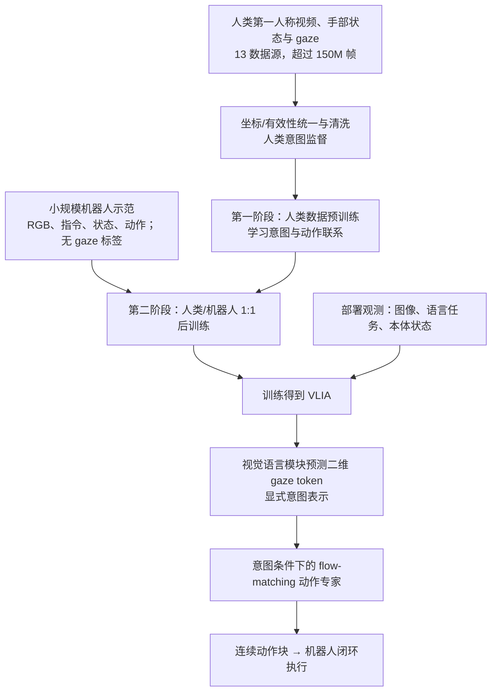
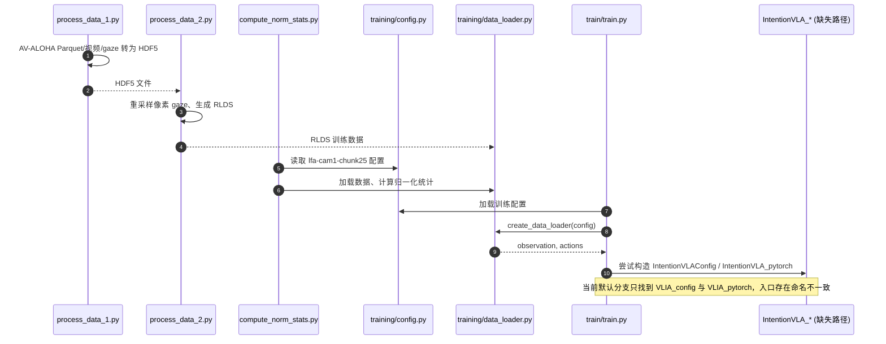

# GazeVLA：从人类注视学习机器人操作意图

**GazeVLA**（*GazeVLA: Learning Human Intention for Robotic Manipulation*，[arXiv:2604.22615v3](https://arxiv.org/abs/2604.22615)，[官网](https://gazevla.github.io/)）是宁波东方理工大学、上海交通大学、北京大学和上海科技大学合作的 **CoRL 2026 Spotlight** 工作。论文把人类眼动（gaze）作为动作出现前的**意图线索**，以跨本体共享的中间表示连接人类视频学习和机器人操作。正文将核心模型称为 **VLIA**，不要把该模型名与项目名 GazeVLA 混为一谈。

## 一句话定义

**以第一人称二维注视点作为可监督的“我要操作哪里”意图变量：先通过视觉语言骨干预测 gaze token，再让动作专家生成连续机器人动作，机器人演示本身无须标注 gaze。**

## 英文缩写速查

| 缩写 | 英文全称 | 简要说明 |
|---|---|---|
| GazeVLA | Gaze Vision-Language-Action | 使用人类注视监督意图的机器人学习项目 |
| VLIA | Vision-Language-Intention-Action | 论文内部的“视觉/语言→意图→动作”模型 |
| VLA | Vision-Language-Action | 视觉-语言-动作模型 |
| VLM | Vision-Language Model | 预测离散注视意图的视觉语言骨干 |
| FM | Flow Matching | 连续动作块生成训练目标 |
| RLDS | Reinforcement Learning Datasets | 官方 AV-ALOHA 数据转换后供训练读取的格式 |

## 为什么重要

- **人–机动作空间不一致。** 人手与机械臂的关节、动力学不同，直接复制动作难以利用大规模人类视频；同一画面中的目标注视可以是较稳定的任务中间变量。
- **“先意图后动作”可训练。** 相比仅靠语言/图像条件回归动作，VLIA 把 gaze 作为显式中间变量，并分别监督意图预测与动作生成。
- **机器人端不用眼动仪。** 训练时以有眼动标注的人类数据学习意图，机器人示范只提供观测和动作；推理时由模型预测 gaze，而不是要求真实操作者持续给出眼动坐标。
- **有限机器人示范的收益。** 论文通过 AV-ALOHA、真实 ALOHA 和 Unitree G1 的实验报告了性能增益，但并非无需机器人后训练的零样本方案。

## 核心信息

| 项 | 论文/官方材料给出的范围 |
|---|---|
| 作者 | Chengyang Li、Kaiyi Xiong、Yuan Xu、Lei Qian、Yizhou Wang、Wentao Zhu |
| 机构 | 宁波东方理工大学（Eastern Institute of Technology, Ningbo）；上海交通大学（SJTU）；北京大学（PKU）；上海科技大学（ShanghaiTech） |
| 会议 | CoRL 2026 Spotlight |
| 论文版本 | arXiv:2604.22615v3，2026-11-02 |
| 人类数据 | 汇集 13 个第一人称数据源，超过 150M 帧 |
| 意图代理 | 二维注视坐标，离散成两个轴向 token |
| 主要架构 | PaliGemma-2 / SigLIP 视觉语言骨干 + flow-matching 动作专家 |
| 官方开源 | [训练代码](https://github.com/lichy2004/GazeVLA) + [数据处理代码](https://github.com/lichy2004/GazeVLA-Data)；权重及评测脚本暂未发布 |

## 流程总览

**数据流解释：** 模型在人体数据上学习 `视觉/语言→注视意图→动作` 的组织方式，随后用人–机混合数据适配机器人动作；机器人数据缺少 gaze 标签并不阻止后训练。图示为论文机制归纳，不表示已独立执行官方代码。

## 核心机制

### 1. 以二维注视点代替直接对齐人机关节

论文把操作意图参数化为图像平面中的 2D gaze `(h, w)`；在 224×224 视觉输入下，把每一坐标轴量化为离散 token。大规模人类第一人称数据还统一了手部运动等字段，论文用 48 维手部动作表示配合人类演示。目标不是假定注视点总是与接触点一致，而是利用 gaze 对未来操作目标的统计预示性。

### 2. 显式“意图 → 动作”分解

论文给出近似建模：

`p(a, i | s, o, l) = p(i | o, l) × p(a | i, s, o, l)`

其中 `o` 为视觉，`l` 为语言，`s` 为状态，`i` 为注视意图，`a` 为连续动作。前半段由视觉语言模块预测意图 token；后半段的动作专家以预测意图、状态与观测为条件，以 conditional flow matching 学习动作块。相较把 gaze 当作输入的行为复制，这里**测试时的 gaze 是模型自己预测的**。

### 3. 人类大规模预训练与机器人后训练

人类数据阶段监督意图与人体动作关系；后训练阶段混合人类与机器人示范（论文给出的配置为 1:1），将行为映射到机器人控制空间。关键限制是人类演示需要 gaze 等监督，而机器人演示**不要求**额外 gaze 标签；这并不等于机器人动作数据完全不需要。

## 源码运行时序图

官方 README 有训练入口，但源代码中模型类名引用不一致，以下区分“读取到的调用”与“尚未证明跑通”。

源码路径已经逐一核对：[官方训练代码归档](../../sources/repos/gazevla_code.md)。只有**修复模型引用并成功安装依赖后**，才可能验证 `model(observation, actions)` 计算 gaze 分类/回归与动作损失，执行 optimizer step 与 checkpoint；上图不声称跑通过。

## 工程实践

| 步骤 | 官方入口或注意事项 |
|---|---|
| 准备 AV-ALOHA | [官方数据来源](https://github.com/Soltanilara/giava)，处理脚本 `examples/process_data_1.py` → `examples/process_data_2.py`（HDF5→RLDS） |
| 归一化 | `python scripts/compute_norm_stats.py --config-name lfa-cam1-chunk25` |
| README 训练命令 | `torchrun --nnodes=1 --nproc_per_node=1 scripts/train/train.py lfa-cam1-chunk25 --exp_name=lfa-cam1-chunk25` |
| 训练配置 / 模型文件 | `src/openpi/training/config.py`；`src/openpi/models/VLIA_config.py`；`src/openpi/models_pytorch/VLIA_pytorch.py` |
| 现阶段复现阻塞 | `train.py` 的 `IntentionVLA_*` 引用找不到对应模块；评测脚本及预训练 checkpoint 未发布 |
| 人类数据处理 | [GazeVLA-Data](https://github.com/lichy2004/GazeVLA-Data)：README 标出 EgoDex/HOT3D 已支持，其他数据源有 TODO；获取 MANO 需遵守其单独许可 |

**开源判定：部分开源。** 训练源文件及数据处理工具可以检查，不能等同于论文所有训练设置、数据与真机评测均已可一键复现。README 中的 clone/path 示例也与实际仓库/代码路径不完全一致。

## 实验与评测

**以下是论文作者报告的数字，不是独立复现结果。** 不同实验条件、样本预算、成功率聚合方式不可混作统一排行榜。

| 评测 | GazeVLA/VLIA | 对照/读法 |
|---|---:|---|
| AV-ALOHA，六任务 ID 平均成功率 | **49%** | π0.5 **41%**，LFA **43%**，HRDT **39%** |
| AV-ALOHA，OOD 干扰物平均 | **28%** | π0.5 **22%** |
| AV-ALOHA，OOD 光照平均 | **27%** | π0.5 **23%** |
| ALOHA + Unitree G1 真实机器人六任务 | **+12.1 pp** | 相对 π0.5 的六任务平均增益 |
| Pick-and-place，无意图→完整模型，ID | **16/20→19/20** | 小样本消融；不等同大规模统计结论 |
| Pick-and-place，无人类预训→完整，OOD-Scene | **0/10→6/10** | 小样本消融 |
| Fruit Collecting：预测/真实 gaze | **65% / 65%** | VLM keypoint 50%，无意图 40%，随机 25% |

论文也报告 gaze 平均定位误差约 **11 px**（224×224 图像下）。对预测意图做人为干预会改变抓取目标，是“中间意图被策略使用”的机制证据，但不是对所有机器人任务因果可控的证明。

## 结论

**GazeVLA 表明：把人类注视点转成可监督的离散意图、再条件化连续动作，能为人类视频到机器人操作提供比直接跨本体复制动作更可解释的接口。**

1. **对照对象必须一致：** 49% 对 41% 是 AV-ALOHA 六任务 ID 的作者报告，不可直接推广为全部基准的统一提升。
2. **不要误读“无标注”：** 无须标注的是**机器人侧 gaze**；人类预训练仍需要注视信息和动作整理。
3. **方法重点在信息流：** gaze 不只是注意力热图，而是动作生成前可单独预测、监督、干预的中间变量。
4. **评估离线效果与部署成本要分开：** 先预测意图引入额外推理工作，机器人仍依赖后训练。
5. **开源入口尚不完整：** 代码路径不一致、权重/评测脚本缺失；不能据此承诺立即复现论文的真机数字。

## 局限与风险

- **泛化边界：** 实验集中在特定仿真与真实操作任务；尚不足以声称可直接迁移至全身人形 loco-manipulation。
- **额外计算：** 意图 token 的预测增加推理链长度；论文讨论了计算开销和机器人数据依赖。
- **监督噪声与偏差：** gaze 可能提前扫视环境而非直接锁定目标，第一人称头部运动、遮挡、注视精度会影响意图标签。
- **复现与授权：** 官方权重及评测脚本尚未公开，README、LICENSE 关于 Apache-2.0 / MIT / CC BY-NC 4.0 表述不一致；商用前必须核实许可证与数据协议。

## 关联页面

- [VLA](../methods/vla.md) — 视觉语言动作策略的统一背景
- [模仿学习](../methods/imitation-learning.md) — 人类示范与机器数据的训练基线
- [Indi：意图蒸馏 VLA](./paper-indi.md) — 另一种对动作解码器施加意图监督的路线
- [VLA-Tug](./paper-vla-tug.md) — 行动前意图与执行中故障监测是互补接口
- [机器人操作任务](../tasks/manipulation.md) — 成功率和动作空间评估语境

## 参考来源

- [GazeVLA arXiv v3 全文归档](../../sources/papers/gazevla_arxiv_2604_22615.md)
- [官方项目主页归档](../../sources/sites/gazevla_project.md)
- [官方训练代码及源码问题归档](../../sources/repos/gazevla_code.md)
- [官方数据处理代码归档](../../sources/repos/gazevla_data.md)

## 推荐继续阅读

- [arXiv:2604.22615v3](https://arxiv.org/abs/2604.22615) — 论文原文与补充材料
- [GazeVLA 项目页](https://gazevla.github.io/) — 演示、研究概览、原始资料入口
- [GazeVLA 官方训练代码](https://github.com/lichy2004/GazeVLA) 与 [数据处理代码](https://github.com/lichy2004/GazeVLA-Data) — 源码可得部分与待发布列表
