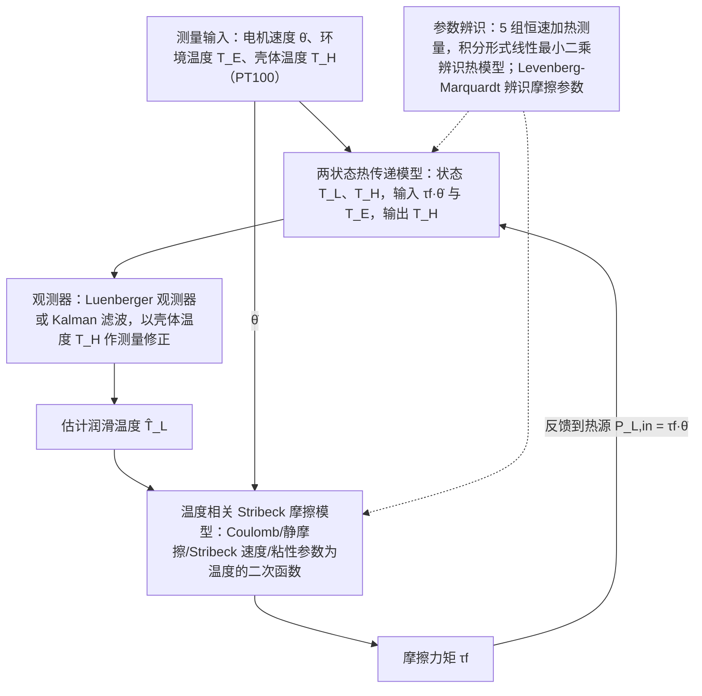

# Gearbox Lubricant Temperature Observer（arXiv:2610.23881）

**Gearbox Lubricant Temperature Observer**（*Lubricant Temperature Observer for Gearboxes in Industrial Robots*，[arXiv:2610.23881](https://arxiv.org/abs/2610.23881)，[项目页](https://doi.org/10.18419/DARUS-5015)）来自 [具身智能小站 2026-11-01 盘点](../../sources/blogs/wechat_embodied_station_56_papers_libero_dynamic_latency_eval_2026-11-01.md)，属「感知、规划与系统」组。

## 一句话定义

**用两状态热模型结合壳体温度观测器，估计工业机器人齿轮箱润滑温度；台架测量验证方法，为热误差补偿提供输入，静置时的润滑脂行为仍难建模。**

## 英文缩写速查

| 缩写 | 英文全称 | 简要说明 |
|------|----------|----------|
| Gearbox Lubricant Temperature Observer | Lubricant Temperature Observer for Gearboxes in Industrial Robots | 本文方法 / 基准的简称 |

## 为什么重要

- 不测齿轮箱内部，也能估计润滑温度。
- 开源结论：**项目页未列 GitHub**（步骤 2.5，2026-11-01）。公众号项目页入口为数据集 DOI（HTTP 200），未见代码仓库。
- 同期同组工作见 [动态评测、技能编译与环境潜变量适配：具身智能小站 11-01 期 56 篇阅读坐标](../overview/embodied-station-2026-11-01-56-papers-technology-map.md)。

## 流程总览

图依据：论文 §II-A 至 §II-C / Fig.2。

## 核心机制

| 项 | 内容（原文 §II–§III 实证） |
|----|------|
| **arXiv** | [2610.23881](https://arxiv.org/abs/2610.23881) |
| **实验台架** | **Nabtesco RH380-N** 摆线减速器（185:1，3724 N·m）+ **RV GREASE LB00**（200–9000 mPa·s）+ Bosch Rexroth MSK070D + 3×PT100（<±0.1 K） |
| **两状态热参数** | $C_L=168.6251\,\text{J/K}$，$C_H=95.8339\,\text{J/K}$，$K_{LH}=0.2132\,\text{W/K}$，$K_{HE}=0.0661\,\text{W/K}$（积分最小二乘辨识） |
| **观测器设计** | Luenberger 增益 $L=[0.1675, 0.0368]^\top\,\text{s}^{-1}$；Kalman $Q=\text{diag}(0.4, 0.01)\,\text{K}^2$，$R=7.2855\times10^{-5}\,\text{K}^2$ |
| **开源状态** | **项目页未列 GitHub**：仅 DaRUS DOI（`10.18419/DARUS-5015`）公开实验温度数据集，观测器代码未开源 |

## 源码运行时序图

**不适用（项目页未列 GitHub）** — 数据集 DOI（`https://doi.org/10.18419/DARUS-5015`，HTTP 200）只公开实验测量时序数据；文中观测器在 MATLAB/Simulink 基于测量回放验证，未发布可执行源码仓库。

## 工程实践

| 环节 | 关键经验（ISW 实验室验证） |
|---|---|
| 参数辨识避微噪 | 对两状态微分方程积分后作线性最小二乘，避免直接对带噪 $T_L, T_H$ 测量求数值导数 |
| 传感器低成本替代 | 工业关节内部难以加装润滑温感，可通过低成本外壳磁性/表面 PT100 结合 $T_H$ 观测重构油温 |
| 初始误差自愈 | 初值错设 10 K（实际 40 °C 误设 30 °C）时，纯开环模型 13 min 后仍偏差 **−5 K**；Luenberger 与 Kalman 均在约 **3.2 min** 内收敛 |
| 自稳闭环机理 | 高估 $T_L$ → 预测粘度下降 → 摩擦功率 $P_{L,\text{in}}$ 降低 → 次步温升率下降，天然避免发散（但高估会反向削弱幅值精度） |

## 实验与评测

- **多轨验证（Table II，5 条升温 + 2 条 4 h 周期 + 12 h 冷却）**：
  - 纯两状态开环模型（初值准确时）：MAE **0.8427 K**、最大误差 **3.4389 K**；
  - **Luenberger 观测器**：MAE **1.3073 K**、最大误差 **3.6098 K**；
  - **Kalman 滤波器**：MAE **1.2956 K**、最大误差 **3.8232 K**（三者均优于滞回/传动误差补偿所需的 `< 5 K` 阈值）。
- **错初值鲁棒性**：40 °C 误设初值 30 °C 后，13 min 末误差分别为纯模型 −5 K、Luenberger 3.1 K、Kalman 3.4 K，Kalman 前 3.2 min 收敛最快。

## 与其他工作对比

- 横向索引见 [动态评测、技能编译与环境潜变量适配：具身智能小站 11-01 期 56 篇阅读坐标](../overview/embodied-station-2026-11-01-56-papers-technology-map.md)；与电机侧热模型（如 [Urs 3D 打印 QDD](./paper-3d-printed-open-source-actuators-legged.md) 的绕组电阻测温二阶 ODE）构成齿轮箱侧热管理对照。

## 常见误区或局限

- **静置工况物理失配**：油脂属非牛顿剪切稀化流体，停机静置后沉降底部且热导下降，实测润滑温度骤降而集中参数模型与观测器无法追踪停机段曲线。
- **空载与电机热耦合忽略**：实验在 **0 N·m 空载** 下进行，尚未计入外载荷导致的额外齿面摩擦生热，也暂未耦合伺服电机端热传导（作者拟在后续用电机线圈温度辅助长时间停机后的初值重建）。
- **无可执行代码开源**：复现需依据论文 Eq.(1)–(14) 与 Table I/II 自行搭建 MATLAB/Simulink 或 C++ 观测器。

## 结论

**仅凭廉价外壳 PT100 与两状态热-摩擦耦合观测器，即可将重载摆线齿轮箱内部润滑脂温度估计误差稳定在 1.3 K MAE（< 5 K 误差补偿门槛），且能从错误初值在 3.2 min 内自动收敛。**

1. 初值确知时纯物理模型 MAE 更优（0.84 K），但实际工况不可避免存在停机未归零或初温未知，因此**必须使用壳温闭环观测器**。
2. 油脂非牛顿流体在停机瞬间的沉降降温不应被观测器强行拟合，只要新轨迹启动阶段温差 < 5 K 即可保证定位误差补偿生效。
3. 本研究补齐了高减速比工业/人形重载关节「只防电机过热、忽视减速器温漂摩擦滞回」的关键空白。

## 关联页面

- [manipulation](../tasks/manipulation.md)
- [locomotion](../tasks/locomotion.md)
- [sim2real](../concepts/sim2real.md)
- [embodied-station-2026-11-01-56-papers-technology-map](../overview/embodied-station-2026-11-01-56-papers-technology-map.md)

## 参考来源

- [gearbox_lubricant_temperature_observer_arxiv_2610_23881.md](../../sources/papers/gearbox_lubricant_temperature_observer_arxiv_2610_23881.md)
- [wechat_embodied_station_56_papers_libero_dynamic_latency_eval_2026-11-01.md](../../sources/blogs/wechat_embodied_station_56_papers_libero_dynamic_latency_eval_2026-11-01.md)
- [arXiv:2610.23881](https://arxiv.org/abs/2610.23881)
- [arXiv PDF](https://arxiv.org/pdf/2610.23881)：已通读方法部分（实验与附录以略读为准）：实验台架、两状态热模型与观测器、Stribeck 摩擦模型、辨识与验证（§II、§III）

## 推荐继续阅读

- [arXiv PDF](https://arxiv.org/pdf/2610.23881)
- [项目页](https://doi.org/10.18419/DARUS-5015)
