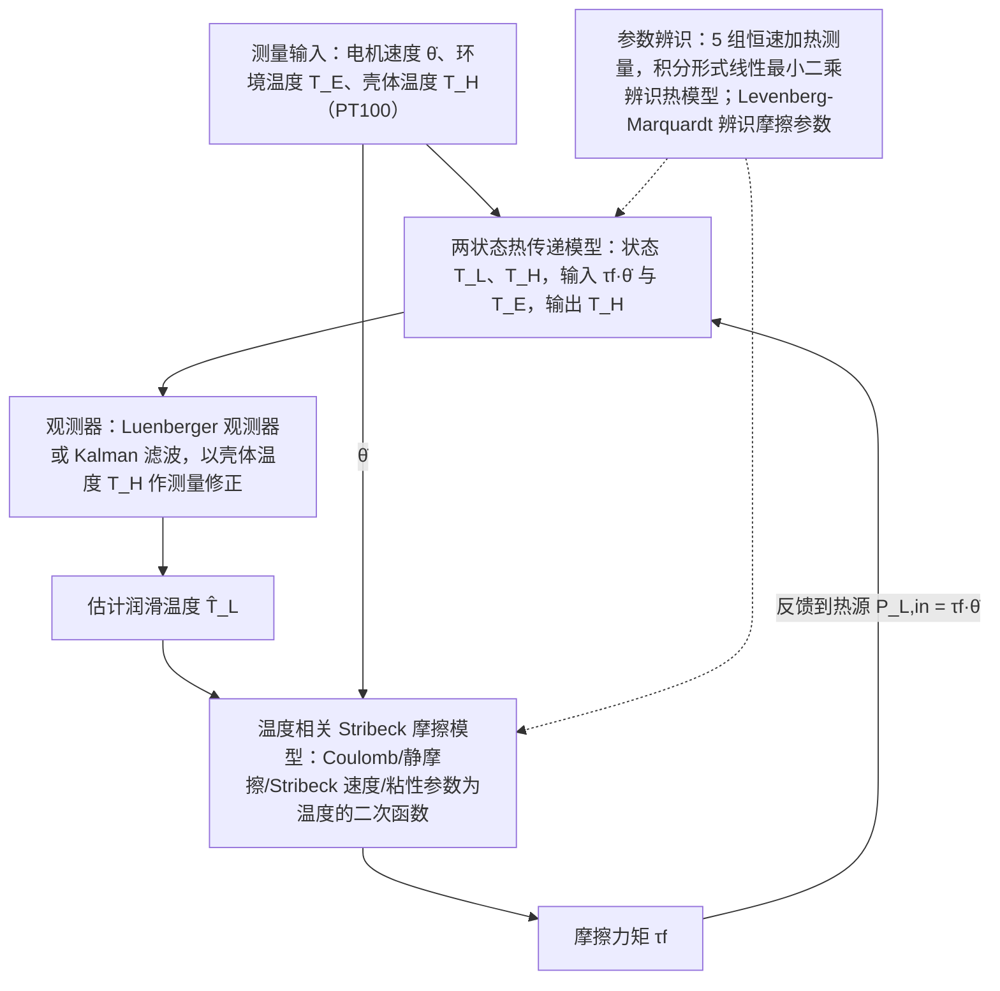

# Gearbox Lubricant Temperature Observer（arXiv:2610.23881）

**Gearbox Lubricant Temperature Observer**（*Lubricant Temperature Observer for Gearboxes in Industrial Robots*，[arXiv:2610.23881](https://arxiv.org/abs/2610.23881)，[项目页](https://doi.org/10.18419/DARUS-5015)）来自 [具身智能小站 2026-11-01 盘点](../../sources/blogs/wechat_embodied_station_56_papers_libero_dynamic_latency_eval_2026-11-01.md)，属「感知、规划与系统」组。

## 一句话定义

**用两状态热模型结合壳体温度观测器，估计工业机器人齿轮箱润滑温度；台架测量验证方法，为热误差补偿提供输入，静置时的润滑脂行为仍难建模。**

## 英文缩写速查

| 缩写 | 英文全称 | 简要说明 |
|------|----------|----------|
| Gearbox Lubricant Temperature Observer | Lubricant Temperature Observer for Gearboxes in Industrial Robots | 本文方法 / 基准的简称 |

## 为什么重要

- 不测齿轮箱内部，也能估计润滑温度。
- 开源结论：**项目页未列 GitHub**（步骤 2.5，2026-11-01）。公众号项目页入口为数据集 DOI（HTTP 200），未见代码仓库。
- 同期同组工作见 [动态评测、技能编译与环境潜变量适配：具身智能小站 11-01 期 56 篇阅读坐标](../overview/embodied-station-2026-11-01-56-papers-technology-map.md)。

## 流程总览

图依据：论文 §II-A 至 §II-C / Fig.2。

## 核心机制

| 项 | 内容 |
|----|------|
| **arXiv** | [2610.23881](https://arxiv.org/abs/2610.23881) |
| **开源** | **项目页未列 GitHub** |
| **要点** | 用两状态热模型结合壳体温度观测器，估计工业机器人齿轮箱润滑温度；台架测量验证方法，为热误差补偿提供输入，静置时的润滑脂行为仍难建模。 |
| **文内指标** | 公众号未给具体数字，本页不引用。 |

## 源码运行时序图

**不适用（项目页未列 GitHub）** — 公众号项目页入口为数据集 DOI（HTTP 200），未见代码仓库。 不编造运行脚本；代码公开后再补。

## 实验与评测

- 公众号未给具体数字，本页不引用。
- **读法：** 本页为索引级摘要，依据公众号转述的官方摘要与仓库信息整理；逐项数字与 baseline 以原文 PDF 为准。

## 与其他工作对比

- 横向索引见 [动态评测、技能编译与环境潜变量适配：具身智能小站 11-01 期 56 篇阅读坐标](../overview/embodied-station-2026-11-01-56-papers-technology-map.md)；同 arXiv 不重复造页。

## 结论

**不测齿轮箱内部，也能估计润滑温度：用两状态热模型结合壳体温度观测器，估计工业机器人齿轮箱润滑温度；台架测量验证方法，为热误差补偿提供输入，静置时的润滑脂行为仍难建模。**

1. 开源边界：**项目页未列 GitHub** — 公众号项目页入口为数据集 DOI（HTTP 200），未见代码仓库。
2. 核心机制：用两状态热模型结合壳体温度观测器，估计工业机器人齿轮箱润滑温度；台架测量验证方法，为热误差补偿提供输入，静置时的润滑脂行为仍难建模。
3. 复现与选型前核对任务协议、硬件与基准口径，勿直接横比公众号摘录数字。

## 关联页面

- [manipulation](../tasks/manipulation.md)
- [locomotion](../tasks/locomotion.md)
- [sim2real](../concepts/sim2real.md)
- [embodied-station-2026-11-01-56-papers-technology-map](../overview/embodied-station-2026-11-01-56-papers-technology-map.md)

## 参考来源

- [gearbox_lubricant_temperature_observer_arxiv_2610_23881.md](../../sources/papers/gearbox_lubricant_temperature_observer_arxiv_2610_23881.md)
- [wechat_embodied_station_56_papers_libero_dynamic_latency_eval_2026-11-01.md](../../sources/blogs/wechat_embodied_station_56_papers_libero_dynamic_latency_eval_2026-11-01.md)
- [arXiv:2610.23881](https://arxiv.org/abs/2610.23881)
- [arXiv PDF](https://arxiv.org/pdf/2610.23881)：已通读方法部分（实验与附录以略读为准）：实验台架、两状态热模型与观测器、Stribeck 摩擦模型、辨识与验证（§II、§III）

## 推荐继续阅读

- [arXiv PDF](https://arxiv.org/pdf/2610.23881)
- [项目页](https://doi.org/10.18419/DARUS-5015)
