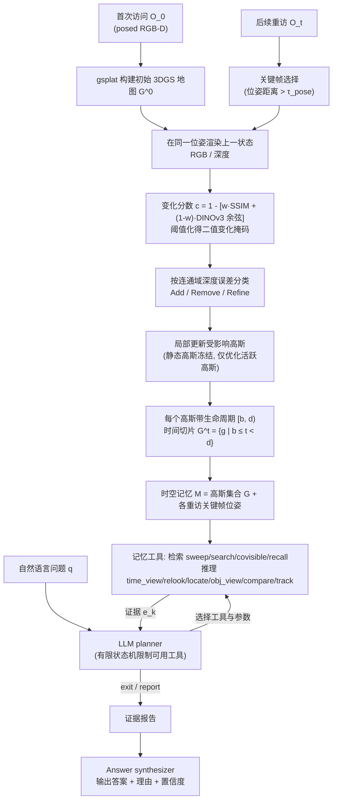

# GEMS（arXiv:2610.33158）

**GEMS**（*Gaussian Episodic Memory for Long-Term Spatiotemporal Reasoning*，[arXiv:2610.33158](https://arxiv.org/abs/2610.33158)，[项目页](https://abwerby.github.io/GEMS/)）来自 [具身智能小站 2026-10-28 盘点](../../sources/blogs/wechat_embodied_station_59_papers_human_video_to_robot_experience_2026-10-28.md)，属「潜在动作与世界模型」组。

## 一句话定义

**以持续更新的高斯地图只记录变化区域，再按需渲染视角，支持跨时间问答与物体定位。**

## 英文缩写速查

| 缩写 | 英文全称 | 简要说明 |
|------|----------|----------|
| GEMS | Gaussian Episodic Memory for Long-Term Spatiotemporal Reasoning | 本文方法 / 基准的简称 |

## 为什么重要

- 把环境变化保存进三维情景记忆。基准聚焦半静态环境，适合长期运行的场景记忆研究，不等同连续动态世界建模。
- 开源结论：**已开源**（步骤 2.5，2026-10-28）。公众号未给代码链接；项目页链接的 abwerby/GEMS 经 git ls-remote 可达（页面另含 soon 字样，可能指部分资源）。
- 同期同组工作见 [潜在动作、免渲染事件仿真与机器人评测：具身智能小站 10-28 期 59 篇阅读坐标](../overview/embodied-station-2026-10-28-59-papers-technology-map.md)。

## 流程总览

图依据：论文 §III-A / §III-B / Fig.2 / Fig.3

## 核心机制

| 项 | 内容 |
|----|------|
| **arXiv** | [2610.33158](https://arxiv.org/abs/2610.33158) |
| **开源** | **已开源** |
| **要点** | 以持续更新的高斯地图只记录变化区域，再按需渲染视角，支持跨时间问答与物体定位。 |
| **文内指标** | 公众号转述：基准聚焦半静态环境，适合长期运行的场景记忆研究，不等同连续动态世界建模。 |

## 源码运行时序图

**不适用（已开源）** — 公众号未给代码链接；项目页链接的 abwerby/GEMS 经 git ls-remote 可达（页面另含 soon 字样，可能指部分资源）。 不编造运行脚本；代码公开后再补。

## 实验与评测

- 公众号转述：基准聚焦半静态环境，适合长期运行的场景记忆研究，不等同连续动态世界建模。
- **读法：** 本页为索引级摘要，依据公众号转述的官方摘要与仓库信息整理；逐项数字与 baseline 以原文 PDF 为准。

## 与其他工作对比

- 横向索引见 [潜在动作、免渲染事件仿真与机器人评测：具身智能小站 10-28 期 59 篇阅读坐标](../overview/embodied-station-2026-10-28-59-papers-technology-map.md)；同 arXiv 不重复造页。

## 结论

**把环境变化保存进三维情景记忆：基准聚焦半静态环境，适合长期运行的场景记忆研究，不等同连续动态世界建模。**

1. 开源边界：**已开源** — 公众号未给代码链接；项目页链接的 abwerby/GEMS 经 git ls-remote 可达（页面另含 soon 字样，可能指部分资源）。
2. 核心机制：以持续更新的高斯地图只记录变化区域，再按需渲染视角，支持跨时间问答与物体定位。
3. 复现与选型前核对任务协议、硬件与基准口径，勿直接横比公众号摘录数字。

## 关联页面

- [world-action-models](../concepts/world-action-models.md)
- [generative-world-models](../methods/generative-world-models.md)
- [vla](../methods/vla.md)
- [embodied-station-2026-10-28-59-papers-technology-map](../overview/embodied-station-2026-10-28-59-papers-technology-map.md)

## 参考来源

- [gems_arxiv_2610_33158.md](../../sources/papers/gems_arxiv_2610_33158.md)
- [wechat_embodied_station_59_papers_human_video_to_robot_experience_2026-10-28.md](../../sources/blogs/wechat_embodied_station_59_papers_human_video_to_robot_experience_2026-10-28.md)
- [arXiv:2610.33158](https://arxiv.org/abs/2610.33158)
- [arXiv PDF](https://arxiv.org/pdf/2610.33158)：已通读方法部分（实验与附录以略读为准）：摘要、§I、§III（时空高斯地图、变化检测、局部更新、智能体问答）；§IV-V 略读

## 推荐继续阅读

- [arXiv PDF](https://arxiv.org/pdf/2610.33158)
- [项目页](https://abwerby.github.io/GEMS/)
