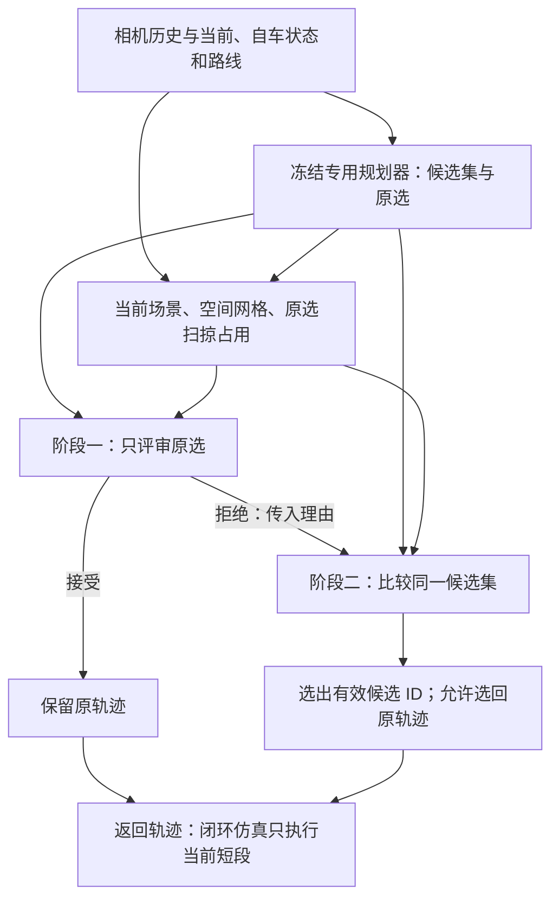

# GAC：用前沿模型评审自动驾驶轨迹 | Generalist Action Critic: Harnessing Frontier Models in Autonomous Driving

## 一句话定义

**Generalist Action Critic（GAC）** 让冻结视觉推理模型先检查专业规划器的原始轨迹，只有拒绝时才在现有候选集中重选；它决定选哪条，不生成新轨迹，也不直接输出执行器命令。

## 英文缩写速查

| 缩写 | 英文全称 | 简要说明 |
|---|---|---|
| GAC | Generalist Action Critic | 通用动作评审器 |
| VLM | Vision-Language Model | 视觉与语言联合推理模型 |
| PDMS | PDM Score | 规划评估合成分，开/闭环组成并不完全相同 |
| NC | No Collision | 碰撞相关评分指标 |
| DAC | Drivable Area Compliance | 可行驶区域遵循 |
| TTC | Time to Collision | 碰撞时间相关指标 |
| RC | Route Completion | 路线完成度 |

## 为什么重要

多候选规划未必缺好的轨迹，也可能是原有评分选错了。固定候选再比较重选，能将生成质量与选择误差分开，也能发现评审器把原本好的动作改坏的情况。

| 字段 | 内容 |
|---|---|
| 机构 | 香港大学、清华大学、上汽智能科技（上海）有限公司 |
| 论文 | [arXiv:2611.27804v1](https://arxiv.org/abs/2611.27804v1)，2026-11-20 |
| 对照 | iDriveVLA / DrivoR / DiffusionDrive，候选数分别为 64 / 64 / 20 |
| 成果形态 | 零样本推理时选择；冻结规划器与 GPT-6 Astra（最高 reasoning effort） |

## 核心机制

1. **固定候选接口。** 每条候选是以当前自车为参考的 8 个按时间排列的位姿 `(x, y, yaw)`，间隔 0.5 s，预测窗 4 s。原选来自专业规划器；不向评审器暴露完整打分向量、oracle 标签或特权状态。
2. **把空间证据放回相机。** 五张图为过去 1.5 s 与当前的无覆盖前视，以及覆盖网格和原选车辆扫掠占用的当下三视角。网格为平地假设下的尺度参照，扫掠带是自车外形沿插值路径的并集，不是其他交通参与者未来状态；冲突仍要结合时间判断。第二阶段也不为每个备选重绘图层。
3. **信息分阶段打开。** Stage I 只见原选并返回接受/拒绝和理由；接受直接返回。拒绝后 Stage II 用新上下文收到同一组图、完整候选与前次结果，可选回原轨迹，输出合法候选 ID 和比较理由。两阶段均不是生成轨迹。

## 流程总览

## 源码运行时序图

**不适用**：官方页未列公开的 GAC 实现或启动入口。附录的 JSON 模式和数据流属于论文方法说明，不当作公开源码调用栈。

## 实验与评测

| 证据 | 作者报告 | 指标边界 |
|---|---|---|
| HUGSIM 全集（345 场景，表 1） | DrivoR HD-Score 35.7→43.2；RC 49.8→55.0 | 在比较表未用额外仿真训练数据的方法组中最高，非所有驾驶方案的泛化结论 |
| HUGSIM-160（表 2） | iDriveVLA 39.27→40.92、DrivoR 37.42→41.62、DiffusionDrive 27.58→36.43 | DiffusionDrive 的 32.1% 是 HD-Score 相对变化，不是事故发生率降幅；三组舒适度略降 |
| NAVSIM v1 开环（表 4） | 原零分且有正分备选时，恢复 42.51%–52.13%；原高质量组新增零分 6/900（0.67%） | 前者分母按规划器为 188、219、541 个合格场景；后者为三规划器各 3×100 个抽样评测实例，跨批次可能重复，且高质量组均分仍下降 1.46–2.84 |
| iDriveVLA 消融（表 5） | 原失败组直接选择 PDMS 61.15，GAC 49.26；原高质量组 NC×DAC 91.00 对 99.00 | 对照没有完全相同的视觉和阶段信息；显示恢复与保留的取舍，不证明所有条件下两阶段更优 |

## 与其他工作对比

| 参照 | 区别 |
|---|---|
| [DriveSTA](./paper-drivesta.md) | 把带仿真评分的候选引入训练，并学习生成、打分和残差精修；GAC 固定已训练规划器，从现有集合重选。 |
| [T2-z](./paper-t2-z-environment-latents.md) | 用少量交互更新环境潜变量，再预测已给定动作的未来观测；GAC 用同一现场图像和结构化约束审候选，不做环境潜变量适配。 |
| [DreamSteer](./paper-dreamsteer-vla-deployment-steering.md) | 都在执行前筛选动作，但 GAC 不靠学习的潜在动力学预测来评分，不应归为生成式世界动作模型。 |

## 结论

**候选集质量与选择质量应分别测试。**

1. 先记录候选覆盖率与 oracle 上限，再算符合条件的恢复比例；没有更好可选项时，后置评审无法创造更好的轨迹。
2. 监测双向错误：原失败恢复、原高分退化，再分别报告舒适性与进度损失。
3. 实际部署前要独立测延迟、超时和非法响应，不能从仿真评审频率推导实时安全性。

## 工程实践

- 离线评测先冻结候选、场景和标签，将候选 ID 作为观测与评分的关联键；保存首次拒绝理由、最终 ID 与评测标签，后者不送进评审上下文。
- 证据中区分图层的参考系与时间、尺度与车辆扫掠区域。NAVSIM 与 HUGSIM 的车辆参考点、相机映射不同，不能直接共享未经复核的投影。

## 局限与风险

- **没有真车安全验证。** HUGSIM 的 4 Hz 规划、默认 2 Hz 评审是仿真时间频率；仿真会等待模型，因此并非实车墙钟时延或上线保证。NAVSIM 另一组是开环轨迹评估。
- **开放状态。** [项目页核验](../../sources/sites/generalist-action-critic.md)仅确认方法与演示，未确认实现；论文还使用了一个作者标注未公开的 iDriveVLA 检查点。未运行代码或复现实验。

## 关联页面

- [DriveSTA](./paper-drivesta.md) · [自动驾驶核心算法技术地图](../overview/autonomous-driving-core-algorithms-series.md)
- [Model-Based RL](../methods/model-based-rl.md) · [VLA](../methods/vla.md) · [WAM Stage 4 筛选接口](../../roadmap/depth-wam.md)

## 参考来源

- [论文 v1 全文核对归档](../../sources/papers/gac_arxiv_2611_27804.md) · [官方项目页归档](../../sources/sites/generalist-action-critic.md)

## 推荐继续阅读

- [arXiv v1 HTML](https://arxiv.org/html/2611.27804v1) — 先读 §3 和附录 A，再核对表 2、4、5 的样本与指标差别。
