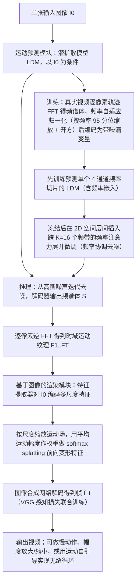

# Generative Image Dynamics（arXiv:2309.07906）

**Generative Image Dynamics**（*Generative Image Dynamics*，[arXiv:2309.07906](https://arxiv.org/abs/2309.07906)，[项目页](https://generative-dynamics.github.io/)）来自 [深蓝具身智能 2026-11-01 盘点](../../sources/blogs/wechat_shenlan_cv_best_papers_2023_2026_labs.md)，属「视觉推理与可控生成」组。

## 一句话定义

**Generative Image Dynamics 在傅里叶域学习图像空间的场景运动先验，由单张图预测频谱体并转成跨整段视频的运动纹理，让静图「动」起来。**

## 英文缩写速查

| 缩写 | 英文全称 | 简要说明 |
|------|----------|----------|
| GID | Generative Image Dynamics | 傅里叶域场景运动先验 |
| FFT | Fast Fourier Transform | 频域表示的基础工具 |

## 为什么重要

- 用真实视频里树、花、烛火、衣物等振荡运动训练先验，可用于静图转循环视频与交互式动态（公众号归属：Google Research）。
- 开源结论：**项目页未列 GitHub**（步骤 2.5，2026-11-01）。项目页 HTTP 200，未见 GitHub 链接或 coming soon 字样（页面仅含项目页模板链接）。
- 同期同组工作见 [从视觉编程到 4D 重建：CV 三大会 2023–2026 Best Paper 阅读坐标](../overview/cv-best-papers-2023-2026-technology-map.md)。

## 流程总览

图依据：论文 §3–§6 / Fig.3、Fig.4。

## 核心机制

| 项 | 内容 |
|----|------|
| **arXiv** | [2309.07906](https://arxiv.org/abs/2309.07906) |
| **开源** | **项目页未列 GitHub** |
| **要点** | 频率协调的扩散采样预测频谱体（spectral volume），转换为运动纹理，配合基于图像的渲染模块生成视频（arXiv 摘要）。 |
| **文内指标** | arXiv 摘要未给单一数字指标；本页不引用。 |

## 源码运行时序图

**不适用（项目页未列 GitHub）** — 项目页 HTTP 200，未见 GitHub 链接或 coming soon 字样（页面仅含项目页模板链接）。 不编造运行脚本；代码公开后再补。

## 实验与评测

- arXiv 摘要未给单一数字指标；本页不引用。
- **读法：** 本页为索引级摘要，依据公众号转述的官方摘要与仓库信息整理；逐项数字与 baseline 以原文 PDF 为准。

## 与其他工作对比

- 横向索引见 [从视觉编程到 4D 重建：CV 三大会 2023–2026 Best Paper 阅读坐标](../overview/cv-best-papers-2023-2026-technology-map.md)；同 arXiv 不重复造页。

## 结论

**Generative Image Dynamics：把运动建模成傅里叶域的图像空间先验。**

1. 开源边界：**项目页未列 GitHub** — 项目页 HTTP 200，未见 GitHub 链接或 coming soon 字样（页面仅含项目页模板链接）。
2. 核心机制：频率协调的扩散采样预测频谱体（spectral volume），转换为运动纹理，配合基于图像的渲染模块生成视频（arXiv 摘要）。
3. 复现与选型前核对任务协议、硬件与基准口径，勿直接横比公众号摘录数字。

## 关联页面

- [generative-world-models](../methods/generative-world-models.md)
- [cv-best-papers-2023-2026-technology-map](../overview/cv-best-papers-2023-2026-technology-map.md)

## 参考来源

- [generative_image_dynamics_arxiv_2309_07906.md](../../sources/papers/generative_image_dynamics_arxiv_2309_07906.md)
- [wechat_shenlan_cv_best_papers_2023_2026_labs.md](../../sources/blogs/wechat_shenlan_cv_best_papers_2023_2026_labs.md)
- [arXiv:2309.07906](https://arxiv.org/abs/2309.07906)
- [arXiv PDF](https://arxiv.org/pdf/2309.07906)：已通读全文：运动表示、频率协调扩散、图像渲染与应用（§3–§6）

## 推荐继续阅读

- [arXiv PDF](https://arxiv.org/pdf/2309.07906)
- [项目页](https://generative-dynamics.github.io/)
